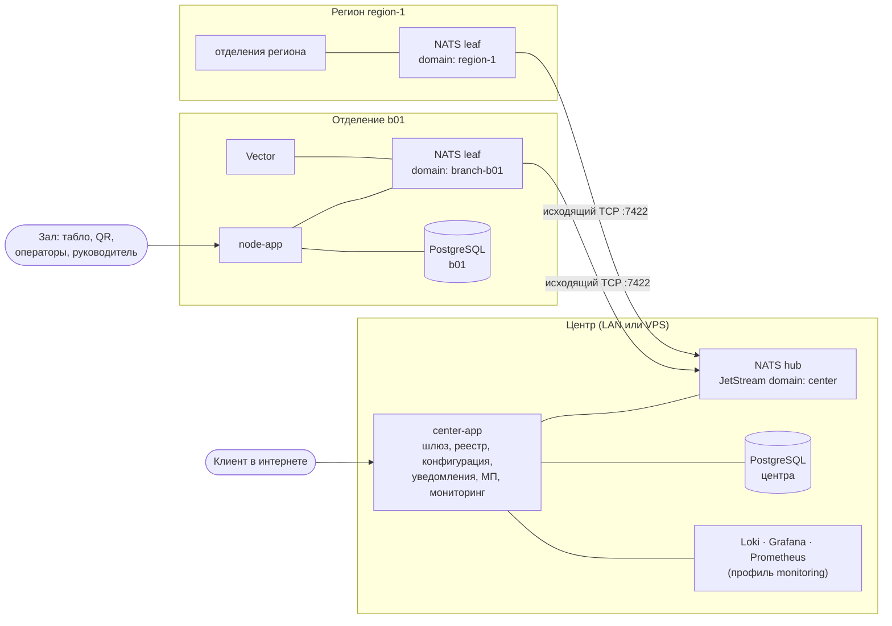
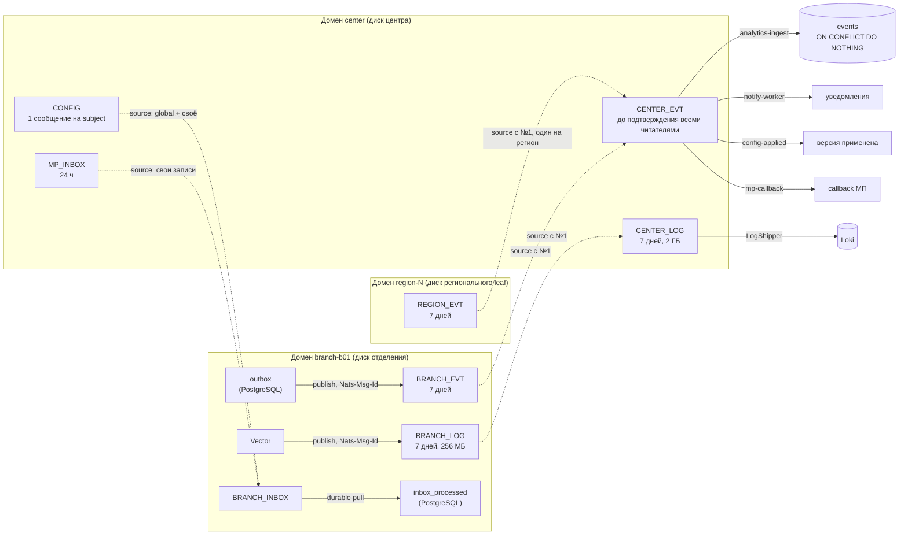

# ЕСУО: технический дизайн-документ

Электронная система управления очередью для сети почтовых отделений.

| | |
|---|---|
| Для кого | инженеры команды и технические члены жюри: как система устроена и почему именно так |
| Состояние | ветка `wip/scale-monitoring`, 2026-10-04 |
| Стек | Java 25, Spring Boot 4.1, PostgreSQL 16, NATS 2.15 (JetStream, leaf nodes), React 18 + Vite, Python 3.11 (офлайн-обучение); мониторинг — Vector, Loki, Grafana, Prometheus |
| Связанные документы | [отчёт о проделанной работе](ESUO-report.md), [`openapi/`](openapi), [`demo/results.md`](demo/results.md), [`demo/ml-report.md`](demo/ml-report.md), [`demo/run-guide.md`](demo/run-guide.md) |

Статусы в тексте: **[Реализовано]** — есть в коде и покрыто тестом или демо-сценарием; **[Компромисс]** — сознательное
упрощение, путь развития описан в разделе 18; **[Проверено на стенде]** — цифра из прогона на стенде «всё в одном»
(MacBook, Docker Desktop, 7,7 ГБ памяти на все контейнеры, рой отделений на том же ноутбуке); **[Расчёт]** — оценка,
на стенде не проверялась.

## Содержание

1. [Задача и принципы](#1-задача-и-принципы)
2. [Топология сети](#2-топология-сети)
3. [Транспорт: NATS](#3-транспорт-nats)
4. [Узел отделения](#4-узел-отделения)
5. [Доменная модель](#5-доменная-модель)
6. [Алгоритм очереди](#6-алгоритм-очереди)
7. [Ожидаемое время и его честность](#7-ожидаемое-время-и-его-честность)
8. [Прогноз длительности обслуживания](#8-прогноз-длительности-обслуживания)
9. [Планирование нагрузки и квота записи](#9-планирование-нагрузки-и-квота-записи)
10. [Центр](#10-центр)
11. [Мониторинг и диагностика](#11-мониторинг-и-диагностика)
12. [Сеть из 250 000 отделений](#12-сеть-из-250-000-отделений)
13. [Устойчивость: матрица отказов](#13-устойчивость-матрица-отказов)
14. [Безопасность](#14-безопасность)
15. [Интерфейсы](#15-интерфейсы)
16. [Развёртывание](#16-развёртывание)
17. [Воспроизводимость и проверка](#17-воспроизводимость-и-проверка)
18. [Компромиссы и развитие](#18-компромиссы-и-развитие)
19. [Стек и российский технологический контур](#19-стек-и-российский-технологический-контур)

---

## 1. Задача и принципы

Сеть отделений принимает клиентов из трёх источников: предварительная запись (сайт центра или мобильное
приложение), талон по QR-коду в зале, живая очередь, которую регистрирует оператор. Все три источника сходятся в одну
очередь отделения. Окна вызывают клиентов, руководитель видит аналитику и нагрузку, центр видит сеть целиком — и
очереди, и здоровье ПК отделений.

Пять решений определяют всю архитектуру:

| # | Принцип | Следствие |
|---|---|---|
| P1 | **Отделение автономно.** Зал обслуживается без центра полностью, а не в урезанном режиме | вся доменная логика и её данные живут на узле; центр в обслуживании клиента в зале не участвует |
| P2 | **Связь инициирует отделение.** Только исходящий TCP до центра | узел за NAT, за мобильным модемом, без белого IP и без VPN подключается одинаково |
| P3 | **Состояние только в PostgreSQL.** В памяти процесса нет ничего, что нельзя потерять | рестарт узла невидим клиенту; таймеры считаются от меток времени в базе |
| P4 | **Доставка через журнал, а не через вызовы.** Всё, что уходит с узла, сначала пишется в журнал на диске отделения | ни одно событие и ни одна важная строка лога не теряются при обрыве, падении или рестарте; синхронизация — это догонка журнала |
| P5 | **Каждое решение объяснимо и воспроизводимо.** Выбор клиента, смена уровня нагрузки, прогноз пишутся в журнал с причинами | спор «почему вызвали не меня» разбирается по журналу; демо-прогоны дают одинаковую подпись хода событий |

---

## 2. Топология сети



**Отделение — три контейнера:** `postgres`, `nats-leaf`, `node-app`, и сборщик логов `vector` с профилем
`monitoring`. Фронтенд (клиентский веб, табло, АРМ оператора, кабинет руководителя, демо-пульт) собран в тот же JAR и
раздаётся самим узлом — отдельного веб-сервера нет.

**Центр — три контейнера:** `nats-hub`, `center-app`, `postgres`. Плюс два демо-адаптера внешних систем
(`notify-mock` — провайдер уведомлений, `mp-simulator` — мобильное приложение), которые в продуктиве заменяются
настоящими интеграциями. С профилем `monitoring` — Loki, Grafana, Prometheus, экспортёры NATS и PostgreSQL и сборщик
логов самого центра (раздел 11).

**Региональный leaf** — один NATS-сервер на регион со своим доменом JetStream. Отделения региона пишут события в общий
региональный стрим, и центр подключает его одним источником на регион, а не по источнику на отделение (раздел 3.8).
Узел отделения (`node-app`) работает со своим leaf; за региональными leaf на стенде работают виртуальные отделения
роя (раздел 12).

**Что отделению нужно знать о мире — три параметра:** `BRANCH_ID`, `CENTER_HOST`, пароль leaf-соединения
(`deploy/branch/.env.example`). Узел знает только адрес своего leaf; адрес центра знает только leaf.

**Что центру нужно знать об отделении заранее — ничего.** Первый heartbeat нового отделения регистрирует его в реестре,
подключает его поток событий к центральному стриму и отправляет ему конфигурацию (раздел 3.5).

Одна и та же топология запускается без изменения кода и на одной машине, и на нескольких (раздел 16):

| Режим | Команда | Сетевая изоляция |
|---|---|---|
| Всё на одной машине (проверка жюри) | `docker compose up -d --build` | каждое отделение в своей docker-сети; с центром связано только через сеть `wan` и TCP-прокси `link-bXX` — «кабель», который можно выдернуть |
| Несколько машин | `deploy/center` на машине центра, `deploy/branch` на каждом ПК отделения, `deploy/swarm` на машине роя | реальная LAN или интернет; центру нужны открытые порты 7422 (leaf) и 8081 (API) |

---

## 3. Транспорт: NATS

### 3.1. Почему NATS

Требования к транспорту следуют из принципов P1–P4: отделение работает без связи сколько угодно, связь инициирует
отделение, события не теряются и не дублируются, центр умеет синхронно спросить отделение (например, свободные слоты
для клиента из интернета) и мгновенно понять, что оно недоступно.

| Вариант | Почему не подошёл |
|---|---|
| Прямые HTTP-вызовы центр ↔ отделение | центру нужен входящий доступ к каждому отделению (NAT, белые IP, VPN); ретраи, буферизацию и дедупликацию пришлось бы писать самим |
| Репликация БД (логическая/потоковая) | ломает автономию: общие таблицы, конфликты записи при разрыве; одна база на сеть — единая точка отказа |
| Kafka | тяжёлый брокер на каждом ПК отделения; нет встроенной модели «локальный брокер в отделении + мост к центру» |
| RabbitMQ + federation/shovel | мост настраивается на каждую пару узлов; request-reply и стримы с догонкой — разные механизмы |

NATS даёт всё нужное **одним бинарником** на отделение и одним в центре:

- **Leaf node** — локальный NATS-сервер отделения, который сам подключается к hub центра исходящим соединением и
  бесконечно переподключается (раз в секунду). Для приложения отделения leaf — это «свой» брокер: он доступен всегда,
  даже когда центра нет.
- **JetStream domains** — у каждого отделения собственный домен (`branch-b01`) с собственным файловым хранилищем.
  События и важные логи отделения лежат на его диске, а не в центре.
- **Stream sources** — центральный стрим объявляет стрим отделения своим источником, и NATS сам докачивает всё
  накопленное после восстановления связи. Синхронизационного кода в приложении нет.
- **Request-reply** — синхронные вызовы центр → отделение без открытых портов на отделении; при отсутствии
  подписчика (отделение офлайн) брокер отвечает «no responders» мгновенно, без ожидания таймаута.
- **Дедупликация по `Nats-Msg-Id`** — повторная публикация одного сообщения в окне дедупликации отбрасывается сервером.

Конфигурация — три файла на всю сеть: `infrastructure/nats/hub.conf`, `leaf.conf`, `region.conf`. Leaf-конфиг один
для всех отделений, региональный — один для всех регионов; различаются только переменные окружения
(`LEAF_SERVER_NAME`, `JS_DOMAIN`, `LEAF_REMOTE_URL`).

### 3.2. Пространство имён

Все subjects строятся в одном месте — `shared-contracts/.../event/Subjects.java`.

| Направление | Subject | Механизм | Назначение |
|---|---|---|---|
| отделение → центр | `branch.{b}.evt.{event_type}` | JetStream, стрим `BRANCH_EVT` в домене отделения (`REGION_EVT` в домене региона) | доменные события (21 тип: жизненный цикл талона, окна, инциденты, уведомления, записи МП, применение конфигурации, модель, уровень нагрузки) |
| отделение → центр | `branch.{b}.hb` | core NATS, раз в 10 с | heartbeat: очередь, окна, лаг outbox, версии конфигурации, уровень нагрузки, каталог услуг, метрики ПК и приложения (раздел 3.7) |
| отделение → центр | `branch.{b}.log.{level}` | JetStream, стрим `BRANCH_LOG` в домене отделения | важные строки лога: WARN, ERROR, жизненный цикл (раздел 11.2) |
| центр → отделение | `branch.{b}.rpc.{op}` | request-reply, таймаут 3 с | синхронные операции: 10 операций публичного API (информация, слоты, квота, запись, QR, статус, поиск по записи МП, отмена, перенос, check-in) и 2 диагностические (`diag.logs`, `diag.snapshot`) |
| центр → отделение | `center.config.branch.{b}` | JetStream, стрим `CONFIG` (последнее сообщение на subject) | полная конфигурация отделения |
| центр → отделение | `center.mp.inbox.branch.{b}` | JetStream, стрим `MP_INBOX` | записи из мобильного приложения |
| центр | `center.log.pull.{b}` | JetStream, стрим `CENTER_LOG` | полные логи, выгруженные из отделения по запросу |

### 3.3. Стримы и домены



- **`BRANCH_EVT`** (домен отделения) — буфер исходящих событий. Хранение 7 дней: отделение может быть отрезано от
  центра неделю, и ни одно событие не потеряется.
- **`BRANCH_LOG`** (домен отделения) — буфер важных строк лога, 7 дней и не больше 256 МБ (раздел 11.2).
- **`BRANCH_INBOX`** (домен отделения) — входящие: собственные субъекты в нём не публикуются, он собирается через
  sources из `CONFIG` и `MP_INBOX` центра. Конфигурация и записи, отправленные, пока отделение было офлайн, ждут в
  центре и приходят сами после восстановления связи.
- **`REGION_EVT`** (домен региона) — общий буфер событий отделений региона (`branch.*.evt.>`), 7 дней (раздел 3.8).
- **`CENTER_EVT`** (домен центра) — все события сети. Своих субъектов из `branch.>` у него намеренно нет: события
  приходят только через sources, иначе при живой связи каждое событие попадало бы в стрим дважды. Это буфер доставки,
  а не архив: событие лежит, пока его не подтвердят все четыре читателя центра (`analytics-ingest`, `notify-worker`,
  `config-applied`, `mp-callback`), и уходит; хранилище событий сети — таблица `events`. Пока центр недоступен, стрим
  копит всё непрочитанное; 30 дней — предел только для того, что больше никто не читает. Окно дедупликации —
  2 минуты: дубли отсекает база по `event_id`. Потребитель `analytics-ingest` создаётся вместе со стримом, до
  подключения sources: событие, пришедшее раньше первого читателя, NATS при таком хранении выбросил бы.
- **`CENTER_LOG`** (домен центра) — важные логи отделений (sources из `BRANCH_LOG`) и выгрузки по запросу; 7 дней,
  не больше 2 ГБ. Из него `LogShipper` пишет в Loki.
- **Каждый source читает свой стрим с №1** (`opt_start_seq = 1`). Без явного начала NATS начинает новый source со
  времени последнего сообщения принимающего стрима, если тот уже что-то удалил, — а `CENTER_EVT` удаляет всё
  выданное. Регион или отделение, подключённые позже других, потеряли бы то, что накопили до подключения. Повторно
  прочитанное отсекает база по `event_id`; у уже подключённого source позиция сохраняется, повторного чтения нет.
- **Стрим-источник, созданный заново** (переустановлен ПК отделения, потеряно хранилище регионального leaf), центр
  читает с начала: NATS замечает пересоздание примерно за 20 с, события это время ждут в источнике
  (`RegionStreamRecreatedIT`).
- **`CENTER_EVT`, созданный заново** (потерян том хаба), получает источники снова: центр помнит это, сверка отключает
  отметки «подключено» у всех отделений и подключает их заново.
- Стримы создаются и приводятся к нужной конфигурации идемпотентно при каждом подключении (`BranchStreams`,
  `CenterStreams`) — ручной подготовки брокера нет.

### 3.4. Гарантии доставки: цепочка из четырёх звеньев

Каждое событие проходит путь от транзакции отделения до таблицы центра ровно один раз по смыслу при доставке
«как минимум один раз» на каждом шаге:

| Звено | Где | Что гарантирует |
|---|---|---|
| 1. Transactional outbox | `ticket_events` и `outbox` пишутся в той же транзакции, что и изменение талона | событие существует тогда и только тогда, когда изменение зафиксировано |
| 2. Публикация с `Nats-Msg-Id = event_id` | `OutboxWorker`: один поток (порядок), синхронный PubAck, окно дедупликации стрима 1 ч | падение между PubAck и отметкой «отправлено» не даёт дубля; без NATS outbox просто растёт |
| 3. Догонка через source | `BRANCH_EVT` / `REGION_EVT` → `CENTER_EVT`, с №1 | после обрыва NATS сам докачивает накопленное; порядок внутри отделения сохраняется |
| 4. Идемпотентные потребители | центр: `ON CONFLICT (event_id) DO NOTHING`; отделение: `inbox_processed` по `Nats-Msg-Id` | повторная доставка ничего не меняет |

Бэкофф публикации — экспоненциальный от 500 мс до 30 с; при догонке после обрыва worker публикует пачками по 100 без
пауз, пока очередь не опустеет.

Важные логи идут той же цепочкой: файл на диске → Vector (позиция в файле сдвигается только после PubAck, повтор
отсекается по хешу строки в `Nats-Msg-Id`) → `BRANCH_LOG` → source → `CENTER_LOG` → Loki (подтверждение после ответа
Loki).

### 3.5. Подключение нового отделения без настройки центра

1. На ПК отделения: `cp deploy/branch/.env.example deploy/branch/.env`, задать `BRANCH_ID`, `CENTER_HOST`, пароль;
   `docker compose -f deploy/branch/docker-compose.yml --env-file deploy/branch/.env up -d --build`.
2. Leaf подключается к hub. Узел создаёт свои стримы в своём домене.
3. Первый heartbeat `branch.{b}.hb` приходит в центр. `HeartbeatListener` ставит неизвестное отделение в очередь
   регистрации; `BranchOnboarding` разбирает её отдельным потоком пачками до 1000 отделений: одна вставка в реестр,
   `BRANCH_EVT` и `BRANCH_LOG` отделения подключаются источниками к `CENTER_EVT` и `CENTER_LOG` (у отделения за
   региональным leaf — `REGION_EVT` его региона, один раз на регион), `ConfigPublisher` публикует полную
   конфигурацию (правила очереди, сотрудники, пользователи, планирование, модель).
4. Отделение применяет конфигурацию и публикует `config.applied`. Центр отмечает версию применённой.

Если какой-то шаг не удался (центр перезапускался, NATS был недоступен), фоновая сверка каждые 15 с
(`HeartbeatListener.reconcile`, `ConfigReconciler`) доводит дело до конца; отделения, ещё стоящие в очереди
регистрации, сверка не трогает — каждое получает ровно одну первую конфигурацию. Руками в центре не настраивается
ничего: ни стримы, ни маршруты, ни список отделений. 40 000 отделений, появившихся разом, регистрируются, подключаются
и получают конфигурацию за 60 с **[Проверено на стенде]**.

### 3.6. Масштабируемость, переносимость, лёгкость

- **Масштабирование сети = запуск ещё одной копии отделения.** Добавление отделения не меняет ни код, ни конфигурацию
  центра, ни конфигурацию других отделений. Нагрузка отделения на центр — heartbeat раз в 10 с и поток его событий.
- **Центр не на пути обслуживания.** Выдача талона, вызов, завершение, аналитика отделения выполняются локально;
  производительность отделения не зависит от числа отделений в сети.
- **Центр выдерживает 250 000 отделений** на одном ноутбуке: региональный уровень NATS, приём heartbeat пачками,
  правила мониторинга в PostgreSQL, обзор сети без списков во всю сеть (разделы 3.8, 10, 12) **[Проверено на стенде]**.
- **Переносимость.** Все образы — alpine (`nats:2.15.0-alpine`, `postgres:16-alpine`, `eclipse-temurin:25-jre-alpine`).
  Одна и та же топология работает на ноутбуке (all-in-one), в LAN и с центром на VPS: отделению всё равно, где центр,
  потому что соединение исходящее.
- **Лёгкость.** На отделении нет ничего, кроме базы, брокера-бинарника, одного JAR-приложения со встроенным
  фронтендом и сборщика логов. Нет отдельного веб-сервера, service discovery, VPN, реплики БД, распределённого кэша.

### 3.7. Heartbeat — не только «я жив»

Heartbeat (`HeartbeatPublisher.snapshot`) несёт срез, по которому центр строит обзор сети без запросов к отделению:
открытые окна, длина очереди, просроченные талоны, самое долгое ожидание, размер и возраст outbox, центральная и
эффективная версия конфигурации, уровень нагрузки и момент входа в него, профиль дня, каталог активных услуг (для
выбора отделения клиентом на сайте центра) и блок `sys` с метриками ПК и приложения (раздел 11.3). Отделение за
региональным leaf добавляет `events_via` — домен региона, где лежат его события.

Heartbeat уходит со своего потока. Его часть из базы (очередь, окна, версии) ждёт не больше 3 с; не успела — heartbeat
всё равно уходит с последними известными цифрами очереди, свежим блоком `sys` и `db_ok=false`. Поэтому зависшая база
отделения не выглядит в центре как обрыв связи (раздел 11.6). Отделение считается офлайн через 30 с без heartbeat.

Аномалии обзора сети (`NetworkAnomalies`): `offline`, `overdue_tickets` (больше 5 просроченных), `no_open_windows`
(очередь есть, окон нет), `outbox_lag` (старше 60 с), `wait_grows_without_tickets`, `config_pending` (опубликованная
версия не применена), `overload` (отделение в перегрузке дольше 15 минут; момент входа берётся от самого отделения,
поэтому обрыв связи не сбрасывает счёт), `db_unavailable` (данные очереди не обновляются: база отделения не отвечает
или ПК перегружен) и сработавшие правила мониторинга `sys.*` с текстом для человека (раздел 11.4).

### 3.8. Региональный уровень

Один стрим центра с источником на каждое отделение хорош для сотен отделений; для сотен тысяч узким местом становятся
число источников у `CENTER_EVT` и число leaf-соединений у hub. Поэтому между отделениями и центром есть региональный
уровень:

```
отделения региона ──▶ региональный leaf (домен region-N, стрим REGION_EVT) ──▶ hub центра (CENTER_EVT)
```

- **Один источник на регион.** Heartbeat отделения несёт `events_via: "region-N"`. По нему центр подключает
  `REGION_EVT` этого региона к `CENTER_EVT` один раз (`CenterStreams.attachRegion`), а не источник на отделение; 4
  региональных источника вместо 250 000.
- **Свой регион — только свои события.** Фильтр по части токена (`branch.s1-*.evt.>`) в NATS недопустим, поэтому
  `REGION_EVT` собирает `branch.*.evt.>`, а региональный leaf не принимает от hub чужие события
  (`deny_imports: ["branch.*.evt.>"]` в `region.conf`). Heartbeat, конфигурация и RPC проходят как обычно.
- **Связь — та же.** Региональный leaf подключается к hub исходящим TCP на 7422 с тем же логином leaf; при обрыве
  события ждут в `REGION_EVT` 7 дней.
- **Нагрузка в центре.** У отделений за региональным leaf содержимое heartbeat и строка истории метрик пишутся с шагом
  60 с, а не 10 с (`METRICS_RESOLUTION_REGIONAL`); «на связи» отмечается по каждому heartbeat (раздел 10.2).

На стенде региональный уровень — четыре leaf `nats-region-1…4` (`deploy/swarm`), за ними — виртуальные отделения
роя (раздел 12).

---

## 4. Узел отделения

### 4.1. Модули

```
java-backend/
  shared-contracts/  — конверт события, subjects, коды ошибок, RPC-ответ, DTO; общий словарь узла и центра
  node-app/
    queue/domain       — чистая логика: Ticket, QueueSelection, QueuePolicy, симулятор очереди
    queue/application  — команды (IssueTicket, CallNext, TicketCommands, WindowCommands), запросы, ETA, рекомендации
    queue/scoring      — стратегии score: uniform, heuristic
    model/             — цепочка прогноза длительности
    planning/          — прогноз нагрузки, уровни, квота записи
    persistence/       — репозитории на JdbcClient, SQL явный
    messaging/         — outbox, inbox, RPC, heartbeat, стримы, связь leaf с hub
    monitoring/        — метрики sys, файл логов и жизненный цикл, выгрузка логов, снимок диагностики
    api/               — REST, SSE, QR, обработка ошибок (RFC 7807 Problem Details)
    security/          — JWT, роли
    demo/              — демо-часы, сброс демо-дня, прокси пульта сценариев
  center-app/        — шлюз, реестр, приём heartbeat, конфигурация, ingest, уведомления, МП, мониторинг, обзор сети
  swarm-sim/         — рой виртуальных отделений для нагрузки центра (раздел 12)
```

Доменное ядро (`QueueSelection`, `LoadLevels`, `BookingQuota`, `ModelParams`, `LoadForecast`) — чистые функции без
базы, Spring и системного времени: всё, от чего зависит решение, передаётся аргументом. Поэтому решения
воспроизводимы по журналу и тестируются без контейнеров.

### 4.2. Хранение

Схема узла — Flyway-миграции `V1…V8`. Основные таблицы:

| Таблица | Назначение |
|---|---|
| `tickets` | талоны: статус, источник, услуга, окно, `due_at`, `eligible_from`, `seq`, версия для оптимистичной проверки |
| `ticket_events`, `window_events` | журнал доменных событий с данными решения (кандидаты, score, причина) |
| `outbox` | исходящие события до подтверждения брокером |
| `inbox_processed` | идентификаторы уже обработанных входящих сообщений |
| `idempotency_keys` | ответы на повторные запросы с тем же `Idempotency-Key` |
| `branch_config` | применённая конфигурация от центра + локальные переопределения руководителя |
| `handling_stats` | статистика длительностей по срезам (каскад прогноза) |
| `appointment_slots` | строка на слот услуги — сериализует конкурентные бронирования |
| `load_state` | уровень нагрузки и момент входа — переживает рестарт |
| `demo_clock` | якоря ускоренного времени демо-режима |

Инварианты закреплены в базе, а не только в коде:

- `ux_one_active_ticket_per_window` — у окна не больше одного талона в статусах `called`/`serving`;
- `ux_one_active_ticket_per_device` — у устройства не больше одного активного талона;
- `ux_ticket_number` — номер талона уникален в пределах услуги и дня;
- уникальный `mp_appointment_id` — запись из МП не создаёт два талона.

Логи узел пишет в файл (ECS JSON, ротация по 20 МБ, 7 дней, не больше 500 МБ): из него читают сборщик логов и
выгрузка по запросу (раздел 11.2).

### 4.3. QR в зале

**Куда ведёт QR на табло** — режим `QR_MODE`:

| Режим | Куда ведёт | Когда |
|---|---|---|
| `center` | страница входа в очередь на центре (`QR_PUBLIC_BASE_URL`) | клиент в зале с мобильным интернетом |
| `local` | та же страница на самом узле (`QR_LOCAL_BASE_URL` или адрес, с которого открыто табло) | только Wi-Fi отделения, без интернета |
| `auto` | центр, пока leaf связан с hub; иначе — узел | по умолчанию |

Связь leaf с hub узел читает из мониторинга своего leaf (`/leafz`) раз в 5 с (`LeafLinkMonitor`): в режиме `auto`
обрыв связи переключает QR на табло на локальный адрес и обратно за 2–7 с **[Проверено на стенде]**. Ссылку для QR
отдаёт API (`join_url`), табло её не собирает.

**Подписанный код.** С `QR_SECRET` код в QR подписан HMAC-SHA256, и выдать талон по сфотографированному и разосланному
коду нельзя:

- код на экране — `q1.{branch}.{slot}.{sig}`, слот меняется каждые 2 минуты, код принимается в своём слоте и в
  следующем: фото табло перестаёт работать не позже чем через две смены;
- код наклейки — `q1.{branch}.k{version}.{sig}`, долгоживущий; отзыв всех напечатанных наклеек — увеличить
  `QR_STICKER_KEY_VERSION`. Печатная страница наклейки — в кабинете руководителя;
- слоты идут по настоящему времени, а не по демо-часам; статический код `demo:{branch}` принимается только с демо-данными.

---

## 5. Доменная модель

**Талон.** Статусы: `booked` (запись, клиент ещё не пришёл) → `waiting` → `called` → `serving` → `done`; боковые выходы
`cancelled` и `no_show`. Источник: `appointment`, `qr`, `walkin`. Ключевые поля очереди:

- `due_at` — дедлайн: к этому моменту клиента обещано вызвать. Для QR и живой очереди `due_at = issued_at + target_wait`
  по категории клиента; для записи — от времени слота.
- `eligible_from` — с какого момента талон может быть вызван (запись — за 15 минут до слота, после check-in).
- `seq` — сквозной порядковый номер, разрешает равенство дедлайнов в пользу пришедшего раньше.
- `target_window_id` — адресное перенаправление в конкретное окно.

**Окно.** `open` → `closing` → `closed`. Окно обслуживает набор услуг (`window_services`), выбранный при открытии.

**Целевое ожидание по умолчанию** (`infrastructure/config/queue-defaults.yml`, меняется из центра без переразвёртывания):

| Источник | Обычный клиент | Пенсионер | Особая категория |
|---|---|---|---|
| QR | 20 мин | 15 мин | 10 мин |
| Живая очередь | 30 мин | 20 мин | 15 мин |

Приоритет категорий выражен дедлайном, а не отдельной очередью: пенсионер не «обгоняет всех навсегда», а получает
более ранний срок. Никто не может ждать бесконечно — у каждого есть дедлайн, и просроченные идут первыми.

---

## 6. Алгоритм очереди

### 6.1. Выбор клиента

Когда окно свободно (кнопка «Следующий» или авто-вызов), узел берёт по одному кандидату — «голову» — из каждой услуги
окна: самый ранний `due_at` среди ожидающих, у кого наступил `eligible_from` и кто не адресован другому окну. Затем
`QueueSelection.choose` применяет три правила по порядку:

1. **Просроченные вперёд.** Есть головы с `due_at ≤ now` → берётся самая ранняя из них. Score не учитывается:
   просрочка — это уже нарушенное обещание, его не оптимизируют, его исправляют.
2. **Окно терпимости (`slack`, 5 мин).** Если несколько голов «подходят к сроку» в пределах `now + slack` → берётся голова
   с наибольшим score, при равенстве — по `(due_at, seq)`.
3. **Иначе — EDF** (earliest deadline first) по `(due_at, seq)`.

**Score** задаётся стратегией из конфигурации (`scoring-strategy`):

- `uniform` — у всех 1, то есть чистый EDF;
- `heuristic` — `1 / прогноз_длительности_p50`: среди почти одновременно «созревших» окно берёт более короткую услугу и
  успевает обслужить больше людей, не нарушая ничьих сроков.

Для порядка кандидатов используется медиана (p50), а не среднее: здесь важен только порядок, а медиана — точечный
прогноз с минимальной абсолютной ошибкой.

**Почему score ограничен окном `slack`.** Правило «самая короткая работа вперёд» без дедлайнов снижает среднее
ожидание, но отодвигает длинные услуги в хвост. Сквозная симуляция самого нагруженного дня истории с потоком на 30 %
выше плана (`python-ai-service`, `benchmark.run_branch`, режимы `slack` и `sjf`, зерно 42):

| Правило | Ожидание ср., мин | p90, мин |
|---|---|---|
| EDF + score в slack (принято) | 128,3 | 219,3 |
| SJF без дедлайнов | 87,6 | 264,5 |

Хвост вырастает в полтора раза. Гарантия «каждого вызовут не позже дедлайна, а просроченных — первыми» для
государственного сервиса важнее среднего, поэтому выбран EDF с ограниченной оптимизацией. Это сознательный размен.

`UniformVsHeuristicTest` проверяет оба свойства: в сценарии «две головы в пределах slack: посылка 600 с и письмо 60 с»
среднее ожидание падает с 300 с до 30 с; долгая услуга среди потока быстрых вызывается ровно по дедлайну и не голодает.

### 6.2. Двойное назначение невозможно — четыре линии защиты

`CallNext` выполняется в одной транзакции:

1. **Блокировка строки окна** (`SELECT … FOR UPDATE`) — два параллельных «Следующий» из одного окна
   сериализуются; второй получает `WINDOW_BUSY`.
2. **Головы очереди — `FOR UPDATE SKIP LOCKED`.** Два окна с общей услугой не ждут друг друга и не берут одного
   клиента: заблокированную соседом голову второе окно пропускает и берёт следующую.
3. **Версионированный UPDATE** талона — изменение применяется только к той версии, которую прочитали.
4. **Уникальный индекс** `ux_one_active_ticket_per_window` — последний рубеж на уровне базы.

`ConcurrentCallNextIT`: два окна с общей услугой, 40 талонов, несколько потоков на окно стартуют одновременно в каждом
раунде. Проверяется, что ни один талон не вызван дважды (по журналу), в большинстве раундов оба окна действительно
получили клиента одновременно, у окна не больше одного активного талона.

### 6.3. Спорные ситуации

| Ситуация | Поведение |
|---|---|
| Клиент не подошёл на вызов | повторный вызов через 90 с, после 2 повторов — `no_show`; таймер считается от `called_at` в базе, поэтому переживает рестарт |
| Оператор закрывает окно с клиентом у стойки | `graceful`: окно в `closing`, клиента дообслуживают, новых не берут, затем `closed`. `force`: клиент возвращается в очередь с сохранением места |
| Перенаправление | в другое окно (адресно, `target_window_id`) или на другую услугу; перенаправленный берётся принимающим окном первым |
| Возврат в очередь | `keep_position` (по умолчанию, место сохраняется) или `to_tail` |
| Клиент просит отложить | один раз, не более чем на 30 минут |
| Опоздание на запись | до 10 минут — без потери приоритета; дальше — `convert_to_qr` (в общую очередь) или `reject`, по конфигурации |
| Оператор регистрирует клиента без талона | walk-in с опцией «вызвать сразу» — талон создаётся и назначается окну в одной транзакции |

### 6.4. Журнал решения

Событие `ticket.called` несёт: причину (`overdue_edf` / `score_in_slack` / `edf` / `call_now`), стратегию, версию модели
и **всех кандидатов** с их дедлайнами, score, прогнозом длительности, основанием прогноза и числом наблюдений. По
журналу любое решение воспроизводится той же чистой функцией. Демо-пульт показывает этот журнал человеческим языком.

### 6.5. Конфигурация без переразвёртывания

Все коэффициенты очереди (≈30 параметров, `queue-defaults.yml`) — это секция центральной конфигурации. Центр
валидирует изменение, присваивает сетевую версию и публикует. Отделение применяет её на лету; версия конфигурации
штампуется в каждый талон, поэтому видно, по каким правилам он обслуживался. Руководитель отделения может
переопределить часть параметров локально в заданных центром границах.

---

## 7. Ожидаемое время и его честность

`WaitTimeEstimator` считает позицию и ожидаемое время вызова (ETA) не делением «место × среднее», а прогоном очереди
вперёд тем же симулятором, что и выбор клиента (`QueueSimulation`): учитываются открытые окна и их наборы услуг,
остаток текущих обслуживаний, `eligible_from` записей, адресные перенаправления.

- ETA — это **сумма** длительностей всех впереди, поэтому здесь берётся среднее, а не медиана (для лог-нормального
  распределения сумма медиан систематически занижает обещание).
- Уверенность: `high` (модель знает сотрудника, категорию и час), `medium` (достаточно статистики по услуге), `low`,
  `none`.
- **Нет открытого окна для услуги → ETA не выдумывается**: ожидание `null`, уверенность `none`, клиент видит честное
  «окно для этой услуги сейчас не открыто».
- При модели клиент видит интервал: «вызов около 10:42 (10:38–10:50)» — p50–p90.

Уведомление о приближении очереди уходит, когда клиент на позиции ≤ 3 или ETA ≤ 5 минут.

---

## 8. Прогноз длительности обслуживания

### 8.1. Зачем

Прогноз длительности — вход сразу для трёх механизмов: ETA клиента (раздел 7), score стратегии `heuristic`
(раздел 6.1) и, главное, **расчёт нужного числа окон** по часам (раздел 9). Последнее даёт основной эффект.

### 8.2. Цепочка с откатом

`ChainedDurationModel` отвечает на вопрос «сколько займёт обслуживание этого клиента у этого сотрудника в этот час»:

```
коэффициенты ML-модели  →  каскад handling_stats  →  константа default-service-duration-sec (300 с)
```

- **ML-модель** — лог-линейная модель со сжатием:
  `log d = μ + a[услуга] + b[услуга, категория] + e[сотрудник] + g[сотрудник, услуга] + h[час]`;
  каждая поправка умножается на `n / (n + k)`, поэтому группа с малым числом наблюдений тянется к среднему.
  Даёт p50, среднее и p90.
- **Каскад `handling_stats`** — средние по срезам от самого узкого к широкому: сотрудник+услуга+категория →
  услуга+категория → услуга → запасное значение; уровень используется, если в нём не меньше 5 наблюдений.
- **Константа** — пока нет ни модели, ни статистики.

Каждый прогноз помечен основанием (`basis`) и числом наблюдений — это пишется в журнал вызова.

### 8.3. Обучение вне отделения

Обучение (`python-ai-service`, только стандартная библиотека Python) выполняется офлайн. Результат — секция `model`
центральной конфигурации, которая едет в отделение тем же путём, что и правила очереди: `CONFIG` → `BRANCH_INBOX` →
`branch_config`. Отделение применяет готовые коэффициенты (`ModelParams` — Java-двойник `predict.py`; тест сверяет их на
общем эталонном файле) и публикует `model.trained`.

Следствия:

- отделение **не зависит от доступности ML** вообще — коэффициенты лежат в его базе;
- выключение модели (`enabled: false`) — не откат, а штатный режим каскада; включается и выключается без рестарта,
  для сети целиком или для одного отделения;
- новая версия модели проходит приёмку (`esuo-ml fit` возвращает код 1, если версия хуже базовой линии).

### 8.4. Эффект

Замер — сквозная симуляция дня на синтетическом мире с известными истинными параметрами (зерно 42, 6 недель истории,
отложенная выборка; [`docs/demo/ml-report.md`](demo/ml-report.md), воспроизводится
`uv run esuo-ml report --end-day 2026-09-20`). Сравнивается прогноз
**ML-модель + каскад** против работы без прогноза (`uniform`, 300 с на любую услугу). По прогнозу строится план окон на
день, день проигрывается с этим планом, меряется фактическое ожидание:

| День | Ошибка плана окон: без прогноза → ML + каскад | Ожидание ср., мин | Ожидание p90, мин | Просроченных талонов |
|---|---|---|---|---|
| Обычный | −21 % → 0 % | 109,4 → **3,3** | 200,0 → **13,6** | 85 → **2** |
| Пенсионные выплаты | −38 % → +3 % | 94,4 → **3,9** | 170,0 → **11,7** | 142 → **0** |
| Пенсионные, поток +30 % к плану | −45 % → −4 % | 75,3 → **15,3** | 187,6 → **30,3** | 139 → **65** |
| Выходной | −21 % → 0 % | 2,8 → **1,9** | 7,0 → **5,9** | 0 → 0 |

Точность самого прогноза на отложенной выборке:

| Показатель | Без прогноза | ML + каскад |
|---|---|---|
| Средняя ошибка длительности (MAE): константа 300 с / среднее по услуге | 176,7 с / 140,5 с | **112,6 с** (−36 % / −20 %) |
| Ошибка обещанного клиенту времени вызова (пенсионный день) | 57,0 мин | **9,3 мин** |
| Отставание от теоретического предела (оракул, знающий истинные параметры: 112,8 с) | +57 % | **в пределах шума** |
| Доля фактов в пределах обещанного p90 | — | **0,89** (цель 0,85–0,95) |

Механизм эффекта важно называть точно: прогноз не ускоряет обслуживание, он **правильно считает, сколько окон нужно в
каждый час**. Без прогноза отделение недооценивает потребность на 21–45 % (300 с — это «выдать посылку», а в
пенсионный день половина потока — финансы и пенсионеры), недобор смены превращается в очередь. Решение открыть окно
остаётся за руководителем — система подсказывает его заранее (раздел 9.4).

Модель также восстанавливает истинные параметры мира: множители скорости сотрудников — с ошибкой не больше 0,016,
множители категорий — не больше 0,08. Эти числа руководитель видит как понятные фразы: «Козлов Д. обслуживает в 1,37
раза дольше среднего», «пенсионер на финансовых услугах — в 1,51 раза дольше».

**То же на живом стенде** (`./scripts/demo/run.sh pension-ab`, отчёт `docs/demo/jury/ab-report.md`). Два отделения
получают одну и ту же трассу пенсионного дня с потоком на 30 % выше плана; b01 работает без модели и истории
(300 с на всё), b02 — с историей и моделью. Руководитель каждого ставит смену по прогнозу своего отделения:

| 08:50–12:30, демо-часы ×60 | b01, без прогноза | b02, с прогнозом |
|---|---:|---:|
| Окно-часов в смене | 12 | 19 |
| Среднее ожидание, мин | 31,6 | **14,7** |
| Максимальное ожидание, мин | 97,6 | **42,0** |
| Очередь к 12:30 | 72 | **16** |
| Запись из мобильного приложения на 10:00 | принята в перегруженный час | **`BOOKING_LIMITED`**: запись закрыта заранее |

Перегружены обе ноды — пять окон физически не вытягивают поток +30 %; разница в том, что b02 поставило в смену всех
с утра и не приняло лишнюю запись.

---

## 9. Планирование нагрузки и квота записи

### 9.1. Профиль дня

Секция `planning` центральной конфигурации (`infrastructure/config/planning-defaults.json`) задаёт профили дня:

| Профиль | Множитель потока | Часы | Особенность |
|---|---|---|---|
| `normal` | ×1,0 | 09–18 | пики в 12–13 и 17 |
| `weekend` | ×0,85 | 10–16 | больше посылок |
| `pension` | ×1,8 | 09–18 | 45 % пенсионеров, 40 % финансовых услуг, пик с открытия |
| `closed` | — | — | отделение не работает |

Профиль на дату выбирается календарём (даты выплат публикует центр), затем картой дней недели; руководитель может
вручную выбрать профиль на сегодня.

### 9.2. Прогноз и мощность

Мощность часа считается в **минутах окна**: `работа(h) = поток(h) × E[длительность]`,
`нужно_окон(h) = ⌈работа(h) / (60 × utilization_target)⌉`, целевая загрузка 0,85. Прогноз строится на весь день по часам
с учётом уже принятых записей. Текущее состояние: фактический поток за последние 30 минут, время до опустошения очереди,
отношение работы к мощности открытых окон.

### 9.3. Уровни нагрузки с гистерезисом

| Уровень | Условие (любое) |
|---|---|
| `normal` | — |
| `high` | очередь не разберётся за 15 мин, или поток > 0,85 мощности |
| `overload` | очередь не разберётся за 30 мин, или поток > 1,1 мощности |

Подъём — после 2 минут устойчивого превышения. Спуск — только когда показатели опустились ниже 80 % порога
**текущего** уровня и держатся там 10 минут. Асимметрия нужна потому, что уровень управляет записью: уровень, который
переключается на каждом клиенте, открывал бы и закрывал запись несколько раз в минуту. Логика — чистая функция
`LoadLevels.next`; состояние хранится в `load_state` и переживает рестарт.

Каждая смена уровня — событие `load.level_changed` с числами и причинами: `flow_above_forecast`, `slow_service`,
`few_windows`, `booking_peak`, `overdue_backlog`. Через час можно разобрать, почему запись была закрыта и было ли это
правильно.

### 9.4. Рычаги

1. **Квота записи** — доля слотов часа, открытых для новой записи: `normal` 100 %, `high` 50 %, `overload` 0 %.
   `BookingQuota.allowed = ⌊60 / длина_слота × ёмкость_слота × квота⌋`. Уже принятые записи **никогда не отзываются** —
   отказ получают только новые (`BOOKING_LIMITED`). Проверка одна для сайта центра, прямой записи на узле и
   мобильного приложения. Клиент заранее видит закрытые часы (`GET /public/booking-limits`).
2. **Рекомендация открыть окно** — руководителю, с названием услуги и закрытыми окнами, которые могут её обслужить.
   Причины: прогноз требует больше окон, чем открыто (срабатывает **до** роста очереди); ETA вылезает за дедлайн
   больше чем на 10 минут; больше 5 просроченных; нет открытого окна для ожидающих. Окна система сама не открывает —
   это решение человека.
3. **Предупреждение для живой очереди** с уровня `high`.

Тесты: `LoadLevelsTest`, `LoadForecastTest`, `LoadCausesTest`, `PlanningConfigTest`, `BookingQuotaTest`,
`BookingQuotaIT`, `LoadPlanningIT`.

---

## 10. Центр

Центр **не хранит очередей** и не участвует в обслуживании клиента в зале. Его обязанности:

| Функция | Реализация |
|---|---|
| Публичный шлюз для интернета | HTTP → NATS request-reply к отделению (`BranchRpcClient`); заголовки `X-Deadline`, `Idempotency-Key`, `X-Request-Id` передаются в отделение; нет подписчика → мгновенный `503 BRANCH_UNAVAILABLE`; список отделений для клиента — страницами с поиском |
| Живой статус талона для клиента из интернета | SSE: снимок по RPC `ticket.get`, обновления — подписка на `branch.*.evt.ticket.>`, талон опознаётся по `token_hash`; при недоступности отделения — событие `branch_unavailable`, после восстановления — свежий снимок |
| Реестр сети | приём heartbeat пачками, регистрация новых отделений (разделы 3.5, 10.2) |
| Обзор сети | снимок сети, сводка, регионы, поиск и страницы отделений, карточка отделения (раздел 10.4) |
| Центральная конфигурация | глобальная + переопределения отделения, deep merge, валидация, сетевая версия на каждое изменение, журнал версий; публикация после коммита, сверка до `config.applied`; страница отделений с поиском |
| Хранилище событий сети | `analytics-ingest`: durable pull из `CENTER_EVT` в `events` пачками (раздел 10.3) |
| Уведомления | `notify-worker`: `max_deliver` 6, бэкофф 1–2–5–15–30 с, circuit breaker (Resilience4j: порог 50 % на окне 10 вызовов, 30 с в OPEN), исчерпанные попытки / 4xx / истёкший TTL → DLQ; ручной и массовый повтор из DLQ |
| Мобильное приложение | вебхук с HMAC-подписью и окном ±5 мин; идемпотентность по `mp_appointment_id` (то же тело → 202 с текущим статусом, другое → 422); запись ждёт в `MP_INBOX`, если отделение офлайн; результат — callback со ссылкой на статус, с ретраями и DLQ |
| Мониторинг отделений и самого центра | история метрик, правила, логи в Loki, выгрузка логов и снимок диагностики по запросу, метрики центра в Prometheus (раздел 11) |

### 10.1. Внешние системы и интеграционный слой

Реальные внешние системы в MVP заменены демонстрационными адаптерами. Очередь о них не знает: отделение пишет
событие в свой журнал, а доставкой во внешнюю систему занимается центр. Замена адаптера — это смена URL или реализации
порта (`NotificationGateway`) в центре, без изменения логики очереди.

| Внешняя система | Направление | Демо-адаптер | Протокол | Таймауты и отказы |
|---|---|---|---|---|
| Провайдер уведомлений (SMS, push, e-mail) | центр → провайдер | `notify-mock` (`tools/notify-mock`, режимы отказа через `/chaos`) | HTTP POST | соединение 2 с, запрос 5 с, TTL уведомления 15 мин; до 6 попыток с бэкоффом, circuit breaker, DLQ с ручным повтором |
| Мобильное приложение Почты | МП → центр (запись), центр → МП (результат) | `mp-simulator` (`tools/mp-simulator`) | HTTPS, HMAC-подпись, окно ±5 мин | идемпотентность по `mp_appointment_id`; запись ждёт в `MP_INBOX`, пока отделение офлайн; callback — таймаут 5 с, до 10 попыток с бэкоффом, DLQ |
| Клиент в интернете | браузер → центр → отделение | — | HTTP → NATS request-reply | 3 с на ответ отделения; офлайн-отделение — мгновенный `503 BRANCH_UNAVAILABLE` |

Повторная доставка безопасна на каждом шаге: события дедуплицируются по `event_id`, записи — по `mp_appointment_id`,
команды клиента — по `Idempotency-Key`.

### 10.2. Приём heartbeat и реестр сети

Heartbeat приходит core-подпиской `branch.*.hb`. Поток NATS ничего не ждёт: heartbeat известного отделения ложится в
буфер (`HeartbeatBuffer`, последний heartbeat на отделение), неизвестного — в очередь регистрации (раздел 3.5).

Раз в 5 с `HeartbeatFlush` пишет буфер в базу:

1. **«Видели» — первым проходом.** Вся пачка отмечается в узкой таблице `branch_seen` (id, время) — ~1 с на 250 000
   отделений. «На связи» не ждёт тяжёлой записи и не падает вместе с ней. «Последний раз слышали» =
   `GREATEST(branches.last_heartbeat_at, branch_seen.seen_at)` — так читают обзор, сводка, конфигурация и метрики.
2. **Содержимое и история.** JSON heartbeat в `branches` и строка истории `branch_metrics` — частями по 5 000 в
   транзакции; часть, которая не записалась, возвращается в буфер, если её не вытеснил свежий heartbeat.
3. **Шаг содержимого.** У своих отделений — 10 с, у отделений за региональным leaf — 60 с. У каждого отделения своя
   фаза внутри шага, поэтому отделения роя не пишутся все в одном сбросе.

Узкая таблица нужна потому, что JSON heartbeat меньше порога TOAST и лежит прямо в строке `branches`: обновление одного
времени копировало бы всю строку. 250 000 обновлений: 7,2–7,7 с в `branches` против 0,6–0,8 с в `branch_seen`
**[Проверено на стенде, копия таблицы]**.

`branch_metrics` — числовые колонки (≈ 250 байт на строку вместе с индексами), **часовые партиции** с партицией по
умолчанию (вставка не падает из-за отсутствующей партиции), удаление старых часов целиком (`DROP`), хранение 48 ч,
страховка диска `METRICS_MAX_SIZE` (100 ГБ): сверх неё самые старые часы удаляются раньше. 40 000 отделений с шагом
60 с — ≈ 14 ГБ за 48 ч **[Расчёт]**.

PostgreSQL центра настроен под эту запись: `shared_buffers` 1 ГБ (`CENTER_DB_SHARED_BUFFERS`), WAL до 4 ГБ,
контрольная точка раз в 15 мин, `wal_compression`, автоочистка без тормоза.

### 10.3. Запись событий сети

`analytics-ingest` забирает из `CENTER_EVT` до 500 событий и пишет их одним многострочным
`INSERT … ON CONFLICT (event_id) DO NOTHING`; подтверждение — после коммита. Ошибка базы — вся пачка приходит снова;
событие, которое не разбирается, снимается с повтора и не стопорит пачку. После рестарта центра чтение продолжается с
позиции консюмера. Хвост из 562 тыс. событий центр дописал со скоростью ~25 700 событий/с при загрузке PostgreSQL
меньше половины **[Проверено на стенде]**.

### 10.4. Обзор сети

Ни один ответ обзора и ни одна страница `/network` не растут с размером сети: главная — только агрегаты, списки —
страницами по 24.

- **Снимок сети** (`NetworkSnapshot`) — кто на связи, аномалии и их тяжесть по каждому отделению, суммы по сети и по
  регионам. Строится по запросу курсором (сеть не попадает в память одним списком), одним потоком на всех читателей,
  не чаще чем раз в `clamp(3 × время сборки, 1 с, 5 с)`; никто не смотрит — нагрузки нет. Карточки отделений — только
  для показанных и свежие из базы: обрыв связи виден без задержки снимка.
- **API** (закрытый, раздел 14): `/network/summary` — счётчики, плитки регионов (очередь отделений на связи, худшее
  отделение), аномалии по типам; `/network/regions/{r}` — сводка региона и худшие отделения; `/network/branches?q&status&region&anomaly`
  — поиск, фильтры, страницы; `/network/branches/{id}` — карточка; `/network/center` — строка «Центр» (раздел 11.7);
  `/network/overview` — все карточки сразу, только для сети до 1 000 отделений, дальше `422 NETWORK_TOO_LARGE`.
- **Публичный** `/api/v1/branches?q&offset&limit` → `{total, offset, limit, items}` — выбор отделения клиентом.
- **Конфигурация** `/api/v1/config?q&region&offset&limit` — глобальные секции и страница отделений с поиском.

---

## 11. Мониторинг и диагностика

Центр видит не только очередь отделения, но и здоровье его ПК и приложения — без SSH на отделение и без отдельного
агента мониторинга. Всё идёт по тому же NATS, что и события. Тот же мониторинг есть у самого центра.

### 11.1. Четыре канала

| Канал | Что | Как доезжает | Где и сколько хранится |
|---|---|---|---|
| Метрики | блок `sys` в heartbeat | heartbeat раз в 10 с (core NATS); центр пишет пачкой раз в 5 с | `branch_metrics` в БД центра, 48 ч |
| Важные логи | WARN, ERROR, жизненный цикл | файл → Vector → `BRANCH_LOG` (отделение) ⇒ `CENTER_LOG` (центр) → Loki | Loki, 7 дней |
| Полные логи | все уровни за интервал | по запросу: RPC `diag.logs` → `CENTER_LOG` → Loki | Loki с меткой выгрузки, 7 дней |
| Снимок | потоки JVM, БД, пул, outbox, NATS, конфигурация, диск, жизненный цикл | по запросу: RPC `diag.snapshot` | `branch_diagnostics`, 30 дней |

Метрики во время обрыва связи не копятся (на графике пробел, в обзоре «нет связи»). Логи за время обрыва не теряются:
доезжают после восстановления со своим временем записи.

### 11.2. Логи

- **Файл на отделении** — ECS JSON, строка на событие; ротация по 20 МБ, 7 дней, не больше 500 МБ, без сжатия:
  сборщик и выгрузка читают старые файлы как есть.
- **События жизненного цикла** — строки с `event.kind=lifecycle`, уходят в центр независимо от уровня: `app.started`,
  `app.stopping`, `config.applied`, `leaf.linked` / `leaf.unlinked`, смена состояния связи с брокером,
  `db.stuck` / `db.answering`, `error.unhandled`. Внезапная смерть приложения видна по `app.started` без
  `app.stopping` перед ним.
- **Vector на отделении** (свой образ с запечённым конфигом, 64 МБ памяти) читает файл, оставляет WARN, ERROR и
  жизненный цикл, глушит повторы (не больше 30 строк в минуту на логгер и уровень — лишнее остаётся в файле) и пишет в
  `BRANCH_LOG`. Позиция в файле сдвигается только после подтверждения JetStream.
- **До центра** строки везёт NATS (раздел 3.3). В центре `LogShipper` забирает пачки до 500 строк и пишет в Loki,
  подтверждая сообщения только после ответа Loki 2xx; Loki недоступен — пачка ждёт в `CENTER_LOG`, повтор с паузой
  1–2–5–15–30 с. Метки Loki: отделение, уровень, источник (`stream` / `pull`). ERROR с отделения виден в Grafana за
  секунды **[Проверено на стенде: сценарий `monitoring`, ≤ 10 с]**.
- **Полные логи по запросу** — `POST /api/v1/branches/{b}/diagnostics/logs` (`minutes` или `from`/`to`, уровень,
  подстрока, до 100 000 строк, интервал до 7 дней). Нода читает свои файлы страницами по 5 000 строк / 512 КБ, центр
  кладёт их в `CENTER_LOG` → Loki, в ответе — число строк и ссылка на них в Grafana Explore. Пока не запросили, полные
  логи не покидают отделение.
- **Логи центра** — тоже файл ECS JSON с ротацией; `vector-center` везёт его в Loki (`service=center`).

### 11.3. Метрики

**Блок `sys` в heartbeat** (≈ 600 байт): CPU процесса и системы, load average, heap, паузы GC, пул соединений БД
(занято / ждут / максимум), размер БД, свободный диск, число запросов, rps, p95 и доля 5xx своего API (только `/api/`,
без потоков SSE и файлов экранов — они искажают перцентиль), клиенты SSE, связь с центром и её RTT, переподключения к
брокеру, ERROR и WARN в логе за интервал, время работы и версия, время по системным часам (расхождение с центром).
Недоступный источник — нет поля, а не ошибка heartbeat.

История — `branch_metrics` (раздел 10.2), API — `GET /api/v1/branches/{b}/metrics?from&to`. Grafana читает базу центра
отдельной ролью `grafana_ro` — только `SELECT` на `branches`, `branch_metrics`, `branch_alerts`.

### 11.4. Правила

Правила — `infrastructure/config/monitoring-rules.yml`, меняются без пересборки. Центр проверяет историю раз в 15 с;
сработавшее правило — аномалия `sys.*` в обзоре сети с готовым текстом.

| Правило | Условие | Важность | Текст в обзоре сети |
|---|---|---|---|
| `sys.cpu` | CPU > 90 % дольше 5 мин | предупреждение | ПК отделения не справляется: CPU N% уже M мин |
| `sys.slow_api` | p95 > 1500 мс дольше 3 мин | предупреждение | API отделения отвечает медленно: p95 N мс |
| `sys.db_pool` | запросы ждут соединения дольше 2 мин | предупреждение | Узкое место в базе: запросы ждут соединения |
| `sys.disk` | свободно < 10 % | критично | На диске отделения осталось N% |
| `sys.link` | > 5 переподключений за час | предупреждение | Нестабильная связь с центром: N переподключений за час |
| `sys.clock` | расхождение с центром > 60 с дольше 2 мин | предупреждение | Часы отделения расходятся с центром на N с |
| `sys.restart` | время работы уменьшилось (окно 30 мин) | информация | Приложение отделения перезапускалось в ЧЧ:ММ |

Четыре вида правил — порог, доля, прирост, перезапуск. Все правила — **один SQL-запрос** в PostgreSQL, собранный при
старте (`RuleQuery`); история в память центра не грузится, в Java приходят только сработавшие:

- **порог** — сначала дешёвый отбор без сортировки (последнее значение, держится ли оно, есть ли плохие точки), потом
  точная проверка непрерывности только для кандидатов;
- **прирост** — по первой и последней точке окна через индекс; **перезапуск** — по времени старта по часам самого
  узла (±5 с), а не по задержке доставки: нагруженный центр, прочитавший heartbeat поздно, не выдумывает перезапусков;
- **свежесть** — отделение, замолчавшее дольше `max(2 мин, 3 × шаг метрик)`, порог не держит.

Проход на 40 000 отделений — 0,3 с, на 125 000 — 1,7 с, на 250 000 — ~5 с **[Проверено на стенде]**. Результат —
таблица `branch_alerts`, пишется под advisory lock массивами, переписываются только изменившиеся строки;
продолжающееся срабатывание сохраняет момент начала. При `DEMO_MODE=true` длительности правил ×0,1 (5 мин → 30 с).

### 11.5. Снимок диагностики

`POST /api/v1/branches/{b}/diagnostics/snapshots` — снять, сохранить, вернуть; список — `GET …/diagnostics/snapshots`
(без содержимого), целиком — `GET /api/v1/diagnostics/snapshots/{id}`. Хранение 30 дней, «кто снял» — из токена.

Девять разделов: `app`, `jvm` (потоки по состояниям, заблокированные со стеком, deadlock'и, heap), `db_pool`, `db`
(активные запросы, кто кого блокирует, крупные таблицы, размер), `outbox`, `nats`, `config`, `disk`, `lifecycle`
(последние 20 событий жизненного цикла).

Снимок нужен ровно тогда, когда что-то сломалось, поэтому:

- каждый раздел — отдельно, общий дедлайн 8 с: упавший или зависший раздел приходит с ошибкой, остальные — как есть;
- `db_pool` читается без запроса к БД — при зависшей базе видно, сколько потоков ждут соединения;
- `db` ходит в базу **своим соединением мимо пула** — блокировка видна, даже когда её жертвы заняли весь пул;
- раздел, зависший с прошлого снимка, не запускается повторно — повторные нажатия не выбирают пул;
- текст запросов обрезан до 200 символов, значений параметров в нём нет;
- ответ ≤ 512 КБ: при превышении сначала убираются стеки, потом самые большие разделы.

Обычный снимок — 0,1 с, 6–9 КБ; при замороженной базе (`docker pause`) — 8 с, разделы базы «timed out», пул, потоки,
NATS и жизненный цикл на месте **[Проверено на стенде]**.

### 11.6. Зависшая база — не обрыв связи

Heartbeat отделения работает на своём потоке, а его часть из базы ждёт не больше 3 с (раздел 3.7). При зависшей базе
отделение остаётся в обзоре сети на связи с аномалией «данные очереди не обновляются N с — база отделения не отвечает
или ПК перегружен» и правилом `sys.db_pool`; снимок показывает, кто кого блокирует. «Или ПК» — честно: при урезанном
CPU чтение очереди тоже не укладывается в 3 с. Размер БД для `sys` читается в фоне и heartbeat не держит.

### 11.7. Мониторинг центра

- **Prometheus** (профиль `monitoring`): метрики центра (`/actuator/prometheus` на порту управления 9081), хаба NATS
  (экспортёр, включая соединения регионов и отделений) и PostgreSQL центра (экспортёр).
- **Метрики центра** (`CenterMeters`): сброс heartbeat (время, отделений за сброс, буфер), строки истории и потерянные,
  проход правил и сбои, срабатывания, приём и ошибки событий, отставание записи событий, регистрация отделений,
  отправка логов в Loki, снимок сети, отделения на связи и без связи, размер истории метрик.
- **Дашборды Grafana:** «ЕСУО · Центр» — CPU, куча, GC, потоки, задачи центра, сброс, правила, события, хаб, база, логи
  центра; «ЕСУО · Сеть» — сводка по отделениям (топ-10, таблицы ограничены); «ЕСУО · Отделение» — CPU, память, база,
  API, связь с центром и логи одного отделения.
- **Строка «Центр»** на `/network`: CPU, GC, куча, heartbeat/с, события/с, время сброса и прохода правил, ссылка на
  дашборд.
- **Снимок центра** `POST /api/v1/center/diagnostics[?heap=true]`: какие потоки едят CPU за секунду — Java-потоки со
  стеками и потоки самой JVM (GC, JIT) из `/proc`; куча, GC, очереди, пул БД, NATS, задачи; с `heap=true` —
  гистограмма классов в куче после полной сборки. Отвечает на вопрос «это GC или код».
- **Центр не живёт «зомби»:** куча ограничена (`CENTER_HEAP`), при `OutOfMemoryError` JVM завершается и Docker
  поднимает её заново; первый дамп кучи остаётся в томе `center-dumps`. Проверка здоровья — на порту управления 9081
  (только localhost), `/readyz` и `/livez` — на основном порту.

---

## 12. Сеть из 250 000 отделений

### 12.1. Рой отделений

`swarm-sim` — один Java-процесс, который изображает до сотен тысяч отделений и шлёт в NATS ровно то, что шлёт нода,
в тех же форматах и через ту же топологию. Поэтому он нагружает шину и центр, а не HTTP API.

- Отделения `s{регион}-{номер}` в часовых поясах России, разного размера (×0,4…×2,5 от среднего потока), с 1–6 окнами.
- Поток клиентов по кривой дня: утренний подъём, обеденный и вечерний пики; будни 08:00–20:00, суббота 09:00–18:00,
  воскресенье — выходной. Полный цикл талона: `ticket.created → called → serving → completed`, отмены и неявки,
  открытие и закрытие окон.
- События — `EventEnvelope` через JetStream с `Nats-Msg-Id = event_id` в `REGION_EVT` своего региона; heartbeat — раз в
  10 с с блоком `sys` и `events_via`. Рой принимает свою конфигурацию от центра и отдаёт её версию в heartbeat, как нода.
- Параметры: число отделений и регионов, клиентов в день, множитель пика, ускорение времени, длительность, виртуальные
  дата и время старта, зерно. Итог — JSON-отчёт: отправлено, подтверждено, ошибки.

Потери проверяются сверкой: `events_acked_total` из отчёта роя = число событий роя в таблице `events` центра.

### 12.2. Результаты

Стенд «всё в одном» на ноутбуке, рой там же: 250 000 отделений в 4 регионах по 62 500, heartbeat раз в 10 с —
25 000 в секунду, до 2 800 событий в секунду; прогон 8 минут в будний день **[Проверено на стенде]**.

| Что | Результат |
|---|---|
| События | 1 448 278 подтверждено роем = 1 448 278 в базе центра |
| «На связи» | 250 002 (рой + b01, b02) во всех замерах за 8 минут |
| Сброс heartbeat | 5,2 с в среднем, максимум 9,5 с |
| Проход правил | 5,0 с в среднем при периоде 15 с |
| `CENTER_EVT` | ~200 непрочитанных событий под нагрузкой, 0 после прогона; хаб NATS — 268 МБ памяти |
| Регистрация 40 000 новых отделений | все зарегистрированы, подключены и получили конфигурацию за 60 с |
| Вкладка `/network` | 4–5,5 МБ памяти страницы на любой странице |
| `/network/summary`, регион, строка «Центр» | 3–6 мс |
| `/network/overview` | `422 NETWORK_TOO_LARGE` за 60 мс |
| Конфигурация (`/api/v1/config`) | 10 КБ; первый запрос 2,1 с (сборка снимка), поиск — 40 мс |
| Публичный список отделений | 25 КБ за 21 мс; 100 анонимных запросов по 10 параллельно — все за ≤ 0,06 с |
| Центр | без перезапусков, без WARN и ERROR в логе |
| Свежий центр под роем 1 000 отделений, регионы подключаются на лету | 24 609 из 24 609 и 24 611 из 24 611 событий |

Хаб NATS во всех прогонах загружен на единицы процентов: первыми упираются приложение центра и запись в PostgreSQL.

**Что ограничивает.** Сброс heartbeat к концу часа растёт до 15–18 с: индекс горячей часовой партиции метрик перестаёт
помещаться в память; на «на связи» это не влияет — отметка «видели» идёт первым проходом. Проход правил — ~5 с при
периоде 15 с.

---

## 13. Устойчивость: матрица отказов

| Отказ | Что продолжает работать | Что деградирует | Как восстанавливается | Доказательство |
|---|---|---|---|---|
| Обрыв связи отделение ↔ центр | весь зал: QR, вызов, завершение, табло, аналитика отделения, планирование нагрузки | запись из интернета в это отделение — понятный 503; центр показывает «нет связи»; QR в режиме `auto` ведёт на узел | leaf переподключается за ~1 с; события и важные логи докачиваются через source со своим временем (буферы 7 дней); конфигурация и записи МП приходят из `BRANCH_INBOX` | демо `link-cut` (10/10), `monitoring` (17/17), `BranchInboxIT` |
| Рестарт узла | — | окно в пару секунд без API | всё состояние в PostgreSQL; таймеры повторного вызова и неявки считаются от `called_at`; outbox досылается | `RestartRecoveryIT` |
| Падение приложения отделения (`kill -9`) | база, брокер, буферы | зал без API до подъёма | Docker поднимает приложение; центр показывает «перезапускалось в …»; логи до и после падения доезжают | демо `health` (18/18) |
| Зависла база отделения | связь с центром, heartbeat | данные очереди в центре не обновляются | центр показывает «данные очереди не обновляются» и `sys.db_pool`, а не «нет связи»; снимок показывает блокировку | демо `health`, `HeartbeatIT`, `DbUnavailableIT` |
| ПК отделения перегружен | обслуживание медленнее | — | правило `sys.cpu` в обзоре сети | демо `health` |
| Недоступен NATS на отделении | весь зал | события не уходят | outbox растёт в PostgreSQL и досылается пачками | `AbstractNodeIT` запускает узел без NATS намеренно |
| Отказ провайдера уведомлений | обслуживание полностью | уведомления копятся | breaker OPEN → HALF_OPEN → CLOSED автоматически; DLQ повторяется вручную | `NotificationOutageIT`, демо `notify-down` (8/8) |
| Рестарт центра | все отделения | обзор сети и шлюз на время рестарта | durable-консюмеры продолжают с позиции; сверка реестра и конфигурации каждые 15 с | — |
| Центру не хватило памяти | все отделения | центр на время подъёма | JVM завершается при `OutOfMemoryError`, Docker поднимает её; дамп кучи в `center-dumps` | — |
| Недоступен Loki | всё, кроме просмотра логов | логи не видны в Grafana | строки ждут в `CENTER_LOG` до 7 дней, отправляются после подъёма | `LogShipperIT` |
| Потеряно хранилище leaf отделения или региона | всё | — | стрим создаётся заново, хаб замечает это за ~20 с и читает его с начала | `RegionStreamRecreatedIT`; стенд: 17 из 17 событий нового `BRANCH_EVT` b01 |
| Потерян том хаба (`CENTER_EVT` создан заново) | все отделения | события ждут в буферах отделений и регионов | центр подключает все источники заново | `CenterEventStreamUpgradeIT` |
| Новый источник с накопленными событиями | — | — | source читает стрим с №1, повторы отсекает база | `RegionsAttachedIT`; стенд: свежий центр под роем без потерь |
| Волна новых отделений | — | регистрация идёт очередью | пачки по 1 000 в отдельном потоке; приём heartbeat не ждёт | `BranchOnboardingIT`; стенд: 40 000 за 60 с |
| Конкурентный поток запросов | — | — | идемпотентность по ключу, уникальные индексы, `SKIP LOCKED`, строка слота для записи | `ConcurrentIssueIT`, `ConcurrentCallNextIT` |
| ML недоступен или модель плохая | всё | ETA без интервала | каскад → константа; версия модели проходит приёмку | `DurationModelChainIT` |

**Идемпотентность внешних команд.** Выдача талона и запись требуют `Idempotency-Key`: повтор с тем же ключом
возвращает исходный ответ. `ConcurrentIssueIT`: 20 параллельных запросов с одним ключом → один талон; 20 запросов
одного устройства с разными ключами → один активный талон; 100 параллельных выдач → уникальные номера, ни одной
потери. Клиентский веб держит ключ до успешного ответа: повторная отправка формы после сбоя сети не создаёт второй талон.

**Изоляция по памяти.** Сервис, вышедший за свою память, перезапускается один и не забирает память у соседей: хаб
NATS — 2 ГБ с `GOMEMLIMIT`, региональные leaf — 1 ГБ, Loki и Grafana — 512 МБ, Prometheus — 1 ГБ, экспортёры —
128 МБ, сборщик логов отделения — 64 МБ. У центра и узлов лимита контейнера нет: их куча ограничена параметрами JVM.

**Резервная копия.** `scripts/backup/dump.sh` / `restore.sh` — ручной дамп баз. **[Компромисс]**: без WAL-архивирования и
реплики (раздел 18).

**Хаос-проверки.** `scripts/chaos/` ломает отделение по одной причине за раз и возвращает всё назад; каждый скрипт раз
в 10 с печатает, что видит центр:

| Скрипт | Поломка |
|---|---|
| `cut-branch-link.sh b01 [restore\|status]` | обрыв связи с центром |
| `cpu-starve.sh b01 [сек] [доля CPU]` | урезанный CPU + нагрузка на API |
| `db-lock.sh b01 [сек] [таблица]` | блокировка таблицы + 25 клиентов, пул занят целиком |
| `db-freeze.sh b01 [сек]` | база не отвечает вообще (`docker pause`) |
| `node-kill.sh b01` | `kill -9` приложения и подъём |
| `notify-down.sh` | отказ провайдера уведомлений |

---

## 14. Безопасность

- **Роли узла:** `OPERATOR`, `BRANCH_ADMIN` (включает оператора). JWT; `/api/v1/admin/**` и actuator — только
  руководитель; публичный API (`/api/v1/public/**`) — без входа. Пользователи и хеши паролей приходят из центра
  конфигурацией; в журнале и API центра хеши вырезаются.
- **Секрет клиента не покидает отделение.** Ссылка на талон содержит `public_token`; в событиях вместо него —
  `token_hash`. Конструктор конверта события отвергает `public_token` в данных — утечка невозможна по построению.
- **Центр закрыт по умолчанию.** Без входа доступен только явный список: шлюз клиента (информация, список отделений,
  слоты, запись, QR, статус талона и его поток — секретом служит сам токен талона), вебхук МП (своя HMAC-подпись),
  вход, health, документация API и статика. Всё остальное под `/api/**` и `/actuator/**` — только с JWT роли
  `NETWORK_ADMIN` (`iss=esuo-center`, токен ноды центр не принимает); экран `/network` — за входом. Учётная запись
  оператора сети — из `.env` (`CENTER_ADMIN_LOGIN`, `CENTER_ADMIN_PASSWORD`); без пароля закрытый API недоступен
  никому. Новый эндпоинт без правки списка закрыт сам; `EndpointCoverageIT` проверяет, что каждый обработчик API
  либо в публичном списке, либо отвечает 401.
- **Порт управления центра** (9081: health, метрики Prometheus) слушает только `127.0.0.1`.
- **Подписанный QR** (раздел 4.3): HMAC-SHA256, код экрана живёт две смены по 2 минуты, наклейки отзываются версией
  ключа; без демо-данных `QR_SECRET` обязателен.
- **Мониторинг не раскрывает данных:** Grafana читает базу центра ролью `grafana_ro` (только `SELECT` трёх таблиц
  мониторинга); в снимке диагностики текст SQL без значений параметров; полные логи покидают отделение только по
  запросу оператора сети. На стенде Grafana открыта на просмотр без входа; на публичном сервере это выключается
  (`GRAFANA_ANONYMOUS=false`).
- **Пульт сценариев** (`demo-runner`) держит сокет Docker, поэтому наружу не публикуется: браузер ходит к нему только
  через узел под входом руководителя, узел предъявляет общий токен; сервис запускается только с профилем `demo`.
- **Leaf-соединения** аутентифицируются логином и паролем; поддерживаются индивидуальные логины отделений.
- **Мобильное приложение** — HMAC-подпись вебхука и callback, окно по времени против повторов.
- Все секреты — только из `.env`; compose отказывается стартовать без `DB_PASSWORD`, `JWT_SECRET`, `LEAF_PASSWORD`,
  `MP_WEBHOOK_SECRET`. Порты баз и брокера на стенде «всё в одном» слушают только `127.0.0.1`.
- Ошибки — RFC 7807 Problem Details со стабильным машиночитаемым `code` и `X-Request-Id` для сквозной
  трассировки через NATS.

---

## 15. Интерфейсы

Один мультистраничный фронтенд (React 18, TypeScript, Vite), собирается в образ бэкенда и раздаётся узлом и центром.

| Экран | Где | Для кого | Что делает |
|---|---|---|---|
| Клиент | узел `/`, центр `/` | посетитель | поиск и выбор отделения, выбор услуги, запись на слот, талон по QR, живой статус и ETA-интервал, отмена, перенос, check-in; при вызове — полноэкранное «Вас вызывают · Окно N» со звуком, вибрацией и без гаснущего экрана; при обрыве сети переподключается и дотягивает состояние |
| Табло | узел `/board` | зал | вызванные талоны и окна, звуковое объявление, QR для входа в очередь (режимы и подписанный код — раздел 4.3) |
| АРМ оператора | узел `/operator` | оператор | окно и услуги, «Следующий», начать/завершить, вернуть, перенаправить, неявка, walk-in, инцидент; источник талона бейджем |
| Кабинет руководителя | узел `/admin` | руководитель отделения | очередь, аналитика (по источникам, услугам, окнам, отклонения), нагрузка по часам с уровнем и причинами, рекомендации, справочники, конфигурация, инциденты, карточка модели, печать QR-наклейки |
| Обзор сети | центр `/network` | оператор сети | главная: счётчики, строка «Центр», аномалии по типам, плитки регионов, худшие отделения, свои отделения карточками; страница региона; список с поиском, фильтрами и страницами; панель отделения `/network/b/:id` — карточка, строка «Узел» (правила, CPU, p95, диск, версия), «Подробные логи (30 мин)», «Снять диагностику», «Графики»; конфигурация и версии по страницам с поиском; уведомления и DLQ |
| Демо-пульт | узел `/demo` | показ | журнал решений человеческим языком, демо-часы, связь с центром, сброс демо-дня; вкладка «Сценарии» — запуск демо-сценариев кнопкой, живой лог, остановка с возвратом стенда в порядок |
| Grafana | центр, порт 3000 | оператор сети | дашборды «ЕСУО · Центр», «ЕСУО · Сеть», «ЕСУО · Отделение», логи отделений и центра в Explore |

На всех экранах есть переключатель «крупный шрифт и высокий контраст» для слабовидящих и тёмная тема. Специального
терминала не нужно: клиенту достаточно браузера, оператору — ноутбука.

REST API описан OpenAPI (`docs/openapi/node.yaml`, `center.yaml`, Swagger UI на каждом сервисе). Поля — snake_case.

---

## 16. Развёртывание

Сервисы описаны по сущностям в `deploy/`; стенд «всё в одном» собирается из них через `extends` и ничего не описывает
заново.

| Файл | Что внутри |
|---|---|
| `deploy/center/docker-compose.yml` | центр: база, хаб, `center-app`, симуляторы МП и уведомлений; профиль `monitoring` — Loki, Grafana, Prometheus, экспортёры, сборщик логов центра |
| `deploy/branch/services.yml` | шаблоны отделения: база, leaf, нода, сборщик логов (профиль `monitoring`) |
| `deploy/branch/docker-compose.yml` | одно отделение где угодно (`BRANCH_ID`, `CENTER_HOST`); несколько на одной машине — разные env-файлы с разными портами |
| `deploy/swarm/docker-compose.yml` | экземпляр роя: четыре региональных leaf и `swarm-sim` (профиль `run`) |
| `deploy/server/` | сервер: те же центр, b01, b02, рой отдельными группами на одном хосте, пульт сценариев, общая сеть `esuo-wan`, env-заготовки; маршруты для внешнего прокси — поддомены одного домена (`deploy/server/README.md`) |
| `docker-compose.yml` | «всё в одном»: центр, b01, b02 из `deploy/`, плюс сети, имена контейнеров, порты на localhost, прокси связи для хаоса, пульт сценариев |

**Профили стенда «всё в одном»:** без профиля — центр и два отделения; `monitoring` — мониторинг центра и сборщики
логов отделений; `swarm` — региональные leaf (с мониторингом центра: рой без графиков не замерить); `swarm-run` —
рой контейнером; `demo` — пульт сценариев.

**Основные переменные** (имена одинаковы во всех файлах):

| Переменная | Где | Зачем |
|---|---|---|
| `DB_PASSWORD`, `JWT_SECRET`, `LEAF_PASSWORD`, `MP_WEBHOOK_SECRET` | все | обязательные секреты |
| `CENTER_ADMIN_LOGIN`, `CENTER_ADMIN_PASSWORD` | центр | вход оператора сети; без пароля закрытый API недоступен |
| `LEAF_ADVERTISE`, `CENTER_HOST`, `HUB_HOST` | центр, отделение, рой | адрес хаба для leaf |
| `QR_MODE`, `QR_PUBLIC_BASE_URL`, `QR_LOCAL_BASE_URL`, `QR_SECRET`, `QR_STICKER_KEY_VERSION` | отделение | QR в зале (раздел 4.3) |
| `LOKI_URL`, `GRAFANA_PUBLIC_URL`, `GRAFANA_DB_PASSWORD`, `GRAFANA_ADMIN_PASSWORD`, `GRAFANA_ANONYMOUS` | центр | логи и Grafana; пусто — без соответствующей части |
| `METRICS_RESOLUTION`, `METRICS_RESOLUTION_REGIONAL`, `METRICS_RETENTION`, `METRICS_MAX_SIZE` | центр | история метрик: 10 с, 60 с, 48 ч, 100 ГБ |
| `CENTER_HEAP`, `CENTER_DB_SHARED_BUFFERS` | центр | куча центра и память его PostgreSQL |
| `DEMO_MODE`, `DEMO_DATA` | отделение, центр | демо-часы и данные; длительности правил ×0,1 |

**Несколько машин.** Центр открывает 7422 (leaf) и 8081 (API); отделение и рой указывают адрес центра в `CENTER_HOST`
и `HUB_HOST`. Все три проекта на одной машине — с адресом `host.docker.internal` вместо адреса центра; так раскладка
проверена вживую: центр видит отделение и все регионы, события роя доходят без потерь **[Проверено на стенде]**.
База центра запоминает пароль первого запуска: смена `DB_PASSWORD` при старом томе не даёт центру войти в базу.

---

## 17. Воспроизводимость и проверка

- **Запуск одной командой:** `cp .env.example .env && docker compose up -d --build` поднимает центр и два отделения;
  фронтенд собирается внутри образа.
- **Автотесты**, 0 падений:

  | Набор | Команда | Тестов |
  |---|---|---|
  | Узел отделения | `./mvnw -pl node-app -am test` | 343 |
  | Центр | `./mvnw -pl center-app -am test` | 222 |
  | Рой | `./mvnw -pl swarm-sim -am test` | 14 |
  | Модель длительности | `uv run pytest` | 42 |
  | Пульт сценариев | `python3 tools/demo-runner/test_runner.py` | 8 |
  | Экраны (Playwright, телефон и десктоп) | `cd frontend && npm run e2e` | `frontend/e2e` |

  Интеграционные тесты — на Testcontainers с настоящим PostgreSQL; тесты центра — с настоящим NATS, транспортные — с
  хабом и региональными leaf (`AbstractRegionsIT`). В тестах узла NATS намеренно отсутствует, чтобы проверять автономию.
- **Демо-сценарии** (`scripts/demo`, 11 штук): не тесты, а проигрыш рабочего дня на стенде с проверками по ходу. Трасса
  клиентов детерминирована зерном; ход событий хешируется в «подпись». Три прогона подряд дают одинаковую подпись
  (`docs/demo/jury/repeatability.md`). Итоги — `docs/demo/results.md`.
- **Проверка стенда перед показом:** `./scripts/demo/run.sh doctor` — инструменты, `.env`, центр, обе ноды, демо-часы,
  входы, симуляторы, мониторинг, данные A/B.
- **Нагрузка центра:** рой `swarm-sim` (раздел 12); перед замером региональные leaf пересоздаются — их стримы живут в
  слое контейнера.
- **Наблюдаемость:** раздел 11; сквозной `X-Request-Id`; структурированные логи ECS (JSON) на узле и в центре.
- **Демо-часы** (`DEMO_MODE=true`): ускоренное время узла ×60 / ×180, чтобы за минуту прожить час и увидеть просрочки,
  уровень нагрузки и рекомендации. Вне демо-режима часы системные.
- **Отчёт модели** пересобирается одной командой и воспроизводим по зерну.

---

## 18. Компромиссы и развитие

| Сделано так | Почему | Цена / путь развития |
|---|---|---|
| Одна PostgreSQL на отделение без реплики и WAL-архива | автономия важнее отказоустойчивости железа | потоковая реплика на втором ПК отделения, WAL-архив в объектное хранилище |
| Демо-адаптеры уведомлений и МП | внешних систем на хакатоне нет | порт `NotificationGateway` уже выделен — подключается реальный SMS/push-шлюз |
| Обучение модели по синтетике | реальной истории нет | `esuo-ml fit --from history.csv` принимает выгрузку реальной истории; иерархия «сеть → регион → отделение» ложится на существующие global/branch-переопределения |
| Окна открывает человек, система только рекомендует | ответственность за смену — у руководителя | автоматический вызов резервного сотрудника по уровню `overload` |
| Одна учётная запись оператора сети из `.env`, без ограничения частоты попыток входа | достаточно для стенда | пользователи центра в БД, роли «наблюдатель» и «администратор», ограничение попыток входа |
| `CENTER_EVT` хранит событие до подтверждения всеми читателями | брокер — буфер доставки, база — хранилище; стрим почти пуст | событие, которое никто не читает 30 дней, удаляется |
| Source читает стрим-источник с №1 | новый источник не теряет того, что лежало в нём до подключения | при подключении стрим источника читается целиком, повторы отсекает база |
| Метрики отделений — в PostgreSQL центра, а не в Prometheus | нет нового компонента на пути отделений; обзор, правила и Grafana читают одну таблицу | к концу часа индекс горячей партиции растёт (раздел 12.2); партиции по 15 минут, TimescaleDB |
| Шаг метрик 60 с у отделений за региональным leaf | на порядок меньше записи | цифры очереди таких отделений в обзоре — до минуты давности |
| Снимок сети раз в 1–5 с | сотни тысяч отделений судятся один раз, а не на каждый запрос каждой вкладки | счётчики и фильтры — до 5 с давности (карточки свежие) |
| `/network/overview` только до 1 000 отделений | все карточки сразу не нужны большой сети | скрипты большой сети работают через сводку и страницы |
| Один Loki | достаточно для стенда | Loki в режиме simple scalable с S3-совместимым хранилищем |
| Без лимита памяти контейнера у центра и узла | куча ограничена параметрами JVM; несогласованный лимит убивал бы контейнер | нативная память центра не ограничена |

---

## 19. Стек и российский технологический контур

Все компоненты — открытое ПО без обязательных зарубежных облачных сервисов; у ключевых есть российские сборки или
аналоги. Оценка команды, а не юридическое заключение.

| Компонент | Лицензия | В российском контуре |
|---|---|---|
| Java 25 (OpenJDK) | GPLv2 + Classpath Exception | российские сборки OpenJDK (например, Axiom JDK) |
| Spring Boot 4 | Apache 2.0 | открытый код, работает на любой сборке OpenJDK |
| PostgreSQL 16 | PostgreSQL License | совместимые российские дистрибутивы (например, Postgres Pro) |
| NATS 2.15 | Apache 2.0 | открытый код, один бинарник без внешних зависимостей |
| React 18, TypeScript, Vite | MIT, Apache 2.0 | сборка в статику внутри JAR; работает в Yandex Browser и Chromium |
| Python 3.11, только стандартная библиотека | PSF | обучение модели без сторонних пакетов |
| Vector 0.58 | MPL-2.0 | сбор логов на отделении и в центре |
| Grafana Loki 3.7, Grafana 13 | AGPLv3 | хранение и просмотр логов, дашборды; ставятся отдельными сервисами без изменений |
| Prometheus 3.5, NATS exporter, postgres_exporter | Apache 2.0 | метрики центра, хаба и базы центра |
| Docker Compose | Apache 2.0 | образы на alpine; пересобираются на базовых образах российских ОС (Astra Linux, РЕД ОС, ALT) |

Loki и Grafana в продукт не встраиваются и не изменяются; обязательства AGPL возникают при изменении их кода и
предоставлении изменённой версии — у нас этого нет.
