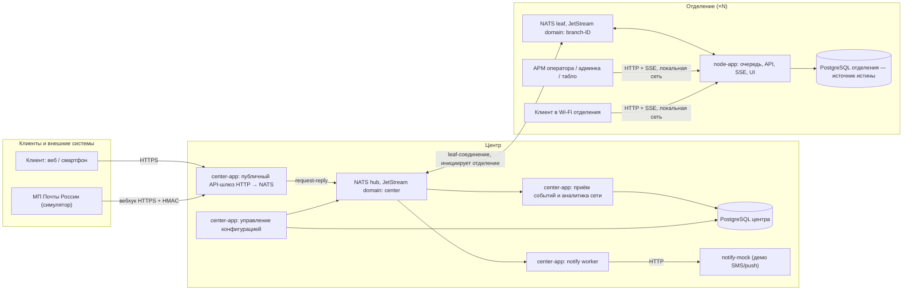
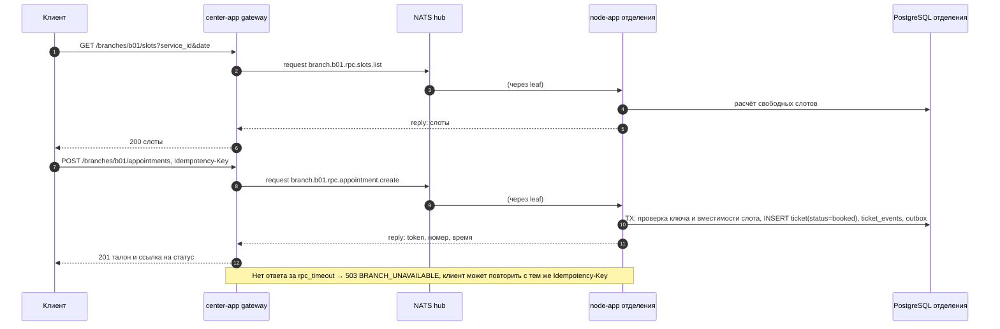
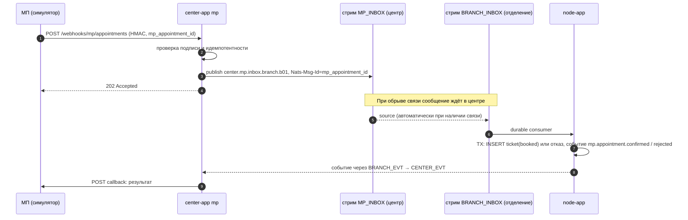
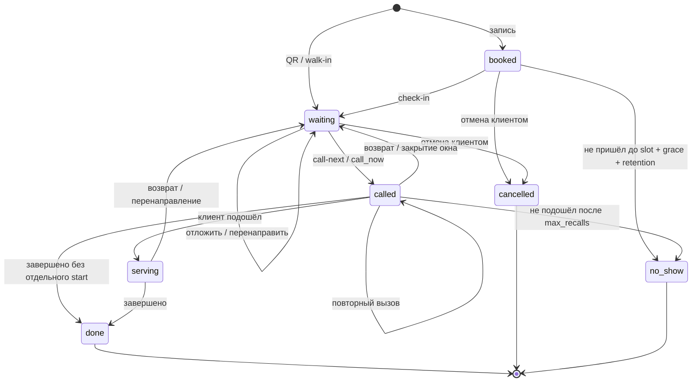
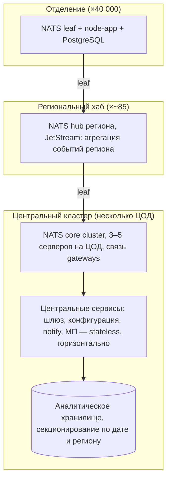

# ЕСУО — электронная система управления очередью

**Дизайн-документ MVP**

| Параметр | Значение                                                                                        |
| -------- | ----------------------------------------------------------------------------------------------- |
| Команда  | Разработчик A (Domain/Core), Разработчик B (Edge/Integration), ИИ-агенты (фронтенд)             |
| Стек     | Java 21, Spring Boot 3.5.16, PostgreSQL 16, NATS 2.10+ JetStream, React + TypeScript, Docker Compose |

---

## 0. О документе

### 0.1. Назначение

Документ фиксирует архитектуру, контракты, алгоритм очереди и план работ MVP. Он служит одновременно:

- единым источником требований для разработчиков и ИИ-агентов, пишущих код;
- материалом для жюри на чекпоинте и основой финальной презентации.

### 0.2. Легенда статусов

ТЗ требует отделять архитектурные расчёты и предположения от фактических проверок. Все утверждения, где это важно, помечены:

| Метка | Смысл |
|---|---|
| **[MVP]** | Реализуется и проверяется в MVP |
| **[MVP-демо]** | Реализуется в упрощённом демонстрационном виде (заглушка, синтетические данные) |
| **[Предложение]** | Архитектурное предложение, в MVP не реализуется, только описывается |
| **[Расчёт]** | Оценка на основе допущений, не результат измерений |
| **[Проверено]** | Подтверждено тестом или прогоном; метка проставляется по мере выполнения |

### 0.3. Правила для ИИ-агентов и разработчиков

1. Контракты из разделов 5, 8, 9, 10 являются источником истины. Код подстраивается под документ, а не наоборот. Если контракт нужно изменить, сначала меняется документ.
2. Доменный слой (очередь, талоны) не импортирует ничего из NATS, HTTP, Spring Web. Внешний мир доступен только через порты (раздел 11).
3. Любое изменение талона выполняется в одной транзакции вместе с записью в `ticket_events` и `outbox`.
4. Все настраиваемые коэффициенты берутся из конфигурации (раздел 6.9), в коде их нет.
5. Все ошибки API возвращаются в формате `ProblemDetail` (RFC 9457) с кодами из раздела 9.2.
6. Термины используются строго по глоссарию (Приложение А).

---

## 1. Контекст и цели

### 1.1. Проблема

Физические системы управления очередью (СУО) стоят примерно в 1 609 отделениях (ОПС). Они состоят из терминала, табло, сервера и ПО, требуют оборудования в каждом отделении, а звук и табло работают не всегда. Клиент не получает электронный талон и вынужден запоминать номер.

Цель — электронная очередь на существующих устройствах клиентов и сотрудников, без специального терминала, с централизованным управлением правилами обслуживания. Планируемый охват по бизнес-материалам — 3 425 ОПС с тремя и более окнами; архитектура должна выдерживать сеть из 40 000 отделений.

### 1.2. Пользователи

| Роль | Что делает |
|---|---|
| Клиент | Записывается заранее, получает талон по QR, следит за статусом, отменяет, откладывает |
| Оператор окна | Открывает и закрывает окно, вызывает, обслуживает, возвращает и перенаправляет клиентов, добавляет клиентов из живой очереди, фиксирует проблемы |
| Руководитель отделения | Управляет окнами и услугами, настраивает приоритеты в границах центра, смотрит очередь и аналитику |
| Менеджер услуг (центр) | Задаёт глобальные правила и границы, категории клиентов, приоритеты |
| Мониторинг сети (центр) | Видит состояние отделений, аномалии времени ожидания |

### 1.3. Цели MVP

- Три способа попасть в очередь: предварительная запись (веб и МП), QR-талон в отделении, живая очередь через оператора.
- Воспроизводимый алгоритм очереди без двойного назначения, с учётом записи на время и ограничением ожидания.
- Автономная работа отделения при потере связи с центром.
- Прохождение 10 проверочных сценариев из ТЗ (раздел 20).
- Демонстрация масштабируемости и отказоустойчивости на стенде из трёх компьютеров: центр и два отделения.

### 1.4. Не-цели MVP

- Реальные учётные записи клиентов, SMS-шлюз, интеграция с продуктивными системами ПочтаТех.
- Региональный уровень иерархии (описывается как предложение).
- Настоящая ML-модель: используется эвристика на синтетических данных.
- Нативные мобильные приложения: только адаптивный веб.

---

## 2. Реестр ключевых решений

Каждое решение подробно раскрыто в указанном разделе.

| # | Решение | Рассмотренные альтернативы | Почему так | Раздел |
|---|---|---|---|---|
| D1 | **Узел очереди (нода) работает в каждом отделении**: Spring Boot + PostgreSQL + NATS leaf на существующем ПК или моноблоке | Очередь в региональном или центральном ЦОД | Очередь продолжает работать при потере связи; отделению не нужны данные о внешнем мире, только о своей очереди; нагрузка на одно отделение мала. Спецтерминал, табло и принтер талонов не нужны — это софт на имеющемся железе | 3 |
| D2 | **Локальный PostgreSQL — единственный источник истины об очереди отделения** | Очередь в памяти, очередь в брокере | Восстановление после рестарта сводится к повторному чтению из БД; транзакции и блокировки строк дают гарантии без двойного назначения | 6, 8 |
| D3 | **Брокер не участвует в записи состояния очереди**; события уходят в NATS только после коммита через outbox | Запись через брокер (event sourcing) | Нет рассинхронизации «БД изменилась, событие потерялось» и наоборот | 10 |
| D4 | **NATS JetStream с leaf-узлами**: у каждого отделения свой JetStream-домен, центр — hub | Kafka, RabbitMQ, прямой HTTP | Leaf держит исходящее соединение (NAT не мешает), автоматически переподключается, копит события локально и досылает после восстановления связи | 10 |
| D5 | **Правило симметрии обмена**: отделение → центр через source-стрим в центре; центр → отделение через source-стрим в отделении | Ручная синхронизация, ретраи в коде | Докачка после обрыва выполняется самим JetStream, код синхронизации не пишется | 4.1, 10.4 |
| D6 | **Синхронные клиентские операции из интернета идут через центральный шлюз по NATS request-reply** | Проброс портов, VPN до отделений | Используется уже существующее leaf-соединение; таймаут и недоступность отделения обрабатываются явно | 4, 9.5 |
| D7 | **Асинхронный приём записей из МП** через очередь `MP_INBOX` с подтверждением результата обратным событием | Синхронный вызов отделения из вебхука | Запись из МП не теряется при недоступности отделения и обрабатывается после восстановления связи | 4.6 |
| D8 | **Алгоритм EDF с фильтром допуска**: у каждого талона есть допуск (`eligible_from`) и дедлайн (`due_at`) | Строгие тиры, взвешенная сумма | Одна модель покрывает запись на время, ограничение ожидания живой очереди, льготные категории и откладывание талона; воспроизводим; score встраивается без нарушения гарантий | 6 |
| D9 | **Score влияет на выбор только внутри окна `slack`** и только между головами разных очередей услуг | Score переупорядочивает всю очередь | Скоринг повышает пропускную способность, не ломая порядок внутри уровня и ограничение ожидания | 6.5 |
| D10 | **Уведомления отправляет центр**, отделение только публикует запрос | Отправка с каждого узла | Секреты SMS-шлюза не хранятся на 40 000 узлах; единая точка ретраев, circuit breaker и DLQ | 4.7, 11 |
| D11 | **Аутентификация операторов локальная**: пользователи приходят из центра через конфиг-стрим, JWT выпускает нода | Централизованный IdP | Оператор может войти при потере связи с центром | 13 |
| D12 | **Живые обновления через SSE**, при потере соединения — снапшот через GET | WebSocket | Нужен только поток сервер → клиент; `EventSource` сам переподключается; проще за прокси | 9.6 |
| D13 | **Фронтенд — SPA (React + TypeScript + Vite)**, собирается статикой и отдаётся нодой и центром | Серверный рендеринг | Фронт пишут ИИ-агенты строго по контрактам; одна сборка работает локально в отделении и публично через центр | 15 |
| D14 | **Идентификаторы UUIDv7 генерируются на узлах** | Автоинкремент, централизованная выдача | Нет конфликтов при слиянии данных в центре, генерация работает офлайн, ID упорядочены по времени | 8 |

---

## 3. Архитектура системы

### 3.1. Общая топология



### 3.2. Компоненты

**Узел отделения (`node-app`)** [MVP] — одно Spring Boot приложение:

| Модуль | Ответственность |
|---|---|
| `queue` (домен) | Талоны, окна, алгоритм выбора, жизненный цикл, скоринг, оценка времени ожидания |
| `api` | REST для клиента, оператора и руководителя; SSE-потоки; раздача SPA |
| `security` | Локальная аутентификация, JWT, роли, проверка принадлежности к отделению |
| `messaging` | Outbox-воркер, RPC-обработчики запросов из центра, потребители `BRANCH_INBOX` |
| `scheduler` | Таймауты вызова, истечение записей, пересчёт уведомлений о приближении очереди |
| `analytics` | Аналитика отделения по локальной БД (работает офлайн) |

Рядом в том же compose: PostgreSQL 16 и NATS-сервер в режиме leaf с включённым JetStream.

**Центр (`center-app`)** [MVP-демо] — одно Spring Boot приложение с модулями:

| Модуль | Ответственность |
|---|---|
| `gateway` | Публичный REST для клиентов из интернета; мост HTTP → NATS request-reply до нужного отделения; SSE-поток талона |
| `mp` | Приём вебхуков МП, идемпотентность, публикация в `MP_INBOX`, отправка результата обратно в МП |
| `config` | Глобальные правила, границы, категории, пользователи отделений; публикация версий в `CONFIG` |
| `ingest` | Потребление `CENTER_EVT`, запись в аналитическую БД центра |
| `notify` | Потребление запросов уведомлений, доставка через `NotificationGateway` с ретраями, CB и DLQ |
| `network` | Реестр отделений, heartbeat, обзор сети |

Рядом: NATS hub с JetStream (домен `center`), PostgreSQL центра, `notify-mock`, `mp-simulator`.

**Внешние демо-системы** [MVP-демо]:

- `mp-simulator` — генерирует записи «из мобильного приложения», шлёт вебхуки в центр, принимает обратные вызовы с результатом.
- `notify-mock` — принимает уведомления и умеет по команде `/chaos` отвечать ошибками, задержками или не отвечать совсем.
- `load-generator` — генерирует поток клиентов и действий операторов на ноде для демо и синтетической статистики.

### 3.3. Демонстрационный стенд

| Машина | Что поднято |
|---|---|
| ПК-1 «Центр» | NATS hub, `center-app`, PostgreSQL центра, `mp-simulator`, `notify-mock`, публичный фронтенд |
| ПК-2 «Отделение b01» | NATS leaf (`branch-b01`), `node-app`, PostgreSQL, фронтенд оператора, админки и табло, `load-generator` |
| ПК-3 «Отделение b02» | То же для `branch-b02` |

Для проверки жюри на одной машине дополнительно поставляется `docker-compose.yml`: центр и два отделения в разных docker-сетях, связанные только через NATS. Разрыв связи имитируется `docker network disconnect`.

### 3.4. Архитектурные принципы

1. **Отделение автономно.** Всё, что нужно для обслуживания клиентов в зале, работает без центра.
2. **Центр — не зависимость, а надстройка.** Он даёт онлайн-запись из интернета, уведомления, конфигурацию и аналитику сети. Его отказ деградирует эти функции, но не останавливает обслуживание.
3. **Одна правда на один объект.** Очередь и талоны — в БД отделения; конфигурация и реестр — в БД центра; события в центре — производная копия.
4. **Доставка «хотя бы один раз» + идемпотентные потребители** вместо попыток «ровно один раз».
5. **Заменяемость интеграций.** Логика очереди не знает о NATS, HTTP и конкретных внешних системах.

---

## 4. Потоки данных

### 4.1. Правило симметрии обмена

| Направление | Механизм | Что доставляется |
|---|---|---|
| Отделение → центр, асинхронно | Outbox → локальный стрим `BRANCH_EVT` → центральный стрим `CENTER_EVT` через sources | Все события талонов, окон, инцидентов, запросы уведомлений, результаты обработки записей МП |
| Центр → отделение, асинхронно | Центральные стримы `CONFIG`, `MP_INBOX` → локальный стрим `BRANCH_INBOX` через sources | Версии конфигурации, пользователи, записи из МП |
| Центр → отделение, синхронно | NATS request-reply с таймаутом | Операции клиента из интернета: слоты, запись, статус, отмена, QR-талон |

При обрыве связи асинхронные данные накапливаются в стримах на своей стороне и досылаются JetStream автоматически после переподключения. Синхронные операции при обрыве завершаются ошибкой `BRANCH_UNAVAILABLE`.

### 4.2. Предварительная запись через веб



В день визита клиент подтверждает приход (check-in) сканированием QR в отделении или у оператора; до этого запись не участвует в выборе.

### 4.3. Электронный талон по QR

1. Табло отделения показывает QR со ссылкой `https://<center>/b/b01/join?code=<qr_code>`. `qr_code` — подписанный HMAC код с TTL, нода обновляет его периодически (раздел 13.4).
2. Клиент открывает ссылку, выбирает услугу и категорию.
3. Центр вызывает `branch.b01.rpc.qr.issue`; нода проверяет код, ограничение «один активный талон на устройство» и создаёт талон `waiting`.
4. Клиент в Wi-Fi отделения может работать с нодой напрямую по локальному адресу; поведение и контракты те же.

Если в запросе QR передан токен ранее созданной записи, операция выполняет check-in этой записи вместо выдачи нового талона.

### 4.4. Живая очередь

1. Клиент без смартфона подходит к оператору.
2. Оператор в АРМ вызывает `POST /windows/{id}/walkin` с услугой и категорией.
3. Нода создаёт талон `waiting` с `source=walkin` по тем же правилам, что и остальные источники. Опционально `call_now=true` сразу назначает талон этому окну.
4. Оператор сообщает клиенту номер; клиент следит за табло в зале.

Центр в этом потоке не участвует, поэтому поток работает при полной потере связи.

### 4.5. Вызов клиента

```mermaid
sequenceDiagram
  autonumber
  participant O as Оператор
  participant N as node-app
  participant DB as PostgreSQL
  participant OW as outbox-воркер
  participant L as NATS leaf
  participant S as SSE-подписчики
  O->>N: POST /windows/w3/call-next
  N->>DB: BEGIN; SELECT window FOR UPDATE
  N->>DB: головы очередей по услугам окна FOR UPDATE SKIP LOCKED
  N->>N: выбор по EDF + score (раздел 6)
  N->>DB: UPDATE ticket SET status=called WHERE status=waiting
  N->>DB: INSERT ticket_events, outbox; COMMIT
  N-->>O: 200 талон
  OW->>DB: SELECT outbox pending FOR UPDATE SKIP LOCKED
  OW->>L: publish branch.b01.evt.ticket.called, Nats-Msg-Id=event_id
  L-->>OW: PubAck
  OW->>DB: UPDATE outbox SET status=sent
  N->>S: SSE: талон вызван в окно 3 (клиент, табло, АРМ)
```

SSE-подписчики на ноде получают событие из внутреннего издателя после коммита; SSE-подписчики в центре — через подписку на тот же subject по leaf-соединению.

### 4.6. Запись из МП



Если к моменту доставки время слота уже прошло, нода отклоняет запись с причиной `SLOT_EXPIRED`.

### 4.7. Уведомления

1. Планировщик ноды при каждом изменении очереди пересчитывает позиции и ожидаемое время.
2. Для талона, впервые попавшего под правило «очередь приближается» (раздел 6.9), нода в транзакции ставит флаг `notified_approaching_at` и пишет событие `notification.requested` с `dedup_key = ticket_id:approaching`.
3. `notify` в центре читает событие, проверяет, не истёк ли TTL, и доставляет через `NotificationGateway`.
4. Параллельно клиентская страница получает то же событие по SSE и показывает уведомление в браузере — этот канал работает и в Wi-Fi отделения при отсутствии центра.

### 4.8. Конфигурация

1. Менеджер услуг меняет правила в центре; центр валидирует их и сохраняет новую `config_version`.
2. Публикуется последнее значение в `center.config.global` или `center.config.branch.{id}`.
3. Стрим `BRANCH_INBOX` отделения получает версию; нода применяет её, если версия выше текущей, и публикует `config.applied`.
4. Руководитель отделения может переопределить параметры локально только в границах `bounds` из центральной версии.
5. Действующая версия фиксируется в каждом новом талоне (`config_version`); уже стоящие в очереди талоны пересчитываются только по явному правилу (раздел 6.8).

---

## 5. Доменная модель

### 5.1. Сущности

| Сущность | Описание |
|---|---|
| Отделение (branch) | Локальная копия данных о своём отделении: код, название, часовой пояс |
| Услуга (service) | Код, название, буквенный префикс номера, длительность слота записи |
| Окно (window) | Рабочее место; статус `open` / `closing` / `closed`; набор услуг; текущий сотрудник |
| Сотрудник (employee) | Оператор; связан с пользователем системы |
| Категория клиента (client_category) | Приходит из центра: `default`, `pensioner`, `svo` и т.д.; влияет на приоритет |
| Талон (ticket) | Главный агрегат: источник, услуга, категория, статус, допуск, дедлайн, окно |
| Событие талона (ticket_event) | Неизменяемая запись журнала о каждом изменении |
| Инцидент (incident) | Техническая или операционная проблема, зафиксированная оператором |
| Версия конфигурации (config) | Правила очереди, границы, категории, пользователи |

### 5.2. Источники талона

| `source` | Как появляется | Начальный статус |
|---|---|---|
| `appointment` | Веб-запись через центр или запись из МП | `booked` |
| `qr` | QR-код в отделении | `waiting` |
| `walkin` | Оператор добавляет из живой очереди | `waiting` (или сразу `called`, если `call_now`) |

Источник никогда не меняется и виден оператору.

### 5.3. Жизненный цикл талона



### 5.4. Таблица переходов

| Команда | Из статуса | В статус | Кто | Эффект |
|---|---|---|---|---|
| `check-in` | `booked` | `waiting` | Клиент, оператор | `checked_in_at=now`; при опоздании больше `grace_late_min` — конвертация по политике `convert_to_qr` |
| `call-next` | `waiting` | `called` | Оператор | `window_id`, `employee_id`, `called_at`, `call_count=1` |
| `recall` | `called` | `called` | Оператор, планировщик | `call_count+1`; число повторов = `call_count-1`. Планировщик после таймаута последнего разрешённого повтора переводит в `no_show` |
| `start` | `called` | `serving` | Оператор | `serving_started_at` |
| `complete` | `called`, `serving` | `done` | Оператор | `completed_at`; обновление `handling_stats` |
| `requeue` | `called`, `serving` | `waiting` | Оператор | Очистка окна; `mode=keep_position` сохраняет `due_at`, `mode=to_tail` пересчитывает |
| `redirect` | `waiting`, `called`, `serving` | `waiting` | Оператор | Смена `service_id` и/или `target_window_id`; `due_at` сохраняется |
| `postpone` | `waiting` | `waiting` | Клиент | `eligible_from = now + минуты`, `postpone_count+1` |
| `cancel` | `booked`, `waiting` | `cancelled` | Клиент | Освобождение слота записи |
| `no-show` | `called` | `no_show` | Оператор, планировщик | — |
| `expire` | `booked` | `no_show` | Планировщик | Нет check-in к `slot_start + grace_late_min + late_checkin_retention_min` |
| закрытие окна `force` | `called`, `serving` | `waiting` | Оператор | Как `requeue` с `keep_position` |

Любой переход, не указанный в таблице, отклоняется с ошибкой `INVALID_STATE_TRANSITION` (409).

---

## 6. Алгоритм очереди

### 6.1. Требования

Из ТЗ алгоритм обязан обеспечивать: отсутствие двойного назначения; сохранение порядка внутри одинакового уровня приоритета; учёт предварительной записи; ограничение ожидания живой очереди; корректное закрытие окна; восстановление после перезапуска; журналирование всех изменений; настраиваемость правил. Дополнительно наша цель — максимизировать пропускную способность окон, если это не нарушает перечисленного.

### 6.2. Идея: допуск и дедлайн

Каждому талону в статусе `waiting` соответствуют два момента времени:

- **`eligible_from`** — с какого момента талон вообще можно вызывать;
- **`due_at`** — к какому моменту его желательно вызвать (дедлайн).

Окно при освобождении выбирает среди допущенных талонов тот, у кого дедлайн наступает раньше всех (Earliest Deadline First, EDF). Все правила приоритета выражаются через то, как вычисляются эти два значения, а не через отдельные ветки кода.

### 6.3. Вычисление `eligible_from` и `due_at`

| Источник | `eligible_from` | `due_at` |
|---|---|---|
| `appointment` (пришёл вовремя) | `max(checked_in_at, slot_start − early_checkin_min)` | `slot_start` |
| `appointment` (опоздал больше `grace_late_min`), политика `convert_to_qr` | `checked_in_at` | `checked_in_at + target_wait[qr][category]` |
| `qr` | `issued_at` | `issued_at + target_wait[qr][category]` |
| `walkin` | `issued_at` | `issued_at + target_wait[walkin][category]` |
| После `postpone` | `now + postpone_min` | Без изменений |

Дополнительно талон с `target_window_id` допущен только для этого окна.

Как это отвечает требованиям ТЗ:

- **Запись на время.** Дедлайн записи равен времени слота. Когда слот наступает, у записавшегося клиента самый ранний дедлайн среди пришедших позже, и он вызывается первым. Раньше `slot_start − early_checkin_min` запись не вызывается, чтобы не вытеснять тех, кто уже ждёт.
- **Ограничение ожидания живой очереди.** Дедлайн walk-in наступает через `target_wait[walkin]` после выдачи. После этого момента талон просрочен и обходит все непросроченные, включая записи, чьё время ещё не подошло.
- **Льготные категории.** Меньший `target_wait` для категории означает более ранний дедлайн. Категории и значения задаёт центр.
- **Настраиваемость.** Все коэффициенты — это целевые ожидания в минутах, их понятно объяснить руководителю отделения.

### 6.4. Выбор талона при освобождении окна

Срабатывает на `call-next`. Автовызов при `open` или `complete` включается флагом `auto_call_on_free` (по умолчанию выключен: оператор сам нажимает «Следующий»).

```text
function callNext(windowId):
  BEGIN TRANSACTION
    window = SELECT * FROM windows WHERE id = windowId FOR UPDATE
    if window.status != 'open'            -> error WINDOW_NOT_OPEN
    if exists active ticket for window    -> error WINDOW_BUSY

    now = clock.now()
    heads = []
    for service in window.services:
      head = SELECT * FROM tickets
             WHERE branch_id = :b AND service_id = service AND status = 'waiting'
               AND eligible_from <= now
               AND (target_window_id IS NULL OR target_window_id = windowId)
             ORDER BY due_at, seq
             LIMIT 1
             FOR UPDATE SKIP LOCKED
      if head: heads.add(head)

    if heads.isEmpty()                    -> error QUEUE_EMPTY

    overdue = heads.filter(t -> t.due_at <= now)
    if overdue.notEmpty():
      chosen = minBy(overdue, (due_at, seq))
      reason = 'overdue_edf'
    else:
      inSlack = heads.filter(t -> t.due_at <= now + slack_min)
      if inSlack.size() > 1:
        scores = inSlack.map(t -> scoring.score(t, window, employee))
        chosen = maxBy(inSlack, (score desc, due_at asc, seq asc))
        reason = 'score_in_slack'
      else:
        chosen = minBy(heads, (due_at, seq))
        reason = 'edf'

    UPDATE tickets SET status='called', window_id=:w, employee_id=:e,
           called_at=now, call_count=1, version=version+1
     WHERE id = chosen.id AND status = 'waiting'
    assert updatedRows == 1

    INSERT ticket_events(ticket.called, payload = {
      window_id, reason, config_version, scoring_strategy, model_version,
      candidates: [{ticket_id, service_id, due_at, score}] })
    INSERT outbox(ticket.called)
  COMMIT
```

Замечания к реализации:

- Запрос головы выполняется отдельно по каждой услуге окна. Число услуг в окне мало (единицы), индекс `(branch_id, service_id, status, due_at, seq)` делает каждый запрос дешёвым.
- `seq` — монотонная последовательность из БД, детерминированный tie-break при равных `due_at`.
- Время `now` берётся один раз на транзакцию.

### 6.5. Роль score

Score выбирает между головами разных очередей услуг, если ни одна из них не просрочена и несколько попадают в окно `slack_min`. Внутри одной услуги порядок никогда не меняется: рассматривается только голова.

```java
public interface ScoringStrategy {
    ScoreResult score(TicketView ticket, WindowView window, EmployeeView employee);
}

public record ScoreResult(
    double value,                  // больше — лучше
    Duration predictedDuration,    // прогноз времени обслуживания
    String strategy,               // "uniform" | "heuristic" | ...
    String modelVersion
) {}
```

| Реализация | Поведение | Статус |
|---|---|---|
| `UniformScoringStrategy` | `value = 1` для всех; выбор сводится к чистому EDF | [MVP] |
| `HeuristicScoringStrategy` | `value = 1 / predicted_duration`, прогноз из `handling_stats` с каскадом уточнений | [MVP-демо] |

Стратегия выбирается параметром `scoring.strategy`. Queue Engine от реализации не зависит.

Почему score ограничен окном `slack`: выбор кратчайшей работы максимизирует пропускную способность, но без ограничителя систематически задвигает длинные услуги. Дедлайн — это ограничитель: как только талон просрочен, score перестаёт действовать.

### 6.6. Гарантии

| Требование ТЗ | Как обеспечено |
|---|---|
| Нет двойного назначения | Блокировка строки окна `FOR UPDATE`; голова берётся `FOR UPDATE SKIP LOCKED`; условный `UPDATE ... WHERE status='waiting'`; частичный уникальный индекс «один активный талон на окно» и проверка статусов на уровне БД (раздел 8.3) |
| Порядок внутри одного уровня | Уровень — это одинаковые услуга, источник, категория и `config_version`. Для QR и walk-in `due_at = issued_at + const`, поэтому порядок по `due_at` совпадает с порядком выдачи; для записей дополнительно сравнивается время слота, при равенстве решает `seq`. Score не переставляет талоны внутри одной услуги |
| Учёт записи | `due_at = slot_start`, допуск с `slot_start − early_checkin_min`, обязательный check-in |
| Ограничение ожидания живой очереди | После `target_wait[walkin]` талон просрочен и обходит всех непросроченных. Оценка сверху: `target_wait + время завершения текущих обслуживаний + ожидание просроченных с более ранним дедлайном`. Гарантия действует, пока нагрузка не превышает возможности открытых окон; при перегрузке система формирует рекомендацию открыть окно (раздел 6.8) |
| Закрытие окна | Раздел 7; талон возвращается с сохранённым `due_at`, то есть на место по сохранённому дедлайну |
| Восстановление после перезапуска | Состояние целиком в БД; выбор — чистая функция от состояния БД, времени и конфигурации; таймеры — периодические задачи по полям БД |
| Журналирование | Каждый переход пишет `ticket_events` в той же транзакции; `ticket.called` хранит всех кандидатов и их score |
| Воспроизводимость | Выбор детерминирован при известных `now`, состоянии, `config_version` и score кандидатов, которые записаны в событии. Решение можно переиграть по журналу |

### 6.7. Конкурентность

| Ситуация | Защита |
|---|---|
| Два окна одновременно вызывают следующего по общей услуге | Первое окно блокирует голову, второе пропускает её через `SKIP LOCKED` и берёт следующий талон |
| Двойной клик или ретрай `call-next` в одном окне | Блокировка строки окна; вторая транзакция видит активный талон и получает `WINDOW_BUSY` |
| Одновременное создание талона с одним `Idempotency-Key` | `INSERT` в `idempotency_keys` с первичным ключом в той же транзакции; второй запрос получает сохранённый ответ |
| Повторная доставка записи из МП | Уникальный `mp_appointment_id` |
| Два талона с одного устройства по QR | Частичный уникальный индекс `(branch_id, device_id)` для активных статусов |
| Выдача номеров «Q-014» | `UPDATE ticket_counters ... RETURNING` по ключу `(branch, service, дата)` |
| Команда оператора по устаревшему состоянию талона | Оптимистическая версия `version` в запросе; при несовпадении — `STALE_STATE` (409) |

### 6.8. Оценка времени ожидания и рекомендации

**Ожидаемое время вызова (ETA)** [MVP] вычисляет `WaitTimeEstimator` при каждом изменении очереди:

1. Упорядочить все допущенные талоны отделения так, как их выбрал бы алгоритм при `uniform`-скоринге.
2. Прогнать упрощённую симуляцию по открытым окнам: каждое окно освобождается через оставшееся прогнозное время текущего обслуживания и берёт следующий подходящий талон.
3. ETA талона — момент, когда симуляция его назначит; позиция — число талонов перед ним в его услуге.

Прогнозная длительность берётся из той же стратегии, что и score (`predictedDuration`), при `uniform` — среднее по услуге или значение по умолчанию.

**Рекомендация открыть окно** [MVP-демо]: если ETA хотя бы одного талона превышает его `due_at` больше чем на `recommend_open_window.overdue_min`, или число просроченных талонов больше `recommend_open_window.overdue_count`, руководитель получает рекомендацию с указанием услуг, где растёт очередь.

**Изменение конфигурации.** Новая версия действует для новых талонов. Уже стоящие талоны сохраняют свою `config_version` и дедлайн. Это принятое ограничение: порядок гарантируется внутри одной версии, между версиями возможна перестановка, и она журналируется.

### 6.9. Конфигурация очереди

Все коэффициенты хранятся в файле `infrastructure/config/queue-defaults.yml` и в центральной конфигурации; в коде значений нет.

```yaml
queue:
  config-version: 1
  target-wait-min:
    qr: {default: 20, pensioner: 15, svo: 5}
    walkin: {default: 30, pensioner: 20, svo: 5}
  early-checkin-min: 15
  grace-late-min: 10
  late-checkin-retention-min: 60
  slot-duration-min: 15
  slot-capacity: 1
  booking-horizon-days: 30
  opening-time: "09:00"
  closing-time: "18:00"
  slack-min: 5
  call-timeout-sec: 90
  max-recalls: 2
  auto-call-on-free: false
  scoring-strategy: uniform
```

Это фактический стартовый конфиг Дней 0–1. Разделы `bounds`, `notifications` и параметры эвристики будут добавлены с соответствующими сценариями. В Java поля используют camelCase, в стартовом YAML — kebab-case; в HTTP и сохранённом JSON — snake_case. Поздняя запись получает правила QR при сохранении источника; альтернативный режим reject пока не реализуется.

---

## 7. Спорные ситуации

| # | Ситуация | Принятое поведение | Обоснование |
|---|---|---|---|
| S1 | Закрытие окна с активным клиентом | Два режима. `graceful`: окно переходит в `closing`, новых клиентов не вызывает, текущего оператор дообслуживает, после `complete` окно закрывается. `force`: активный талон возвращается в `waiting` с сохранённым `due_at` и `eligible_from=now`, окно закрывается сразу | Клиент не должен терять место из-за проблемы оператора. Сохранённый дедлайн сохраняет накопленный приоритет, но не гарантирует абсолютное первое место |
| S2 | Окно закрыто, а под его услуги стоят клиенты, и других окон с этими услугами нет | Талоны остаются в очереди; руководитель получает отклонение «услуга без открытых окон»; клиентам показывается ETA «не определено» | Молча отменять талоны нельзя; решение об открытии окна принимает человек |
| S3 | Перенаправление на другую услугу | Меняется `service_id`, `due_at` сохраняется | Клиент уже отстоял своё время; перенаправление — решение оператора, а не клиента |
| S4 | Перенаправление в конкретное окно | Устанавливается `target_window_id`; вызвать талон может только это окно. Если окно закрывается, `target_window_id` сбрасывается | Поддержка сценария «пройдите к специалисту в окно 5» |
| S5 | Клиент не подошёл после вызова | Через `call_timeout_sec` планировщик делает повторный вызов; после `max_recalls` — `no_show`, окно освобождается | Окно не простаивает бесконечно; решение воспроизводимо и журналируется |
| S6 | Запись пришла раньше времени | Check-in разрешён; к вызову допускается с `slot_start − early_checkin_min` | Не вытесняет тех, кто уже ждёт |
| S7 | Запись опоздала больше `grace_late_min` | По умолчанию `convert_to_qr`: талон остаётся, но получает дедлайн как QR-талон от момента check-in | Клиент не теряет визит, но не обходит тех, кто пришёл вовремя |
| S8 | Записавшийся не пришёл | `booked → no_show` в `slot_start + grace_late_min + late_checkin_retention_min` | Призрачные записи не блокируют окна |
| S9 | Отделение недоступно для веб-записи | 503 `BRANCH_UNAVAILABLE`, клиенту предлагается повторить позже; ключ идемпотентности позволяет безопасно повторить | Нельзя подтвердить запись, которую источник истины не принял |
| S10 | Запись из МП доставлена после обрыва на прошедший слот | Отказ `SLOT_EXPIRED`, результат уходит в МП | Нельзя создать запись в прошлом |
| S11 | Сервис уведомлений недоступен | Очередь работает; уведомления ретраятся, после `max_attempts` или истечения TTL уходят в DLQ; клиент видит статус на странице через SSE | Уведомления — вспомогательный канал, не условие обслуживания |
| S12 | Перезапуск ноды во время вызова | Талон остаётся `called` с тем же окном; таймаут вызова считается по `called_at` из БД | Никакого состояния в памяти |
| S13 | Потеря связи клиента | Токен хранится в `localStorage` и в URL; при возврате — снапшот через GET и переподключение SSE с `Last-Event-ID` | Сценарий «восстановить сессию» из ТЗ |
| S14 | Оператор закрыл вкладку, окно осталось `open` | Окно остаётся открытым; руководитель видит окно без активности дольше `idle_alert_min` в отклонениях | Автоматически закрывать окно рискованно: оператор мог отлучиться на минуту |

---

## 8. Хранение данных

### 8.1. PostgreSQL отделения

Миграции — Flyway, файлы в `java-backend/node-app/src/main/resources/db/migration`. Все времена — `timestamptz` в UTC; часовой пояс отделения используется только для отображения и расчёта слотов.

```sql
CREATE TABLE branch (
  id            text PRIMARY KEY,
  name          text NOT NULL,
  address       text,
  timezone      text NOT NULL
);

CREATE TABLE services (
  id                uuid PRIMARY KEY,
  branch_id         text NOT NULL REFERENCES branch(id),
  code              text NOT NULL,
  name              text NOT NULL,
  number_prefix     text NOT NULL,
  slot_duration_min int  NOT NULL DEFAULT 15,
  slot_capacity     int  NOT NULL DEFAULT 1,
  active            boolean NOT NULL DEFAULT true,
  UNIQUE (branch_id, code)
);

CREATE TABLE employees (
  id          uuid PRIMARY KEY,
  branch_id   text NOT NULL REFERENCES branch(id),
  full_name   text NOT NULL,
  active      boolean NOT NULL DEFAULT true
);

CREATE TABLE users (
  id              uuid PRIMARY KEY,
  login           text NOT NULL UNIQUE,
  password_hash   text NOT NULL,
  role            text NOT NULL CHECK (role IN ('OPERATOR','BRANCH_ADMIN')),
  employee_id     uuid REFERENCES employees(id),
  active          boolean NOT NULL DEFAULT true
);

CREATE TABLE windows (
  id                  uuid PRIMARY KEY,
  branch_id           text NOT NULL REFERENCES branch(id),
  name                text NOT NULL,
  status              text NOT NULL CHECK (status IN ('open','closing','closed')),
  current_employee_id uuid REFERENCES employees(id),
  opened_at           timestamptz,
  version             int NOT NULL DEFAULT 0
);

CREATE TABLE window_services (
  window_id   uuid REFERENCES windows(id),
  service_id  uuid REFERENCES services(id),
  PRIMARY KEY (window_id, service_id)
);

CREATE TABLE tickets (
  id                      uuid PRIMARY KEY,
  branch_id               text NOT NULL REFERENCES branch(id),
  public_token            uuid NOT NULL UNIQUE,
  display_number          text NOT NULL,
  service_id              uuid NOT NULL REFERENCES services(id),
  source                  text NOT NULL CHECK (source IN ('appointment','qr','walkin')),
  client_category         text NOT NULL DEFAULT 'default',
  status                  text NOT NULL CHECK (status IN
                            ('booked','waiting','called','serving','done','cancelled','no_show')),
  config_version          int  NOT NULL,
  seq                     bigserial NOT NULL UNIQUE,
  issued_at               timestamptz NOT NULL,
  slot_start              timestamptz,
  slot_end                timestamptz,
  checked_in_at           timestamptz,
  eligible_from           timestamptz,
  due_at                  timestamptz,
  target_window_id        uuid REFERENCES windows(id),
  window_id               uuid REFERENCES windows(id),
  employee_id             uuid REFERENCES employees(id),
  called_at               timestamptz,
  call_count              int NOT NULL DEFAULT 0,
  serving_started_at      timestamptz,
  completed_at            timestamptz,
  postpone_count          int NOT NULL DEFAULT 0,
  device_id               text,
  mp_appointment_id       text UNIQUE,
  notified_approaching_at timestamptz,
  close_reason            text,
  updated_at              timestamptz NOT NULL,
  version                 int NOT NULL DEFAULT 0,
  CHECK (source <> 'appointment' OR slot_start IS NOT NULL),
  CHECK (status NOT IN ('waiting') OR (eligible_from IS NOT NULL AND due_at IS NOT NULL)),
  CHECK (status NOT IN ('called','serving') OR window_id IS NOT NULL)
);

CREATE TABLE ticket_events (
  id           uuid PRIMARY KEY,
  ticket_id    uuid NOT NULL REFERENCES tickets(id),
  event_type   text NOT NULL,
  from_status  text,
  to_status    text,
  actor_type   text NOT NULL,
  actor_id     text,
  payload      jsonb NOT NULL,
  occurred_at  timestamptz NOT NULL
);

CREATE TABLE window_events (
  id           uuid PRIMARY KEY,
  window_id    uuid NOT NULL REFERENCES windows(id),
  event_type   text NOT NULL,
  actor_id     text,
  payload      jsonb NOT NULL,
  occurred_at  timestamptz NOT NULL
);

CREATE TABLE incidents (
  id           uuid PRIMARY KEY,
  window_id    uuid REFERENCES windows(id),
  ticket_id    uuid REFERENCES tickets(id),
  kind         text NOT NULL CHECK (kind IN ('technical','operational')),
  description  text NOT NULL,
  reported_by  uuid REFERENCES employees(id),
  status       text NOT NULL DEFAULT 'open' CHECK (status IN ('open','resolved')),
  created_at   timestamptz NOT NULL,
  resolved_at  timestamptz
);

CREATE TABLE ticket_counters (
  branch_id   text NOT NULL,
  service_id  uuid NOT NULL,
  day         date NOT NULL,
  last_value  int  NOT NULL,
  PRIMARY KEY (branch_id, service_id, day)
);

CREATE TABLE idempotency_keys (
  key            text NOT NULL,
  scope          text NOT NULL,
  request_hash   text NOT NULL,
  response_code  int,
  response_body  jsonb,
  created_at     timestamptz NOT NULL,
  PRIMARY KEY (scope, key),
  CHECK ((response_code IS NULL) = (response_body IS NULL))
);

CREATE TABLE outbox (
  id             uuid PRIMARY KEY,
  subject        text NOT NULL,
  payload        jsonb NOT NULL,
  headers        jsonb NOT NULL DEFAULT '{}',
  status         text NOT NULL CHECK (status IN ('pending','sent','failed')),
  attempts       int  NOT NULL DEFAULT 0,
  next_attempt_at timestamptz NOT NULL,
  last_error     text,
  created_at     timestamptz NOT NULL,
  sent_at        timestamptz
);

CREATE TABLE inbox_processed (
  message_id    text PRIMARY KEY,
  stream        text NOT NULL,
  processed_at  timestamptz NOT NULL
);

CREATE TABLE branch_config (
  id               int PRIMARY KEY DEFAULT 1 CHECK (id = 1),
  central_version  int   NOT NULL,
  central_config   jsonb NOT NULL,
  local_overrides  jsonb NOT NULL DEFAULT '{}',
  effective_version int  NOT NULL,
  updated_at       timestamptz NOT NULL
);

CREATE TABLE handling_stats (
  service_id        uuid NOT NULL,
  employee_id       uuid,
  window_id         uuid,
  client_category   text NOT NULL,
  avg_duration_sec  double precision NOT NULL,
  sample_count      int NOT NULL,
  updated_at        timestamptz NOT NULL
);
CREATE UNIQUE INDEX ux_handling_stats
  ON handling_stats (service_id, COALESCE(employee_id, '00000000-0000-0000-0000-000000000000'),
                     COALESCE(window_id, '00000000-0000-0000-0000-000000000000'), client_category);


CREATE INDEX ix_tickets_queue
  ON tickets (branch_id, service_id, due_at, seq)
  WHERE status = 'waiting';


CREATE INDEX ix_tickets_booked ON tickets (slot_start) WHERE status = 'booked';


CREATE INDEX ix_tickets_called ON tickets (called_at) WHERE status = 'called';


CREATE INDEX ix_tickets_issued ON tickets (branch_id, issued_at);


CREATE INDEX ix_outbox_pending ON outbox (next_attempt_at) WHERE status = 'pending';

CREATE INDEX ix_ticket_events_ticket ON ticket_events (ticket_id, occurred_at);


CREATE UNIQUE INDEX ux_one_active_ticket_per_window
  ON tickets (window_id) WHERE status IN ('called','serving');


CREATE UNIQUE INDEX ux_one_active_ticket_per_device
  ON tickets (branch_id, device_id)
  WHERE device_id IS NOT NULL AND status IN ('booked','waiting','called','serving');

-- Строка слота сериализует конкурентные бронирования одной услуги.
CREATE TABLE appointment_slots (
  service_id uuid NOT NULL REFERENCES services(id),
  slot_start timestamptz NOT NULL,
  PRIMARY KEY (service_id, slot_start)
);
CREATE INDEX ix_ticket_slot ON tickets (service_id, slot_start)
  WHERE source = 'appointment' AND status NOT IN ('cancelled', 'no_show');

-- Локальный день фиксируется при выдаче и не зависит от часового пояса соединения.
ALTER TABLE tickets ADD COLUMN issued_day date NOT NULL;
ALTER TABLE tickets ADD CONSTRAINT ux_ticket_number UNIQUE (branch_id, service_id, issued_day, display_number);
ALTER TABLE services ADD CONSTRAINT ck_slot_duration CHECK (slot_duration_min > 0 AND slot_duration_min <= 1440);
ALTER TABLE services ADD CONSTRAINT ck_slot_capacity CHECK (slot_capacity > 0);
ALTER TABLE tickets ADD CONSTRAINT ck_ticket_slot CHECK (slot_end IS NULL OR slot_end > slot_start);
ALTER TABLE handling_stats ADD CONSTRAINT ck_handling_stats CHECK (avg_duration_sec > 0 AND sample_count >= 0);
ALTER TABLE window_services ALTER COLUMN window_id SET NOT NULL;
ALTER TABLE window_services ALTER COLUMN service_id SET NOT NULL;
```

### 8.2. Индексы

Индексы включены в SQL выше и в миграцию V1.

### 8.3. Дополнительные ограничения

Миграция V2 добавляет уникальность префикса услуги внутри отделения, составные внешние ключи принадлежности талона и оператора к отделению, запрещает UPDATE/DELETE/TRUNCATE журналов и убирает неявные значения длительности/вместимости слота. Авторитетная исполняемая схема — файлы `java-backend/node-app/src/main/resources/db/migration/V*.sql`.

### 8.4. PostgreSQL центра

| Таблица | Назначение |
|---|---|
| `branches` | Реестр отделений: код, регион, часовой пояс, адрес NATS-домена, последний heartbeat |
| `branch_services_cache` | Кеш каталога услуг для публичной страницы выбора отделения |
| `config_versions` | Все версии глобальной и отделенческой конфигурации, автор, время |
| `center_users` | Пользователи центра: `SERVICE_MANAGER`, `NETWORK_MONITOR` |
| `branch_users` | Пользователи отделений, публикуются в конфиг-стрим |
| `mp_requests` | Вебхуки МП: `mp_appointment_id`, отделение, статус `accepted/confirmed/rejected`, попытки обратного вызова |
| `events` | Копия событий отделений, секционирование по дню (`PARTITION BY RANGE (occurred_at)`) |
| `inbox_processed` | Дедупликация потребителей центра |
| `notification_log` | Попытки доставки уведомлений |
| `notification_dlq` | Недоставленные уведомления: `ticket_id`, канал, payload, попытки, последняя ошибка |

---

## 9. REST API

### 9.1. Общие соглашения

- Префикс `/api/v1`. Формат — JSON, `snake_case` в полях.
- OpenAPI 3.1 генерируется springdoc и коммитится в `docs/openapi/node.yaml` и `docs/openapi/center.yaml`; сгенерированный клиент используется фронтендом.
- `X-Request-Id` принимается или генерируется, возвращается в ответе, передаётся в NATS-заголовках и в логах.
- `Idempotency-Key` обязателен для всех операций создания талона: `POST appointments`, `POST qr-tickets`, `POST walkin`.
- Команды оператора над талоном принимают `expected_version`; при расхождении — `STALE_STATE`.
- Время в ответах — ISO 8601 с часовым поясом.

### 9.2. Ошибки

Формат `application/problem+json`:

```json
{
  "type": "urn:esuo:problem:window-busy",
  "title": "Окно уже обслуживает клиента",
  "status": 409,
  "code": "WINDOW_BUSY",
  "detail": "В окне 3 активен талон П-014",
  "instance": "urn:esuo:request:01J...",
  "request_id": "01J...",
  "errors": []
}
```

| `code` | HTTP | Когда |
|---|---|---|
| `VALIDATION_ERROR` | 400 | Некорректное тело или параметры; поле `errors` содержит список нарушений |
| `UNAUTHENTICATED` | 401 | Нет или истёк JWT |
| `FORBIDDEN` | 403 | Недостаточно прав или чужое отделение |
| `TICKET_NOT_FOUND` | 404 | Неизвестный токен или ID |
| `WINDOW_NOT_FOUND`, `SERVICE_NOT_FOUND`, `BRANCH_NOT_FOUND` | 404 | — |
| `INVALID_STATE_TRANSITION` | 409 | Переход не разрешён таблицей 5.4 |
| `STALE_STATE` | 409 | `expected_version` не совпал |
| `WINDOW_NOT_OPEN` | 409 | Команда для закрытого окна |
| `WINDOW_BUSY` | 409 | У окна уже есть активный талон |
| `QUEUE_EMPTY` | 409 | Нет допущенных талонов для окна |
| `SLOT_UNAVAILABLE` | 409 | Слот заполнен |
| `SLOT_EXPIRED` | 409 | Слот в прошлом |
| `ACTIVE_TICKET_EXISTS` | 409 | У устройства уже есть активный талон |
| `IDEMPOTENCY_CONFLICT` | 422 | Тот же ключ с другим телом запроса |
| `QR_CODE_INVALID` | 422 | Подпись неверна или TTL истёк |
| `CONFIG_OUT_OF_BOUNDS` | 422 | Локальное значение вне границ центра |
| `SERVICE_NOT_IN_WINDOW` | 422 | Услуга не оказывается в этом окне |
| `RATE_LIMITED` | 429 | Превышен лимит запросов |
| `BRANCH_UNAVAILABLE` | 503 | Отделение не ответило за `rpc_timeout` |
| `INTERNAL_ERROR` | 500 | Непредвиденная ошибка; детали только в логах |

Повтор запроса с тем же `Idempotency-Key` и тем же телом возвращает сохранённый код и тело ответа.

### 9.3. API узла отделения

Базовый адрес: `http://<node>/api/v1`.

**Публичные (клиент, табло), доступ по токену талона или без аутентификации:**

| Метод | Путь | Тело / параметры | Ответ |
|---|---|---|---|
| GET | `/branch` | — | Отделение, активные услуги, категории |
| GET | `/slots` | `service_id`, `date` | Свободные слоты |
| POST | `/appointments` | `service_id`, `slot_start`, `client_category`; `Idempotency-Key` | 201 `TicketView` |
| POST | `/qr-tickets` | `qr_code`, `service_id`, `client_category`, `device_id`; `Idempotency-Key` | 201 `TicketView` |
| POST | `/tickets/{token}/check-in` | `qr_code` | 200 `TicketView` |
| GET | `/tickets/{token}` | — | 200 `TicketView` |
| GET | `/tickets/{token}/stream` | SSE | События талона |
| POST | `/tickets/{token}/cancel` | — | 200 `TicketView` |
| POST | `/tickets/{token}/postpone` | `minutes` | 200 `TicketView` |
| GET | `/board` | — | Последние вызовы, текущий QR |
| GET | `/board/stream` | SSE | Вызовы, обновление QR |

**Аутентификация:**

| Метод | Путь | Тело | Ответ |
|---|---|---|---|
| POST | `/auth/login` | `login`, `password` | `access_token` (JWT, 12 ч), роль, `employee_id` |

**Оператор (`OPERATOR`, `BRANCH_ADMIN`):**

| Метод | Путь | Тело | Ответ |
|---|---|---|---|
| GET | `/windows` | — | Окна отделения |
| GET | `/windows/{id}` | — | Состояние окна и активный талон |
| POST | `/windows/{id}/open` | `service_ids[]` | 200 `WindowView` |
| POST | `/windows/{id}/close` | `mode`: `graceful` \| `force` | 200 `WindowView` |
| POST | `/windows/{id}/call-next` | — | 200 `TicketView` |
| POST | `/windows/{id}/walkin` | `service_id`, `client_category`, `call_now`; `Idempotency-Key` | 201 `TicketView` |
| GET | `/queue` | `service_id?`, `status?` | Талоны очереди с источником, `due_at`, ETA |
| POST | `/operator/tickets/{id}/check-in` | `expected_version` | 200 |
| POST | `/tickets/{id}/start` | `expected_version` | 200 |
| POST | `/tickets/{id}/complete` | `expected_version` | 200 |
| POST | `/tickets/{id}/recall` | `expected_version` | 200 |
| POST | `/tickets/{id}/no-show` | `expected_version` | 200 |
| POST | `/tickets/{id}/requeue` | `mode`, `expected_version` | 200 |
| POST | `/tickets/{id}/redirect` | `service_id?`, `window_id?`, `reason`, `expected_version` | 200 |
| GET | `/tickets/{id}/events` | — | Журнал талона |
| POST | `/incidents` | `kind`, `description`, `window_id?`, `ticket_id?` | 201 |
| GET | `/operator/stream` | SSE | Очередь, окна, инциденты |

**Руководитель отделения (`BRANCH_ADMIN`):**

| Метод | Путь | Назначение |
|---|---|---|
| GET, POST, PUT, DELETE | `/admin/services`, `/admin/windows`, `/admin/employees` | Управление справочниками; удаление — мягкое |
| PUT | `/admin/windows/{id}/services` | Перечень услуг окна |
| GET | `/admin/config` | Центральная версия, локальные переопределения, границы |
| PUT | `/admin/config` | Локальные переопределения в пределах `bounds` |
| GET | `/admin/analytics/summary` | `from`, `to`: обслужено, среднее и максимальное ожидание по источникам и услугам |
| GET | `/admin/analytics/windows` | Загрузка окон: время открытия, время обслуживания, простой, число клиентов |
| GET | `/admin/analytics/deviations` | Отклонения: просроченные талоны, `no_show`, долгие обслуживания, окна без активности, услуги без окон, инциденты |
| GET | `/admin/analytics/unfinished` | Незавершённые талоны за период |
| GET | `/admin/recommendations` | Рекомендации по открытию окон |
| PATCH | `/admin/incidents/{id}` | Закрыть инцидент |
| GET | `/admin/stream` | SSE: очередь в реальном времени |

**Служебные:** `/actuator/health`, `/actuator/health/liveness`, `/actuator/health/readiness`, `/actuator/prometheus`.

### 9.4. Модель `TicketView`

```json
{
  "ticket_id": "0192...",
  "token": "7f1c...",
  "branch_id": "b01",
  "display_number": "П-014",
  "service": { "id": "...", "name": "Получение посылки" },
  "source": "qr",
  "client_category": "pensioner",
  "status": "waiting",
  "position": 3,
  "eta": "2026-09-21T10:42:00+03:00",
  "eta_confidence": "low",
  "slot_start": null,
  "window": null,
  "called_at": null,
  "can_cancel": true,
  "can_postpone": true,
  "version": 4,
  "updated_at": "2026-09-21T10:30:12+03:00"
}
```

Поле `token` возвращается только владельцу талона и оператору; `due_at` и данные скоринга видны только в API оператора и руководителя.

### 9.5. API центра

Базовый адрес: `https://<center>/api/v1`.

| Метод | Путь | Реализация |
|---|---|---|
| GET | `/branches` | Реестр отделений со статусом online/offline |
| GET | `/branches/{b}/services` | Кеш каталога |
| GET | `/branches/{b}/slots` | RPC `slots.list` |
| POST | `/branches/{b}/appointments` | RPC `appointment.create` |
| POST | `/branches/{b}/qr-tickets` | RPC `qr.issue` |
| GET | `/branches/{b}/tickets/{token}` | RPC `ticket.get` |
| GET | `/branches/{b}/tickets/{token}/stream` | SSE: снапшот через RPC + подписка на события талона |
| POST | `/branches/{b}/tickets/{token}/cancel` | RPC `ticket.cancel` |
| POST | `/branches/{b}/tickets/{token}/postpone` | RPC `ticket.postpone` |
| POST | `/branches/{b}/tickets/{token}/check-in` | RPC `ticket.checkin` |
| POST | `/webhooks/mp/appointments` | HMAC `X-Signature`; 202; публикация в `MP_INBOX` |
| PUT | `/config/global` | `SERVICE_MANAGER`; новая глобальная версия |
| PUT | `/config/branches/{b}` | `SERVICE_MANAGER`; переопределения для отделения |
| POST | `/branches/{b}/users` | `SERVICE_MANAGER`; пользователи отделения |
| GET | `/network/overview` | `NETWORK_MONITOR`; статус отделений, среднее ожидание, аномалии |
| GET | `/admin/notifications/dlq` | Просмотр DLQ, повторная отправка |

### 9.6. SSE

- Каждое SSE-сообщение содержит `id` (= `event_id`), `event` (= `event_type`) и `data` (конверт события, раздел 10.2).
- При подключении сервер первым сообщением отправляет `snapshot` с актуальным `TicketView`.
- Клиент при разрыве переподключается сам; сервер по `Last-Event-ID` понимает, что это переподключение, и снова присылает снапшот. Потерянные промежуточные события не досылаются: снапшот их заменяет.
- Сервер шлёт `heartbeat` каждые 15 секунд.
- Если SSE недоступен, фронтенд переходит на опрос `GET` раз в 10 секунд.

---

## 10. Обмен сообщениями: NATS

### 10.1. Subjects

| Subject | Тип | Направление | Назначение |
|---|---|---|---|
| `branch.{b}.evt.ticket.{event}` | JetStream | Отделение → центр | `created`, `checked_in`, `called`, `recalled`, `serving`, `completed`, `requeued`, `redirected`, `postponed`, `cancelled`, `no_show` |
| `branch.{b}.evt.window.{event}` | JetStream | Отделение → центр | `opened`, `closing`, `closed` |
| `branch.{b}.evt.incident.created` | JetStream | Отделение → центр | Инцидент оператора |
| `branch.{b}.evt.notification.requested` | JetStream | Отделение → центр | Запрос уведомления |
| `branch.{b}.evt.mp.appointment.{confirmed\|rejected}` | JetStream | Отделение → центр | Результат записи из МП |
| `branch.{b}.evt.config.applied` | JetStream | Отделение → центр | Подтверждение применения версии |
| `branch.{b}.hb` | Core NATS | Отделение → центр | Heartbeat каждые 10 с: версия, лаг outbox, окна |
| `branch.{b}.rpc.{op}` | Core request-reply | Центр → отделение | `slots.list`, `appointment.create`, `qr.issue`, `ticket.get`, `ticket.cancel`, `ticket.postpone`, `ticket.checkin` |
| `center.config.global` | JetStream | Центр → отделения | Глобальная конфигурация |
| `center.config.branch.{b}` | JetStream | Центр → отделение | Конфигурация и пользователи отделения |
| `center.mp.inbox.branch.{b}` | JetStream | Центр → отделение | Записи из МП |

### 10.2. Конверт события

Заголовки NATS: `Nats-Msg-Id: <event_id>`, `X-Request-Id`, `Content-Type: application/json`.

```json
{
  "event_id": "0192a7c0-...",
  "event_type": "ticket.called",
  "schema_version": 1,
  "branch_id": "b01",
  "aggregate_type": "ticket",
  "aggregate_id": "0192a7b1-...",
  "aggregate_version": 5,
  "occurred_at": "2026-09-21T07:31:02.114Z",
  "config_version": 3,
  "actor": { "type": "operator", "id": "..." },
  "data": {
    "display_number": "П-014",
    "public_token": "7f1c...",
    "source": "qr",
    "service_id": "...",
    "window_id": "...",
    "window_name": "Окно 3",
    "reason": "overdue_edf",
    "candidates": []
  }
}
```

### 10.3. Конверт RPC

Запрос: заголовки `X-Request-Id`, `Idempotency-Key` (если есть), `X-Deadline` (UTC); тело — параметры операции.

Ответ:

```json
{ "ok": true, "status": 201, "data": { } }
```

```json
{ "ok": false, "status": 409, "problem": { "code": "SLOT_UNAVAILABLE", "title": "...", "detail": "..." } }
```

Центр транслирует `status` и `problem` в HTTP-ответ как есть. Нет ответа за `rpc_timeout_ms` или нет подписчиков на subject — центр отвечает `503 BRANCH_UNAVAILABLE`.

### 10.4. Стримы

| Стрим | Домен | Subjects / sources | Хранение | Назначение |
|---|---|---|---|---|
| `BRANCH_EVT` | `branch-{b}` | subjects `branch.{b}.evt.>` | file, `max_age` 7 д, `duplicate_window` 1 ч | Буфер событий отделения на время обрыва |
| `BRANCH_INBOX` | `branch-{b}` | sources: `CONFIG` c фильтрами `center.config.global` и `center.config.branch.{b}`; `MP_INBOX` c фильтром `center.mp.inbox.branch.{b}`; оба через `external.api = $JS.center.API` | file, `max_age` 7 д | Входящие данные центра, доступные офлайн |
| `CENTER_EVT` | `center` | sources: `BRANCH_EVT` каждого отделения через `external.api = $JS.branch-{b}.API`; собственных subjects нет | file, `max_age` 30 д | Сводный поток событий сети |
| `CONFIG` | `center` | subjects `center.config.>`, `max_msgs_per_subject = 1` | file | Последняя версия конфигурации на ключ |
| `MP_INBOX` | `center` | subjects `center.mp.inbox.branch.*` | file, `max_age` 24 ч, `duplicate_window` 24 ч | Записи из МП до доставки в отделение |

Важно: у `CENTER_EVT` не должно быть собственных `subjects`, пересекающихся с `branch.>`. Иначе при наличии связи событие попадёт в стрим дважды — напрямую и через source.

### 10.5. Потребители

| Потребитель | Стрим | Тип | Параметры | Обработка |
|---|---|---|---|---|
| `node-inbox` | `BRANCH_INBOX` | durable pull | `ack_explicit`, `max_deliver` 10, `backoff` 1 с → 5 мин | Применение конфигурации, создание записей МП; дедупликация по `inbox_processed` |
| `analytics-ingest` | `CENTER_EVT` | durable pull | `ack_explicit`, `max_deliver` −1 | `INSERT ... ON CONFLICT (event_id) DO NOTHING` в `events` |
| `notify-worker` | `CENTER_EVT`, фильтр `branch.*.evt.notification.requested` | durable pull | `ack_explicit`, `max_deliver` 6, `backoff` 1, 2, 5, 15, 30 с | Доставка; при исчерпании или истечении TTL — DLQ |
| `mp-callback` | `CENTER_EVT`, фильтр `branch.*.evt.mp.appointment.>` | durable pull | как `notify-worker` | Обратный вызов в МП |
| `center-sse` | subjects `branch.*.evt.ticket.>` | core subscription | — | Живые обновления клиентам центра; повтор не нужен, есть снапшот |

### 10.6. Outbox-воркер

- Один поток публикации на ноду. Для порядка одного агрегата дополнительно запрещено выбирать более новую `aggregate_version`, пока предыдущая версия этого агрегата остаётся неотправленной, в том числе ожидает backoff. Один поток сам по себе порядок при ретраях не гарантирует.
- Цикл: раз в 200 мс выбирает до 100 готовых строк `pending` с `next_attempt_at <= now()` и без более раннего неотправленного события того же агрегата. Идентификатор и версия агрегата берутся из payload; перед реализацией B может вынести их в индексируемые колонки. Блокировка строк — `FOR UPDATE SKIP LOCKED`.
- Для каждой строки — синхронная публикация в JetStream с ожиданием `PubAck`, затем `status='sent'`.
- Ошибка публикации: `attempts+1`, `next_attempt_at` по экспоненте до 30 с; более новые события того же агрегата блокируются до доставки проблемного события. Независимые агрегаты могут продолжать доставку.
- Повторная публикация после падения между `PubAck` и `UPDATE` отсекается `duplicate_window` по `Nats-Msg-Id`; за пределами окна — идемпотентными потребителями по `event_id`.
- Отправленные строки удаляются через 24 ч; события остаются в `ticket_events`.

### 10.7. Гарантии доставки

| Звено | Гарантия |
|---|---|
| Изменение состояния → outbox | Атомарно, одна транзакция |
| Outbox → `BRANCH_EVT` | Хотя бы один раз; дубликаты отсекаются по `Nats-Msg-Id` |
| `BRANCH_EVT` → `CENTER_EVT` | Хотя бы один раз, с докачкой после обрыва |
| Потребители | Идемпотентны по `event_id` |
| Порядок | Потребители учитывают `aggregate_version` внутри агрегата; общий порядок фиксации независимых транзакций и отделений не обещается |

### 10.8. Примеры конфигурации NATS [MVP]

Hub центра, `infrastructure/nats/hub.conf`:

```hcl
server_name: center-hub
port: 4222
http: 8222

jetstream {
  domain: center
  store_dir: /data/jetstream
}

leafnodes {
  port: 7422
  authorization {
    users: [
      { user: "branch-b01", password: $LEAF_B01_PASSWORD }
      { user: "branch-b02", password: $LEAF_B02_PASSWORD }
    ]
  }
}
```

Leaf отделения, `infrastructure/nats/leaf.conf`:

```hcl
server_name: $SERVER_NAME          # leaf-b01
port: 4222
http: 8222

jetstream {
  domain: $JS_DOMAIN               # branch-b01
  store_dir: /data/jetstream
}

leafnodes {
  remotes: [
    { url: $LEAF_REMOTE_URL }      # nats-leaf://branch-b01:<пароль>@<center-host>:7422
  ]
}
```

Разные JetStream-домены обязательны: без них JetStream отделения попытается объединиться с JetStream центра, и автономность пропадёт.

В MVP у каждого leaf-пользователя отдельный пароль. Ограничение прав по subjects (отделение публикует только `branch.{b}.>` и получает только свои RPC и входящие) [Предложение] включается после того, как базовая схема заработает: списки служебных subjects JetStream для межсерверного доступа нужно выверить на стенде, иначе легко сломать sourcing. Пароли и URL — из `.env`.

Стримы создаются приложениями при старте (идемпотентно, через JetStream Management API), а также скриптом `scripts/nats/bootstrap.sh`.

---

## 11. Интеграционный слой

### 11.1. Порты и адаптеры

Доменный слой зависит только от интерфейсов. Адаптеры подключаются Spring-профилями или свойствами; замена демонстрационного адаптера реальным не требует изменений в логике очереди.

| Порт | Где | Демо-адаптер [MVP-демо] | Реальная интеграция [Предложение] |
|---|---|---|---|
| `NotificationGateway` | center-app | `HttpDemoNotificationAdapter` → `notify-mock` | SMS-шлюз, push-сервис МП |
| `MpCallbackClient` | center-app | HTTP → `mp-simulator` | API МП Почты России |
| `MpWebhookVerifier` | center-app | HMAC-SHA256 с общим секретом | Схема подписи, согласованная с МП |
| `EventPublisher` | node-app | `NatsJetStreamPublisher` | Без изменений |
| `BranchRpcClient` | center-app | `NatsRequestReplyClient` | Без изменений |
| `ConfigSource` | node-app | Потребитель `BRANCH_INBOX` + `infrastructure/config/queue-defaults.yml` при первом старте | Без изменений |
| `ScoringStrategy` | node-app | `Uniform`, `Heuristic` | Модель, обученная на реальной истории |
| `WaitTimeEstimator` | node-app | Симуляция по средним | Модель прогноза |
| `Clock` | везде | Системное время | Без изменений; в тестах — фиксированное |

```java
public interface NotificationGateway {
    DeliveryResult send(NotificationMessage message);   // бросает NotificationUnavailableException
}

public record NotificationMessage(
    String dedupKey,            // ticket_id:rule
    String branchId,
    UUID ticketId,
    String channel,             // "sms" | "push" | "demo"
    String recipientRef,        // ссылка на получателя, не сам номер телефона
    String templateCode,        // "queue.approaching" | "ticket.called"
    Map<String, String> params,
    Instant expiresAt
) {}
```

### 11.2. Внешние системы и допущения

| Система | Направление | Протокол | Что передаётся | Допущения |
|---|---|---|---|---|
| МП / портал Почты России | МП → центр | HTTPS вебхук, HMAC | Созданная или отменённая запись: `mp_appointment_id`, отделение, услуга, слот, категория, ссылка на клиента | МП повторяет вебхук при ответе, отличном от 2xx; `mp_appointment_id` уникален |
| МП / портал | Центр → МП | HTTPS callback | Подтверждение или отказ, номер талона, ссылка на статус | МП принимает callback идемпотентно |
| SMS / push-провайдер | Центр → провайдер | HTTPS | Текст уведомления по шаблону | Провайдер может отвечать 5xx, медленно или не отвечать |
| Учётные записи клиентов | — | — | Не подключаются | Клиент идентифицируется токеном талона |
| Кадровая система | Центр → отделения | Через `CONFIG` | Сотрудники и пользователи | В MVP заводятся вручную в центре |

### 11.3. Устойчивость

Библиотека — Resilience4j. Параметры в `application.yml`, секция `integration`:

```yaml
integration:
  branch-rpc:
    timeout_ms: 3000
  notification:
    connect_timeout_ms: 2000
    read_timeout_ms: 5000
    retry:
      max_attempts: 6               # вместе с redelivery JetStream
      backoff_ms: [1000, 2000, 5000, 15000, 30000]
    circuit_breaker:
      failure_rate_threshold: 50
      sliding_window_size: 20
      wait_in_open_state_ms: 30000
      permitted_calls_in_half_open: 3
    message_ttl_sec: 900
  mp-callback:
    connect_timeout_ms: 2000
    read_timeout_ms: 5000
    max_attempts: 10
```

| Проблема | Поведение |
|---|---|
| Таймаут | Попытка считается неуспешной; сообщение не подтверждается (`nak` с задержкой) |
| Ответ 5xx или отказ соединения | То же |
| Ответ 4xx | Сообщение не повторяется, сразу в DLQ с причиной |
| Circuit breaker открыт | Сообщение возвращается с задержкой `wait_in_open_state_ms`, провайдер не нагружается |
| Истёк `expires_at` | Сообщение подтверждается и пишется в DLQ со статусом `expired`: запоздалое уведомление вредно |
| Исчерпаны попытки | Запись в `notification_dlq`, `ack`; из админки центра можно повторить |
| Повторная доставка того же сообщения | `dedup_key` проверяется в `notification_log` до отправки |

---

## 12. Отказоустойчивость и восстановление

| Сценарий | Что продолжает работать | Что деградирует | Восстановление |
|---|---|---|---|
| Потеря связи отделения с центром | Вся работа в зале: walk-in, вызовы, табло, аналитика отделения, клиенты в Wi-Fi отделения, вход операторов | Веб-запись и QR через интернет в это отделение (503), уведомления, аналитика сети | Leaf переподключается сам; события из `BRANCH_EVT` и входящие из `MP_INBOX`/`CONFIG` докачиваются |
| Падение центра целиком | То же, во всех отделениях | Онлайн-запись, приём вебхуков МП (МП повторяет), уведомления, конфигурация | После старта центр продолжает с позиций durable-потребителей |
| Перезапуск `node-app` | Данные в PostgreSQL | Во время рестарта API недоступен; SSE-клиенты переподключаются | Состояние читается из БД; outbox досылает `pending`; планировщик обрабатывает просроченные таймауты |
| Падение локального NATS | Очередь и API | Публикация событий | Outbox копит в PostgreSQL, досылает после старта NATS |
| Падение PostgreSQL отделения | — | Нода не принимает команды, readiness = DOWN | После старта — работа с последнего коммита; Docker volume сохраняет данные |
| Недоступен `notify-mock` | Очередь, SSE-уведомления в браузере | Внешние уведомления | Ретраи, CB, DLQ, повтор из админки |
| Недоступен `mp-simulator` для callback | Запись создана в отделении | МП не знает результат | Ретраи `mp-callback`, затем DLQ |
| Потеря связи у клиента | Талон | Живые обновления | Токен в `localStorage`/URL, снапшот, переподключение SSE |
| Сбой часов на ноде | — | Дедлайны и слоты сдвигаются | Требование NTP на ноде; heartbeat сообщает смещение, центр показывает отклонение [Предложение] |
| Порча диска ноды | — | Потеря локальной истории | [Предложение] Периодический `pg_dump` в центр; события за 30 дней уже есть в `CENTER_EVT` |

**Корректное завершение.** По SIGTERM нода перестаёт принимать новые запросы, дожидается активных транзакций (до 10 с), закрывает SSE с событием `reconnect`, останавливает outbox-воркер после текущей пачки.

---

## 13. Безопасность

### 13.1. Роли

| Роль | Где | Права |
|---|---|---|
| Клиент (анонимный) | node, center | Операции над своим талоном по `token`; создание талона |
| `OPERATOR` | node | Окна и талоны своего отделения; инциденты |
| `BRANCH_ADMIN` | node | Всё, что оператор, плюс справочники, локальная конфигурация, аналитика |
| `SERVICE_MANAGER` | center | Глобальная конфигурация, пользователи отделений |
| `NETWORK_MONITOR` | center | Обзор сети, DLQ |
| Система МП | center | Только вебхук, подпись HMAC |

### 13.2. Аутентификация и авторизация

- **Нода:** Spring Security, stateless. `POST /auth/login` проверяет bcrypt-хеш из локальной таблицы `users` и выдаёт JWT (HS256 или ES256), подписанный ключом ноды из `.env`. Пользователи приходят из центра через `CONFIG`, поэтому вход работает без связи с центром. Проверка принадлежности окна и талона отделению — `@PreAuthorize` с бином `branchGuard`.
- **Центр:** отдельные пользователи центра, тот же механизм JWT.
- **Клиент:** `public_token` — UUIDv4 (122 бита случайности) — работает как bearer-секрет. Токен не логируется целиком (маскируется), не попадает в `Referer` на внешние сайты (`Referrer-Policy: no-referrer`).
- **Межсервисный обмен:** leaf-соединение с логином и паролем отделения [MVP]; ограничение subjects по отделению и TLS [Предложение].
- **Вебхук МП:** `X-Signature: sha256=<hmac(body, secret)>` и `X-Timestamp` с допуском ±5 минут против повторов.

### 13.3. Защита публичных операций

- Rate limit на центре и ноде (Bucket4j): создание талона — 5 в минуту на IP и 1 активный талон на `device_id`; чтение статуса — 60 в минуту на токен.
- Валидация всех входных данных (Bean Validation), ограничение размера тела.
- CORS: только адреса собственного фронтенда.

### 13.4. QR-код

[MVP-демо] `qr_code = base64url(branch_id | window_start | hmac(branch_qr_secret, branch_id | window_start))`, окно ротации 120 с, принимаются текущее и предыдущее окна. Табло обновляет QR по SSE. Печатный статический QR допускается как резерв с ограничением по устройству. Окончательная схема защиты QR — открытый вопрос (раздел 22).

### 13.5. Секреты и данные

- Секреты только в переменных окружения; в репозитории — `.env.example` без значений. Пароли демо-пользователей генерируются скриптом `scripts/demo/seed-secrets.sh`.
- Персональные данные клиента не хранятся: категория клиента — только код категории; для уведомлений — ссылка на получателя, а не номер телефона [MVP-демо].
- Журнал событий не содержит паролей, токенов целиком и контактных данных.

---

## 14. Наблюдаемость

**Логи** [MVP]: JSON через `logstash-logback-encoder`, в stdout. Обязательные поля:

```json
{
  "ts": "2026-09-21T07:31:02.114Z",
  "level": "INFO",
  "service": "node-app",
  "branch_id": "b01",
  "request_id": "01J...",
  "logger": "ru.esuo.node.queue.application.CallNextHandler",
  "message": "ticket called",
  "ticket_id": "0192...",
  "window_id": "3f...",
  "event_id": "0192...",
  "reason": "overdue_edf"
}
```

Поля `request_id`, `branch_id`, `ticket_id`, `window_id` кладутся в MDC и передаются через NATS-заголовки, так что один запрос клиента прослеживается от центра до ноды.

**Health** [MVP]: Spring Boot Actuator.

| Проверка | liveness | readiness |
|---|---|---|
| Приложение отвечает | ✓ | ✓ |
| PostgreSQL | | ✓ |
| Локальный NATS и JetStream | | ✓ (на ноде деградация отражается в деталях, но не делает readiness DOWN: очередь работает и без NATS) |
| Лаг outbox (самая старая `pending`) | | Детали; `WARN` при > 60 с |
| Связь leaf с hub | | Детали |

**Метрики** [MVP-демо]: `/actuator/prometheus` — число талонов по статусам, время ожидания (гистограмма), длительность обслуживания, лаг outbox, ошибки RPC, состояние circuit breaker, размер DLQ. Grafana — [Предложение].

**Сетевой мониторинг** [MVP-демо]: центр по heartbeat и событиям показывает карту отделений: online/offline, среднее ожидание, число просроченных талонов, аномалию «ожидание растёт, а число талонов нет» (как на слайде мониторинга).

---

## 15. Фронтенд

Фронтенд пишут ИИ-агенты строго по OpenAPI и этому документу.

| Параметр | Решение |
|---|---|
| Стек | React 18, TypeScript, Vite, TanStack Query, клиент API генерируется из OpenAPI |
| Сборка | Один проект `frontend/` с несколькими точками входа; результат копируется в статику `node-app` и `center-app` при сборке Docker-образа |
| Браузеры | Актуальные Yandex Browser и Chromium; мобильные Safari (iOS) и Chrome (Android) |
| Живые данные | `EventSource` + снапшот; при недоступности SSE — опрос раз в 10 с |
| Хранение на клиенте | `token` и `branch_id` в `localStorage`; `device_id` — случайный UUID в `localStorage` |
| Доступность | Контраст AA, масштабирование шрифта, крупные кнопки; режим для слабовидящих [MVP-демо] — переключатель увеличенного шрифта и высокой контрастности |
| Язык | Русский |

| Приложение | Где работает | Экраны |
|---|---|---|
| `client` | node и center | Выбор отделения и услуги, запись на слот, получение талона по QR, статус талона (номер, позиция, ETA, окно после вызова), отмена, отложить, check-in |
| `operator` | node | Вход, выбор окна, открытие с набором услуг, текущий талон с источником, «Следующий», «Начать», «Завершить», «Повторный вызов», «Не пришёл», «Вернуть», «Перенаправить», «Добавить из живой очереди», «Сообщить о проблеме», список очереди |
| `admin` | node | Очередь в реальном времени, окна, услуги, сотрудники, настройки приоритетов в границах, аналитика, отклонения и незавершённые талоны, рекомендации |
| `board` | node | Табло/киоск для монитора в зале: последние вызовы крупно, текущий QR, звуковой сигнал при вызове |
| `network` | center | Карта и список отделений, статусы, аномалии, DLQ уведомлений, редактор глобальной конфигурации |

Требования к фронтенду, которые нельзя нарушать: все запросы создания талона отправляют `Idempotency-Key`, сгенерированный один раз на действие пользователя; команды оператора отправляют `expected_version`; ошибки показываются по `code` из `ProblemDetail`, а не по тексту.

---

## 16. Прогноз и скоринг

Статус: [MVP-демо]. Используются синтетические данные; цель — показать концепцию и точку подключения модели.

### 16.1. Данные

`load-generator` создаёт историю обслуживания за несколько недель с заложенными закономерностями:

- разные средние длительности по услугам (выдача посылки быстрее оформления перевода);
- категория `pensioner` обслуживается дольше на некоторых услугах;
- один «медленный» и один «быстрый» сотрудник;
- наплыв клиентов в дни выплат пенсий и в обеденное время.

Фактические длительности завершённых талонов обновляют `handling_stats` инкрементально (скользящее среднее).

### 16.2. `HeuristicScoringStrategy`

Прогноз длительности — каскад уточнений, на каждом уровне используется значение, если `sample_count >= min_samples`:

1. сотрудник + услуга + категория;
2. сотрудник + услуга;
3. услуга + категория (все сотрудники);
4. услуга;
5. `fallback_duration_sec`.

`score = 1 / predicted_duration_sec`. В событии `ticket.called` сохраняются уровень каскада и число наблюдений.

### 16.3. Где это видно на демо

- При одинаковом наборе талонов `heuristic` в пределах `slack` выбирает более короткие обслуживания, а `uniform` — по дедлайну; сравнение пропускной способности на прогоне `load-generator` показывается в презентации как [Проверено] на синтетике.
- ETA клиента учитывает скорость конкретных сотрудников открытых окон.
- Руководитель видит отклонение «окно обслуживает медленнее нормы» и рекомендацию открыть окно.

### 16.4. Развитие [Предложение]

Модель градиентного бустинга на истории сети в центре, обучение по регионам, публикация версии модели через `CONFIG`, инференс на ноде (ONNX Runtime для Java). Интерфейс `ScoringStrategy` не меняется.

---

## 17. Масштабирование на 40 000 отделений

### 17.1. Целевая топология [Предложение]



- **Отделение** — полностью автономная ячейка очереди. Отказ одного отделения не влияет ни на кого.
- **Региональный хаб** — только транспорт и агрегация: источник событий региона для центра, точка подключения leaf-узлов региона, кеш входящих для отделений. Логики очереди в нём нет, поэтому изоляция отделений не нарушается. Отказ хаба переводит отделения региона в автономный режим.
- **Центр** — сервисы без состояния за балансировщиком, NATS-кластер, аналитическое хранилище.

### 17.2. Расчёт нагрузки [Расчёт]

Исходные данные из бизнес-материалов: 26,9 млн клиентов в год на 3 425 ОПС. Допущения: 300 рабочих дней, 10 рабочих часов, пиковый множитель ×4, та же средняя плотность клиентов на отделение в сети из 40 000.

| Показатель | Оценка |
|---|---|
| Клиентов в год на одно ОПС | ≈ 7 900 (≈ 26 в день); с запасом ×20 — ≈ 500 в день |
| Клиентов в год в сети 40 000 | ≈ 314 млн |
| Клиентов в день | ≈ 1,05 млн |
| Выдача талонов, средняя / пик | ≈ 29 / ≈ 120 в секунду |
| Событий на талон | ≈ 6 |
| Поток событий в центр, пик | ≈ 700 в секунду |
| Объём событий (≈ 1 КБ) | ≈ 6 ГБ в день, ≈ 180 ГБ за 30 дней |
| Одновременно ожидающих при среднем ожидании 15 мин | ≈ 26 тыс., в пике ≈ 100 тыс. |
| SSE-соединений через центр (≈ 70% клиентов с мобильного интернета) | до ≈ 70 тыс.; при 10–20 тыс. на инстанс шлюза — 4–8 инстансов |
| Опрос вместо SSE (раз в 10 с), пик | ≈ 10 тыс. RPS — поэтому основной канал SSE |
| RPC центр → отделения, пик | ≈ 400 в секунду |
| Нагрузка на ноду | Единицы запросов в секунду; ресурсы ноды: 2 ядра, 4 ГБ ОЗУ, 20 ГБ диска |
| Leaf-соединений на региональный хаб | В среднем ≈ 470, в крупных регионах — тысячи |

### 17.3. Распределение данных и нагрузки

- Оперативные данные очереди распределены естественно: каждое отделение хранит только своё. Шардирования центральной БД под очередь не требуется.
- Центральная аналитика секционирована по дате и региону; горячие данные — 30 дней, агрегаты — долго.
- Центральные сервисы stateless; маршрутизация RPC к отделению — по subject `branch.{b}.rpc.>`, без таблиц маршрутизации.
- SSE-шлюз масштабируется горизонтально; каждый инстанс подписывается на события только тех отделений, клиенты которых к нему подключены.

### 17.4. Централизованное управление правилами

- Иерархия: глобальная версия → региональная [Предложение] → отделения → локальные переопределения в `bounds`.
- Развёртывание новой версии правил поэтапно: пилотные отделения → регион → сеть, по `config.applied` видно, где версия применена.
- Центр видит, какая версия действует в каждом отделении, и может откатить.

### 17.5. Обновление ПО узлов [Предложение]

Образы в локальном зеркале реестра; поэтапное обновление по кольцам (пилот → 1% → 10% → все); обновление только вне часов работы отделения; миграции БД обратно совместимы на одну версию назад.

### 17.6. Риски масштабирования, требующие проверки

| Риск | Что проверить |
|---|---|
| Распространение интереса к subjects на десятки тысяч leaf-узлов | Нагрузочный стенд NATS с тысячами leaf; изоляция через аккаунты по регионам |
| Сопровождение 40 000 узлов на ПК отделений | Стоимость выездов, удалённое управление, автоматическое восстановление |
| Докачка событий после длительного обрыва многих отделений одновременно | Лимиты скорости sourcing, размер стримов хабов |
| Число SSE-соединений в пике | Нагрузочный тест шлюза |

---

## 18. Стек и российский технологический контур

| Компонент | Выбор | Лицензия | Контур |
|---|---|---|---|
| JDK | Java 21 | GPL + Classpath Exception | Есть российские сборки (Axiom JDK, Liberica JDK); статус в реестре отечественного ПО проверить перед защитой |
| Фреймворк | Spring Boot 3.5.16, Spring Security | Apache 2.0 | Свободное ПО, широко используется |
| БД | PostgreSQL 16 | PostgreSQL License | Российские дистрибутивы на базе PostgreSQL (Postgres Pro и др.) |
| Брокер | NATS Server 2.10+, клиент `jnats` | Apache 2.0 | Свободное ПО, в реестре не состоит; развёртывается и сопровождается самостоятельно, исходный код открыт |
| Миграции | Flyway Community | Apache 2.0 | — |
| Устойчивость | Resilience4j | Apache 2.0 | — |
| API-документация | springdoc-openapi | Apache 2.0 | — |
| Тесты | JUnit 5, Testcontainers, k6 | EPL / MIT / AGPL | — |
| Фронтенд | React, TypeScript, Vite | MIT | — |
| Контейнеры | Docker, Docker Compose | Apache 2.0 | Альтернатива — Podman |
| Аналитика сети [Предложение] | ClickHouse | Apache 2.0 | Российская разработка по происхождению |

---

## 19. Репозиторий и соглашения

### 19.1. Структура

```text
tsifrovaya-ochered-novogo-pokoleniya/
├── docker-compose.yml
├── .env.example
├── infrastructure/
│   ├── config/queue-defaults.yml
│   └── nats/{hub,leaf}.conf
├── frontend/
├── python-ai-service/
├── java-backend/
│   ├── pom.xml
│   ├── common-dto/
│   ├── node-app/
│   │   └── src/main/java/com/dogma/node/
│   │       ├── queue/{domain,application,scoring}/
│   │       ├── persistence/
│   │       ├── api/
│   │       ├── config/
│   │       ├── scheduler/
│   │       └── analytics/
│   └── center-app/
└── docs/
    ├── ESUO-design-doc.md
    ├── ESUO-work-plan.md
    └── implementation-status.md
```

`order-service` и `payment-service` на примере структуры заменены предметными `node-app` и `center-app`. Папка Python зарезервирована; отдельный ИИ-сервис не является зависимостью базовой очереди. Демо-инструменты и варианты развёртывания следующих дней размещаются в `infrastructure/`.

### 19.2. Соглашения

- Команды — глаголы (`CallNextCommand`), события — прошедшее время (`TicketCalled`), subjects и `event_type` — `snake_case` через точку.
- Каждая команда предметной области — отдельный application-сервис с `@Transactional`, внутри: загрузка с блокировкой → проверка перехода → изменение → `ticket_events` → `outbox`.
- Слушатели Spring `@TransactionalEventListener(AFTER_COMMIT)` используются только для SSE-рассылки внутри ноды; для журнала и outbox — нет.
- Все времена в коде — `Instant` через инжектируемый `Clock`.
- Номер версии схемы события (`schema_version`) повышается при несовместимом изменении `data`.

---

## 20. Проверка решения

### 20.1. Десять сценариев ТЗ

Имена автотестов ниже сохранены как исходные предложения архитектуры. В текущей работе тестовые файлы не создаются по прямому указанию пользователя. Реальные ручные проверки и ограничения перечислены в `../dev-docs/implementation-status.md`.

| # | Проверка ТЗ | Как проверяется | Автотест | Шаг демо |
|---|---|---|---|---|
| 1 | Создание предварительной записи | Запись через `client` (центр → RPC → нода); запись из `mp-simulator` | `AppointmentCreateIT`, `MpInboxIT` | 1 |
| 2 | Выдача талона по QR | Скан QR с табло телефоном | `QrIssueIT` | 2 |
| 3 | Вызов клиента свободным окном | «Следующий» в АРМ; вызов на телефоне клиента и на табло | `CallNextIT` | 3 |
| 4 | Одновременный вызов из двух окон без двойного назначения | 2 окна × N потоков, общие услуги; проверка уникальности назначений | `ConcurrentCallNextIT` (Testcontainers, `CountDownLatch`) | 4 |
| 5 | Закрытие окна с активным клиентом | `graceful` и `force`; талон на месте по сохранённому дедлайну | `CloseWindowIT` | 5 |
| 6 | Перенаправление клиента | На услугу и в конкретное окно | `RedirectIT` | 5 |
| 7 | Восстановление после перезапуска | `docker compose restart node-app` в середине вызова; очередь и таймауты на месте | `RestartRecoveryIT` + скрипт `chaos/restart-node.sh` | 6 |
| 8 | Работа при недоступности уведомлений | `notify-mock /chaos` → очередь работает, CB открыт, DLQ растёт; восстановление → доставка | `NotificationOutageIT`, `chaos/notify-down.sh` | 7 |
| 9 | Конкурентное создание талонов без дублирования | Параллельные запросы с одним `Idempotency-Key`; параллельные QR с одного устройства; k6 на выдачу | `ConcurrentIssueIT`, `k6/issue.js` | 4 |
| 10 | Аналитика руководителя | Экран `admin` после прогона `load-generator` | `AnalyticsSummaryIT` | 8 |

Дополнительно проверяется (сценарии архитектуры): разрыв связи отделения с центром и докачка событий (`chaos/cut-branch-link.sh`); падение центра; падение локального NATS; ограничение ожидания живой очереди на перегрузке (`QueueFairnessTest` на детерминированной симуляции).

Результаты прогонов записываются в `../dev-docs/demo` с меткой [Проверено], датой и версией коммита.

### 20.2. Сценарий демонстрации (до 5 минут)

| Шаг | Время | Действие | Что видно |
|---|---|---|---|
| 1 | 0:00 | Клиент записывается на слот через веб; `mp-simulator` отправляет запись в b02 | Талон создан в отделении, callback в МП |
| 2 | 0:35 | Клиент сканирует QR с табло b01; оператор добавляет walk-in | Три источника в очереди АРМ |
| 3 | 1:05 | Оператор вызывает следующего | Вызов на телефоне и табло; в журнале — кандидаты и причина выбора |
| 4 | 1:30 | Скрипт: 2 окна и 50 параллельных вызовов, 100 параллельных выдач | Отчёт: 0 двойных назначений, 0 дублей |
| 5 | 2:00 | Закрытие окна с активным клиентом, перенаправление | Талон вернулся на место по сохранённому дедлайну, новое окно |
| 6 | 2:40 | Рестарт `node-app` | Через несколько секунд всё на месте, SSE переподключился |
| 7 | 3:10 | Отключение `notify-mock`; разрыв сети b01 ↔ центр | Очередь b01 работает; веб-запись в b01 — понятный 503; центр показывает b01 offline; после восстановления события докачаны, уведомления доставлены или в DLQ |
| 8 | 4:10 | Экран руководителя и обзор сети | Среднее и максимальное ожидание, загрузка окон, отклонения, рекомендация открыть окно |

---

## 21. Команда и план работ

### 21.1. Роли

| Участник | Зона ответственности |
|---|---|
| **A — Domain/Core** | Схема БД и миграции; агрегаты и переходы; Queue Engine (EDF, допуск, slack, score); конкурентность и ограничения БД; `ScoringStrategy`, `WaitTimeEstimator`, `handling_stats`; планировщики; применение конфигурации; аналитика отделения; `load-generator`; тесты алгоритма |
| **B — Edge/Integration** | Spring Security и JWT; REST-контроллеры и `ProblemDetail`; OpenAPI; SSE; outbox-воркер; NATS-топология, стримы, bootstrap; RPC-обработчики на ноде и шлюз центра; МП-вебхук, `mp-simulator`, callback; notify worker, `notify-mock`, Resilience4j, DLQ; heartbeat и обзор сети; compose-файлы, all-in-one, chaos-скрипты; наблюдаемость |
| **ИИ-агенты** (постановка задач: A — `admin`; B — `client`, `board`, `network`; `operator` — оба) | Фронтенд по OpenAPI и разделу 15 |
| **Оба** | Контракты, демо-стенд на трёх ПК, презентация, видео |

Граница A/B: запись в `ticket_events` и `outbox` делает домен (A) в транзакции команды; B владеет всем, что читает outbox, и всеми входами и выходами системы.

### 21.2. План

День 0 добавлен в согласованный `../dev-docs/ESUO-work-plan.md`: структура, миграции, конфигурация и каркасы приложений. Таблица ниже описывает последующие дни и зоны обоих разработчиков. В текущей итерации выполняются задачи A; автотесты не пишутся по указанию пользователя.

| День | A — Domain/Core | B — Edge/Integration | Общий чекпоинт |
|---|---|---|---|
| 1 | Миграции разделов 8.1–8.3; агрегаты; `IssueTicket` для трёх источников с идемпотентностью и счётчиками номеров; ручная проверка дублей | Каркас `node-app` и `center-app`; `common-dto`; Security + login; `ProblemDetail`; springdoc; compose отделения и центра с NATS leaf/hub и доменами | Талон любого источника создаётся через REST ноды; leaf подключён к hub |
| 2 | Окна open/close/call-next; EDF с допуском; `UniformScoringStrategy`; `ConcurrentCallNextIT`; complete/requeue/redirect/recall/no-show | Все контроллеры оператора и клиента; outbox-воркер → `BRANCH_EVT`; SSE на ноде; бутстрап стримов; постановка задач агентам на `operator` и `client` | Оператор вызывает и обслуживает клиентов; события в JetStream отделения |
| 3 | Check-in, postpone, планировщики таймаутов и истечения; S1–S14; ETA; уведомление о приближении; `RestartRecoveryIT` | RPC-мост: шлюз центра ↔ нода; `CENTER_EVT` через sources; `analytics-ingest`; SSE центра; МП-вебхук + `MP_INBOX` + callback; стенд на трёх ПК | Запись из интернета и из МП доходит до отделения; разрыв связи и докачка работают |
| 4 | Применение конфигурации из `BRANCH_INBOX`, локальные переопределения и границы; аналитика, отклонения, незавершённые; постановка задач агентам на `admin` | `notify worker` + Resilience4j + DLQ + `notify-mock /chaos`; heartbeat и `network overview`; rate limit; QR с ротацией; `all-in-one` compose | Все 10 проверок проходят вручную хотя бы один раз |
| 5 | `handling_stats`, `HeuristicScoringStrategy`, `load-generator` с синтетикой; рекомендации по окнам; сравнение uniform/heuristic | Chaos-скрипты; структурированные логи и health; внешний деплой центра; README и запуск одной командой | Автотесты 10 сценариев зелёные; стенд доступен извне |
| 6 | Багфиксы; `../dev-docs/demo` | Багфиксы; финализация OpenAPI | Репетиция демо, запись видео, презентация, заморозка версии |

Приоритет при нехватке времени (что вырезается первым): рекомендации по окнам → `HeuristicScoringStrategy` → ротация QR → обзор сети → права subjects в NATS. Не вырезается: 10 проверок ТЗ, автономность отделения, outbox, RPC-мост, all-in-one запуск.

---

## 22. Допущения и открытые вопросы

### 22.1. Допущения

1. Нода отделения размещается на уже существующем компьютере отделения; специальное оборудование не требуется. Сопровождение выполняют технические специалисты, которые уже обслуживают технику отделений.
2. У ноды есть исходящий доступ к центру (или региональному хабу) по TCP; входящий доступ из интернета не требуется.
3. Часы ноды синхронизированы по NTP.
4. Категория клиента передаётся источником записи или выбирается клиентом/оператором; проверка права на категорию вне рамок MVP.
5. В MVP центр и региональный уровень совмещены; региональные хабы описаны как предложение.
6. Интеграция с МП смоделирована симулятором по контракту раздела 11.2; реальный контракт не согласовывался.
7. Уведомления доставляются демо-адаптером; реальный канал (SMS, push МП) не выбран.
8. ML-скоринг — эвристика на синтетических данных; цель — показать архитектуру подключения модели, а не качество прогноза.
9. Клиент на мобильном интернете при потере связи отделения с центром временно не может получить новый талон через интернет; уже выданные талоны сохраняются. Клиенты в Wi-Fi отделения обслуживаются полностью.
10. Число записей на слот (`slot_capacity`) задаётся руководителем отделения вручную.

### 22.2. Открытые вопросы

| # | Вопрос | Текущее решение по умолчанию |
|---|---|---|
| Q1 | Схема защиты QR от удалённого получения талонов | Ротируемый подписанный QR на табло + ограничение по устройству (13.4) |
| Q2 | Канал уведомлений для демо и целевой | Уведомление в браузере через SSE + `notify-mock` |
| Q3 | Точные правила «очередь приближается» | `position_lte: 3` или `eta_lte_min: 5` |
| Q4 | Нужен ли региональный уровень конфигурации | Не в MVP |
| Q5 | Резервное копирование БД ноды | Не в MVP; события за 30 дней в центре |

---

## Приложение А. Глоссарий

| Термин | Значение |
|---|---|
| ОПС | Отделение почтовой связи |
| Нода, узел отделения | `node-app` + PostgreSQL + NATS leaf в отделении |
| Центр | `center-app` + NATS hub + PostgreSQL центра |
| Талон | Запись клиента в очереди, агрегат `ticket` |
| Токен талона | `public_token`, секрет, по которому клиент управляет талоном |
| Источник | `appointment`, `qr` или `walkin` |
| Категория | Код категории клиента, влияющий на приоритет |
| Check-in | Подтверждение прихода клиента с предварительной записью |
| Допуск, `eligible_from` | Момент, с которого талон можно вызывать |
| Дедлайн, `due_at` | Момент, к которому талон желательно вызвать |
| Просроченный талон | `due_at <= now` |
| Голова очереди услуги | Допущенный талон `waiting` с минимальными `(due_at, seq)` в услуге |
| Slack | Интервал `[now, now + slack_min]`, внутри которого действует score |
| Score | Оценка выгоды обслуживания талона в данном окне данным сотрудником |
| EDF | Earliest Deadline First, выбор по самому раннему дедлайну |
| Outbox | Таблица событий, записанных в транзакции и ожидающих публикации |
| Leaf | NATS-сервер отделения, подключённый к hub исходящим соединением |
| JetStream-домен | Изолированное пространство JetStream конкретного сервера (`center`, `branch-b01`) |
| Source-стрим | Стрим, автоматически копирующий сообщения из другого стрима, в том числе из другого домена |
| DLQ | Хранилище сообщений, которые не удалось доставить |
| RPC | Синхронный запрос центра к отделению через NATS request-reply |


## 23. Согласование Дней 0–1 (17 сентября 2026)

Этот раздел фиксирует уточнения к исходной версии. Фактический объём реализации описан в `../dev-docs/implementation-status.md`; остальная архитектура остаётся планом.

1. Используется структура монорепозитория со скриншота пользователя. Центр реализуется отдельно; старый тезис «центр только на схеме» отменён.
2. Java 21 сохраняется; Spring Boot переведён на 3.5.16 по указанию пользователя. JDBC-репозитории заменяют требование JPA Entity без изменения доменных сущностей.
3. Приоритеты — допуск и EDF; строгие тиры из старого плана не используются. Запрос головы очереди только выбирает и блокирует кандидата; окончательное назначение относится к Дню 2.
4. Поздний check-in допускается до `slot_start + grace_late_min + late_checkin_retention_min`, по умолчанию дополнительное окно 60 минут. До истечения этого окна запись остаётся `booked`; при опоздании получает правила QR, сохраняя исходный `source=appointment`. После окна — `no_show`. На граничном моменте истечение имеет приоритет. Планировщик будет реализован в День 3.
5. Возврат сохраняет дедлайн, но не обещает абсолютное первое место. Порядок выдачи гарантируется для QR/walk-in одного уровня; у appointment первичен слот, затем `seq`. При SKIP LOCKED порядок фиксации параллельных транзакций может отличаться от порядка выбора.
6. Бронирование сериализуется блокировкой строки `(service_id, slot_start)`; отмена и создание используют одинаковый порядок блокировок. В вместимость входят все записи слота, кроме `cancelled` и `no_show`, включая обслуженные. Закрытый слот не продаётся повторно после обслуживания.
7. Идемпотентность ограничена парой `(scope, key)`; scope включает отделение и операцию, для walk-in также окно. Хеш запроса и полный ответ сохраняются в той же транзакции. Повтор с другим телом даёт `IDEMPOTENCY_CONFLICT`. Внешний `mp_appointment_id` дедуплицируется отдельно и не принимается публичным REST.
8. Журнал и outbox записывает A внутри транзакции команды. AFTER_COMMIT не используется для их сохранения. Публикация в NATS — зона B.
9. Публичный check-in: `/api/v1/tickets/{token}/check-in`. Операторский: `/api/v1/operator/tickets/{id}/check-in`.
10. Первичный конфиг загружается из `infrastructure/config/queue-defaults.yml`, сохраняется в БД и после рестарта не перезаписывается. Центральное версионирование — День 4. Коэффициенты и параметры слотов находятся в конфиге.
11. День 1 возвращает `position=null`, `eta=null`: оценка ожидания относится к Дню 3. Это честное отсутствие прогноза, а не оценка «ноль минут».
12. До JWT от B демонстрационные операторские запросы защищены секретом `X-Operator-Key` из окружения. Compose публикует порты только на localhost. Стенд не предназначен для публичного развёртывания на этом этапе.
13. Автотесты не создаются по указанию пользователя. Пункты исходного плана, требующие написания тестов, заменены сборкой и ручной проверкой; автоматические гарантии не заявляются.

14. Минимальный REST Дня 1 принимает QR `demo:b01` только при `DEMO_DATA=true`. Это демонстрационный адаптер без подтверждения физического присутствия; ротация/подпись — зона B.
15. События создания/отмены содержат плоские поля `data`: `display_number`, `public_token`, `source`, `service_id`, `window_id`, `target_window_id`, `status`, `client_category`, `slot_start`, `eligible_from`, `due_at`, `issued_at`, `updated_at`. Для вызова будут добавлены `reason`, `candidates` и данные стратегии. Успешная команда увеличивает версию талона; создание имеет версию 0.
16. На Дне 1 рабочий день задаётся общими opening-time/closing-time для всех календарных дней. Праздники и отдельное расписание дней недели пока не моделируются; границы слотов рассчитываются в часовом поясе отделения.
17. Временная проверка проведена отдельно от целевого Compose: локальный JDK 25 с компиляцией release 21 и PostgreSQL 15. Целевые JDK 21 / PostgreSQL 16 в контейнерах пока не проверены из-за недоступного Docker Engine.


## Уточнение границы A/B

По указанию пользователя дальнейшая работа ограничена частью A: домен, application-сервисы, JDBC, миграции, конфигурация ядра, алгоритм и аналитика отделения по плану. Пакеты написанного в этой работе кода и Maven groupId — `com.dogma`. Исходная заглушка `OrderCreatedEvent` из репозитория сохраняет свой прежний пакет; она не относится к ядру очереди.

Минимальные REST-контроллеры, обработчик HTTP-ошибок и фильтр request-id были добавлены сверх части A для ручной проверки. Они остаются временным адаптером в пакете `api`, не развиваются и не считаются реализацией задач B. Их дальнейшее оформление и замена — ответственность B. Каркас центра также не развивается в рамках A.

Проект переведён с Spring Boot 4 на 3.5.16: заменены стартеры Web/Flyway и адаптирована сериализация под Jackson 2. Доменная логика и миграции не изменены. Новые тесты не добавляются.
