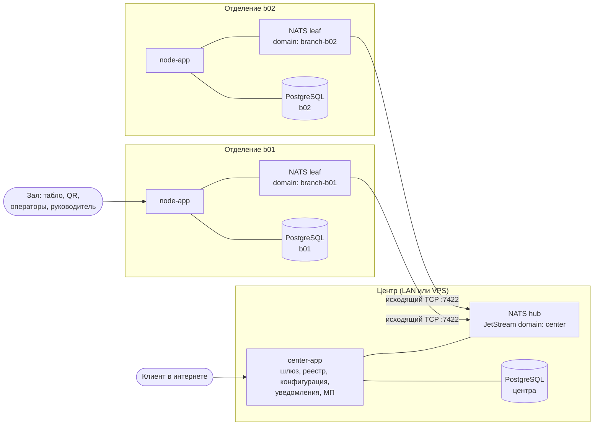
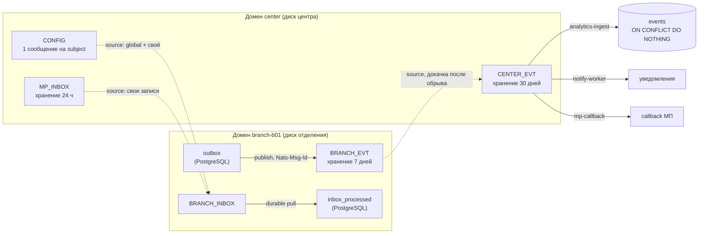

# ЕСУО: технический дизайн-документ

Электронная система управления очередью для сети почтовых отделений.

| | |
|---|---|
| Для кого | инженеры и технические члены жюри: как система устроена и почему именно так |
| Состояние | ветка `WiP/load-planning`, 2026-09-23 |
| Стек | Java 25, Spring Boot 4.1, PostgreSQL 16, NATS 2.10 (JetStream, leaf nodes), React 18 + Vite, Python 3.11 (офлайн-обучение) |
| Связанные документы | [отчёт о проделанной работе](ESUO-report.md), [`openapi/`](openapi), [`demo/results.md`](demo/results.md), [`demo/ml-report.md`](demo/ml-report.md), [`demo/run-guide.md`](demo/run-guide.md) |

Статусы в тексте: **[Реализовано]** — есть в коде и покрыто тестом или демо-сценарием; **[Компромисс]** — сознательное
упрощение в рамках хакатона, путь развития описан в разделе 15; **[Расчёт]** — архитектурная оценка, на стенде не
проверялась (раздел 3.8).

## Содержание

1. [Задача и принципы](#1-задача-и-принципы)
2. [Топология сети](#2-топология-сети)
3. [Транспорт: NATS](#3-транспорт-nats)
4. [Узел отделения](#4-узел-отделения)
5. [Доменная модель](#5-доменная-модель)
6. [Алгоритм очереди](#6-алгоритм-очереди)
7. [Ожидаемое время и его честность](#7-ожидаемое-время-и-его-честность)
8. [Прогноз длительности обслуживания](#8-прогноз-длительности-обслуживания)
9. [Планирование нагрузки и квота записи](#9-планирование-нагрузки-и-квота-записи)
10. [Центр](#10-центр)
11. [Устойчивость: матрица отказов](#11-устойчивость-матрица-отказов)
12. [Безопасность](#12-безопасность)
13. [Интерфейсы](#13-интерфейсы)
14. [Воспроизводимость и проверка](#14-воспроизводимость-и-проверка)
15. [Компромиссы и развитие](#15-компромиссы-и-развитие)
16. [Стек и российский технологический контур](#16-стек-и-российский-технологический-контур)

---

## 1. Задача и принципы

Сеть отделений принимает клиентов из трёх источников: предварительная запись (сайт центра или мобильное
приложение), талон по QR-коду в зале, живая очередь, которую регистрирует оператор. Все три источника сходятся в одну
очередь отделения. Окна вызывают клиентов, руководитель видит аналитику и нагрузку, центр видит сеть целиком.

Пять решений определяют всю архитектуру:

| # | Принцип | Следствие |
|---|---|---|
| P1 | **Отделение автономно.** Зал обслуживается без центра полностью, а не в урезанном режиме | вся доменная логика и её данные живут на узле; центр в обслуживании клиента в зале не участвует |
| P2 | **Связь инициирует отделение.** Только исходящий TCP до центра | узел за NAT, за мобильным модемом, без белого IP и без VPN подключается одинаково |
| P3 | **Состояние только в PostgreSQL.** В памяти процесса нет ничего, что нельзя потерять | рестарт узла невидим клиенту; таймеры считаются от меток времени в базе |
| P4 | **Доставка через журнал, а не через вызовы.** Всё, что уходит с узла, сначала пишется в outbox в той же транзакции | ни одно событие не теряется при обрыве, падении или рестарте; синхронизация — это догонка журнала |
| P5 | **Каждое решение объяснимо и воспроизводимо.** Выбор клиента, смена уровня нагрузки, прогноз пишутся в журнал с причинами | спор «почему вызвали не меня» разбирается по журналу; демо-прогоны дают одинаковую подпись хода событий |

---

## 2. Топология сети



**Отделение — три контейнера:** `postgres`, `nats-leaf`, `node-app`. Фронтенд (клиентский веб, табло, АРМ оператора,
кабинет руководителя, демо-пульт) собран в тот же JAR и раздаётся самим узлом — отдельного веб-сервера нет.

**Центр — три контейнера:** `nats-hub`, `center-app`, `postgres`. Плюс два демо-адаптера внешних систем
(`notify-mock` — провайдер уведомлений, `mp-simulator` — мобильное приложение), которые в продуктиве заменяются
настоящими интеграциями.

**Что отделению нужно знать о мире — три параметра:** `BRANCH_ID`, `CENTER_HOST`, пароль leaf-соединения
(`deploy/branch/.env.example`). Узел знает только адрес своего leaf; адрес центра знает только leaf.

**Что центру нужно знать об отделении заранее — ничего.** Первый heartbeat нового отделения регистрирует его в реестре,
подключает его поток событий к центральному стриму и отправляет ему конфигурацию (раздел 3.5).

Одна и та же топология запускается двумя способами без изменения кода:

| Режим | Команда | Сетевая изоляция |
|---|---|---|
| Всё на одной машине (проверка жюри) | `docker compose up -d --build` | каждое отделение в своей docker-сети; с центром связано только через сеть `wan` и TCP-прокси `link-bXX` — «кабель», который можно выдернуть |
| Несколько машин | `deploy/center/docker-compose.yml` на машине центра, `deploy/branch/docker-compose.yml` на каждом ПК отделения | реальная LAN или интернет; центру нужны открытые порты 7422 (leaf) и 8081 (API) |

---

## 3. Транспорт: NATS

### 3.1. Почему NATS

Требования к транспорту следуют из принципов P1–P4: отделение работает без связи сколько угодно, связь инициирует
отделение, события не теряются и не дублируются, центр умеет синхронно спросить отделение (например, свободные слоты
для клиента из интернета) и мгновенно понять, что оно недоступно.

| Вариант | Почему не подошёл |
|---|---|
| Прямые HTTP-вызовы центр ↔ отделение | центру нужен входящий доступ к каждому отделению (NAT, белые IP, VPN); ретраи, буферизацию и дедупликацию пришлось бы писать самим |
| Репликация БД (логическая/потоковая) | ломает автономию: общие таблицы, конфликты записи при разрыве; одна база на сеть — единая точка отказа |
| Kafka | тяжёлый брокер на каждом ПК отделения; нет встроенной модели «локальный брокер в отделении + мост к центру» |
| RabbitMQ + federation/shovel | мост настраивается на каждую пару узлов; request-reply и стримы с догонкой — разные механизмы |

NATS даёт всё нужное **одним бинарником** на отделение и одним в центре:

- **Leaf node** — локальный NATS-сервер отделения, который сам подключается к hub центра исходящим соединением и
  бесконечно переподключается (раз в секунду). Для приложения отделения leaf — это «свой» брокер: он доступен всегда,
  даже когда центра нет.
- **JetStream domains** — у каждого отделения собственный домен (`branch-b01`) с собственным файловым хранилищем.
  События отделения лежат на его диске, а не в центре.
- **Stream sources** — центральный стрим объявляет стрим отделения своим источником, и NATS сам докачивает всё
  накопленное после восстановления связи. Синхронизационного кода в приложении нет.
- **Request-reply** — синхронные вызовы центр → отделение без открытых портов на отделении; при отсутствии
  подписчика (отделение офлайн) брокер отвечает «no responders» мгновенно, без ожидания таймаута.
- **Дедупликация по `Nats-Msg-Id`** — повторная публикация одного события в окне дедупликации отбрасывается сервером.

Конфигурация — два файла на всю сеть: `infrastructure/nats/hub.conf` и `infrastructure/nats/leaf.conf`. Leaf-конфиг
один для всех отделений; различаются только переменные окружения (`LEAF_SERVER_NAME`, `JS_DOMAIN`, `LEAF_REMOTE_URL`).

### 3.2. Пространство имён

Все subjects строятся в одном месте — `shared-contracts/.../event/Subjects.java`.

| Направление | Subject | Механизм | Назначение |
|---|---|---|---|
| отделение → центр | `branch.{b}.evt.{event_type}` | JetStream, стрим `BRANCH_EVT` в домене отделения | доменные события (21 тип: жизненный цикл талона, окна, инциденты, уведомления, записи МП, применение конфигурации, модель, уровень нагрузки) |
| отделение → центр | `branch.{b}.hb` | core NATS, раз в 10 с | heartbeat: очередь, окна, лаг outbox, версии конфигурации, уровень нагрузки, каталог услуг |
| центр → отделение | `branch.{b}.rpc.{op}` | request-reply, таймаут 3 с | синхронные операции публичного API (10 операций: слоты, квота, запись, QR, статус, отмена, перенос, check-in) |
| центр → отделение | `center.config.branch.{b}` | JetStream, стрим `CONFIG` (последнее сообщение на subject) | полная конфигурация отделения |
| центр → отделение | `center.mp.inbox.branch.{b}` | JetStream, стрим `MP_INBOX` | записи из мобильного приложения |

### 3.3. Стримы и домены



- **`BRANCH_EVT`** (домен отделения) — буфер исходящих событий. Хранение 7 дней: отделение может быть отрезано от
  центра неделю, и ни одно событие не потеряется.
- **`BRANCH_INBOX`** (домен отделения) — входящие: собственные субъекты в нём не публикуются, он собирается через
  sources из `CONFIG` и `MP_INBOX` центра. Конфигурация и записи, отправленные, пока отделение было офлайн, ждут в
  центре и приходят сами после восстановления связи.
- **`CENTER_EVT`** (домен центра) — все события сети. Своих субъектов из `branch.>` у него намеренно нет: события
  приходят только через sources, иначе при живой связи каждое событие попадало бы в стрим дважды.
- Стримы создаются идемпотентно при каждом подключении (`BranchStreams`, `CenterStreams`) — ручной подготовки
  брокера нет.

### 3.4. Гарантии доставки: цепочка из четырёх звеньев

Каждое событие проходит путь от транзакции отделения до таблицы центра ровно один раз по смыслу при доставке
«как минимум один раз» на каждом шаге:

| Звено | Где | Что гарантирует |
|---|---|---|
| 1. Transactional outbox | `ticket_events` и `outbox` пишутся в той же транзакции, что и изменение талона | событие существует тогда и только тогда, когда изменение зафиксировано |
| 2. Публикация с `Nats-Msg-Id = event_id` | `OutboxWorker`: один поток (порядок), синхронный PubAck, окно дедупликации стрима 1 ч | падение между PubAck и отметкой «отправлено» не даёт дубля; без NATS outbox просто растёт |
| 3. Догонка через source | `BRANCH_EVT` → `CENTER_EVT` | после обрыва NATS сам докачивает накопленное; порядок внутри отделения сохраняется |
| 4. Идемпотентные потребители | центр: `ON CONFLICT (event_id) DO NOTHING`; отделение: `inbox_processed` по `Nats-Msg-Id` | повторная доставка ничего не меняет |

Бэкофф публикации — экспоненциальный от 500 мс до 30 с; при догонке после обрыва worker публикует пачками по 100 без
пауз, пока очередь не опустеет.

### 3.5. Подключение нового отделения без настройки центра

1. На ПК отделения: `cp deploy/branch/.env.example deploy/branch/.env`, задать `BRANCH_ID`, `CENTER_HOST`, пароль;
   `docker compose -f deploy/branch/docker-compose.yml up -d --build`.
2. Leaf подключается к hub. Узел создаёт свои стримы в своём домене.
3. Первый heartbeat `branch.{b}.hb` приходит в центр. `HeartbeatListener` вносит отделение в реестр, `CenterStreams`
   добавляет `BRANCH_EVT` этого отделения источником в `CENTER_EVT`, `ConfigPublisher` публикует ему полную
   конфигурацию (правила очереди, сотрудники, пользователи, планирование, модель).
4. Отделение применяет конфигурацию и публикует `config.applied`. Центр отмечает версию применённой.

Если какой-то шаг не удался (центр перезапускался, NATS был недоступен), фоновая сверка каждые 15 с
(`HeartbeatListener.reconcile`, `ConfigReconciler`) доводит дело до конца. Руками в центре не настраивается ничего:
ни стримы, ни маршруты, ни список отделений.

### 3.6. Масштабируемость, переносимость, лёгкость

- **Масштабирование сети = запуск ещё одной копии отделения.** Добавление отделения не меняет ни код, ни конфигурацию
  центра, ни конфигурацию других отделений. Нагрузка отделения на центр — heartbeat раз в 10 с и поток его событий.
- **Центр не на пути обслуживания.** Выдача талона, вызов, завершение, аналитика отделения выполняются локально;
  производительность отделения не зависит от числа отделений в сети.
- **Масштабирование центра** — стандартными средствами NATS: hub собирается в кластер, консюмеры центра — durable pull,
  их можно запускать в нескольких экземплярах. В рамках хакатона не делалось (раздел 15).
- **Переносимость.** Все образы — alpine (`nats:2.10-alpine`, `postgres:16-alpine`, `eclipse-temurin:25-jre-alpine`).
  Одна и та же топология работает на ноутбуке (all-in-one), в LAN и с центром на VPS: отделению всё равно, где центр,
  потому что соединение исходящее.
- **Лёгкость.** На отделении нет ничего, кроме базы, брокера-бинарника и одного JAR-приложения с встроенным
  фронтендом. Нет отдельного веб-сервера, service discovery, VPN, реплики БД, распределённого кэша.

### 3.7. Heartbeat — не только «я жив»

Heartbeat (`HeartbeatPublisher.snapshot`) несёт срез, по которому центр строит обзор сети без запросов к отделению:
открытые окна, длина очереди, просроченные талоны, самое долгое ожидание, размер и возраст outbox, центральная и
эффективная версия конфигурации, уровень нагрузки и момент входа в него, профиль дня, каталог активных услуг (для
выбора отделения клиентом на сайте центра). Отделение считается офлайн через 30 с без heartbeat.

Аномалии обзора сети (`NetworkController`): `offline`, `overdue_tickets` (больше 5 просроченных), `no_open_windows`
(очередь есть, окон нет), `outbox_lag` (старше 60 с), `wait_grows_without_tickets`, `config_pending` (опубликованная
версия не применена), `overload` (отделение в перегрузке дольше 15 минут; момент входа берётся от самого отделения,
поэтому обрыв связи не сбрасывает счёт).

### 3.8. Сеть из 40 000 отделений [Расчёт]

Этот раздел — архитектурная оценка, а не результат проверки. На стенде проверено: два отделения на одном hub,
автоматическая регистрация нового отделения, обрыв и докачка, 100 параллельных выдач талонов. Всё ниже — расчёт на
допущениях, которые названы явно.

**Допущения.** 40 000 отделений в 11 часовых поясах; в среднем 150 клиентов в день; около 7 событий на талон
(создан, вызван, обслуживается, завершён, уведомления) плюс события окон — около 1 000 событий на отделение в день;
в пиковый час — 15 % дневного потока; heartbeat — около 2 КБ.

| Величина | Расчёт | Итог |
|---|---|---|
| События сети в сутки | 40 000 × 1 000 | ≈ 40 млн (≈ 40 ГБ при ~1 КБ на событие) |
| События, средний поток | 40 млн / 86 400 с | ≈ 460 в секунду |
| События, пиковый час одного пояса | даже если все отделения в одном поясе: 40 млн × 0,15 / 3 600 с | ≈ 1 700 в секунду |
| Heartbeat | 40 000 / 10 с | 4 000 сообщений в секунду, ≈ 8 МБ/с |
| Leaf-соединений | по одному на отделение | 40 000 |

**Что меняется в топологии.** Потоки сообщений — на порядок ниже возможностей одного NATS-сервера; узкое место —
не пропускная способность, а 40 000 соединений и 40 000 источников у одного стрима. Поэтому между отделениями и
центром добавляется региональный уровень, а код отделения не меняется:

```
отделение (leaf) ──▶ региональный hub (кластер NATS, ~500 отделений) ──▶ федеральный центр (кластер NATS)
```

- **Распределение нагрузки.** Около 80 регионов по ~500 отделений. Отделению нужен только адрес регионального hub
  вместо федерального (`CENTER_HOST`). Региональный стрим собирает события своих 500 отделений через sources, как
  `CENTER_EVT` сейчас; федеральный собирает 80 региональных стримов вместо 40 000.
- **Изоляция отделений.** У каждого отделения своя база и свой домен JetStream — сбой одного не задевает других.
  Регионы разделяются аккаунтами NATS: отделение видит только свои subjects.
- **Данные.** Журнал событий центра партиционируется по дням; горячие 90 дней (≈ 3,6 ТБ) — в PostgreSQL, история —
  в колоночном хранилище для аналитики (например, ClickHouse). Heartbeat реже (30 с) и без каталога услуг, пока тот
  не изменился: ≈ 1 300 сообщений в секунду.
- **Правила.** Иерархия «сеть → регион → отделение» ложится на существующие глобальные и отделенческие
  переопределения конфигурации. Стрим `CONFIG` хранит последнее сообщение на subject: 40 000 отделений × ~20 КБ ≈ 0,8 ГБ.
  Глобальное изменение публикуется по регионам с ограничением скорости.
- **Проблемы связи.** Поведение отделения не меняется: автономия и буфер событий на 7 дней уже есть. Региональный
  hub изолирует сбой: пропала связь региона с центром — его отделения работают, записи из интернета в них получают
  понятный 503.
- **Публичный API.** `center-app` без состояния, масштабируется горизонтально за балансировщиком; запросы из
  интернета уходят в нужный регион тем же request-reply.

---

## 4. Узел отделения

### 4.1. Модули

```
java-backend/
  shared-contracts/  — конверт события, subjects, коды ошибок, RPC-ответ, DTO; общий словарь узла и центра
  node-app/
    queue/domain       — чистая логика: Ticket, QueueSelection, QueuePolicy, симулятор очереди
    queue/application  — команды (IssueTicket, CallNext, TicketCommands, WindowCommands), запросы, ETA, рекомендации
    queue/scoring      — стратегии score: uniform, heuristic
    model/             — цепочка прогноза длительности
    planning/          — прогноз нагрузки, уровни, квота записи
    persistence/       — репозитории на JdbcClient, SQL явный
    messaging/         — outbox, inbox, RPC, heartbeat, стримы
    api/               — REST, SSE, обработка ошибок (RFC 7807 Problem Details)
    security/          — JWT, роли
    demo/              — демо-часы, сброс демо-дня
  center-app/        — шлюз, реестр, конфигурация, ingest, уведомления, МП, SSE для интернета
```

Доменное ядро (`QueueSelection`, `LoadLevels`, `BookingQuota`, `ModelParams`, `LoadForecast`) — чистые функции без
базы, Spring и системного времени: всё, от чего зависит решение, передаётся аргументом. Поэтому решения
воспроизводимы по журналу и тестируются без контейнеров.

### 4.2. Хранение

Схема узла — Flyway-миграции `V1…V8`. Основные таблицы:

| Таблица | Назначение |
|---|---|
| `tickets` | талоны: статус, источник, услуга, окно, `due_at`, `eligible_from`, `seq`, версия для оптимистичной проверки |
| `ticket_events`, `window_events` | журнал доменных событий с данными решения (кандидаты, score, причина) |
| `outbox` | исходящие события до подтверждения брокером |
| `inbox_processed` | идентификаторы уже обработанных входящих сообщений |
| `idempotency_keys` | ответы на повторные запросы с тем же `Idempotency-Key` |
| `branch_config` | применённая конфигурация от центра + локальные переопределения руководителя |
| `handling_stats` | статистика длительностей по срезам (каскад прогноза) |
| `appointment_slots` | строка на слот услуги — сериализует конкурентные бронирования |
| `load_state` | уровень нагрузки и момент входа — переживает рестарт |
| `demo_clock` | якоря ускоренного времени демо-режима |

Инварианты закреплены в базе, а не только в коде:

- `ux_one_active_ticket_per_window` — у окна не больше одного талона в статусах `called`/`serving`;
- `ux_one_active_ticket_per_device` — у устройства не больше одного активного талона;
- `ux_ticket_number` — номер талона уникален в пределах услуги и дня;
- уникальный `mp_appointment_id` — запись из МП не создаёт два талона.

---

## 5. Доменная модель

**Талон.** Статусы: `booked` (запись, клиент ещё не пришёл) → `waiting` → `called` → `serving` → `done`; боковые выходы
`cancelled` и `no_show`. Источник: `appointment`, `qr`, `walkin`. Ключевые поля очереди:

- `due_at` — дедлайн: к этому моменту клиента обещано вызвать. Для QR и живой очереди `due_at = issued_at + target_wait`
  по категории клиента; для записи — от времени слота.
- `eligible_from` — с какого момента талон может быть вызван (запись — за 15 минут до слота, после check-in).
- `seq` — сквозной порядковый номер, разрешает равенство дедлайнов в пользу пришедшего раньше.
- `target_window_id` — адресное перенаправление в конкретное окно.

**Окно.** `open` → `closing` → `closed`. Окно обслуживает набор услуг (`window_services`), выбранный при открытии.

**Целевое ожидание по умолчанию** (`infrastructure/config/queue-defaults.yml`, меняется из центра без переразвёртывания):

| Источник | Обычный клиент | Пенсионер | Особая категория |
|---|---|---|---|
| QR | 20 мин | 15 мин | 10 мин |
| Живая очередь | 30 мин | 20 мин | 15 мин |

Приоритет категорий выражен дедлайном, а не отдельной очередью: пенсионер не «обгоняет всех навсегда», а получает
более ранний срок. Никто не может ждать бесконечно — у каждого есть дедлайн, и просроченные идут первыми.

---

## 6. Алгоритм очереди

### 6.1. Выбор клиента

Когда окно свободно (кнопка «Следующий» или авто-вызов), узел берёт по одному кандидату — «голову» — из каждой услуги
окна: самый ранний `due_at` среди ожидающих, у кого наступил `eligible_from` и кто не адресован другому окну. Затем
`QueueSelection.choose` применяет три правила по порядку:

1. **Просроченные вперёд.** Есть головы с `due_at ≤ now` → берётся самая ранняя из них. Score не учитывается:
   просрочка — это уже нарушенное обещание, его не оптимизируют, его исправляют.
2. **Окно терпимости (`slack`, 5 мин).** Если несколько голов «подходят к сроку» в пределах `now + slack` → берётся голова
   с наибольшим score, при равенстве — по `(due_at, seq)`.
3. **Иначе — EDF** (earliest deadline first) по `(due_at, seq)`.

**Score** задаётся стратегией из конфигурации (`scoring-strategy`):

- `uniform` — у всех 1, то есть чистый EDF;
- `heuristic` — `1 / прогноз_длительности_p50`: среди почти одновременно «созревших» окно берёт более короткую услугу и
  успевает обслужить больше людей, не нарушая ничьих сроков.

Для порядка кандидатов используется медиана (p50), а не среднее: здесь важен только порядок, а медиана — точечный
прогноз с минимальной абсолютной ошибкой.

**Почему score ограничен окном `slack`.** Правило «самая короткая работа вперёд» без дедлайнов снижает среднее
ожидание, но отодвигает длинные услуги в хвост. Сквозная симуляция самого нагруженного дня истории с потоком на 30 %
выше плана (`python-ai-service`, `benchmark.run_branch`, режимы `slack` и `sjf`, зерно 42):

| Правило | Ожидание ср., мин | p90, мин |
|---|---|---|
| EDF + score в slack (принято) | 128,3 | 219,3 |
| SJF без дедлайнов | 87,6 | 264,5 |

Хвост вырастает в полтора раза. Гарантия «каждого вызовут не позже дедлайна, а просроченных — первыми» для
государственного сервиса важнее среднего, поэтому выбран EDF с ограниченной оптимизацией. Это сознательный размен.

`UniformVsHeuristicTest` проверяет оба свойства: в сценарии «две головы в пределах slack: посылка 600 с и письмо 60 с»
среднее ожидание падает с 300 с до 30 с; долгая услуга среди потока быстрых вызывается ровно по дедлайну и не голодает.

### 6.2. Двойное назначение невозможно — четыре линии защиты

`CallNext` выполняется в одной транзакции:

1. **Блокировка строки окна** (`SELECT … FOR UPDATE`) — два параллельных «Следующий» из одного окна
   сериализуются; второй получает `WINDOW_BUSY`.
2. **Головы очереди — `FOR UPDATE SKIP LOCKED`.** Два окна с общей услугой не ждут друг друга и не берут одного
   клиента: заблокированную соседом голову второе окно пропускает и берёт следующую.
3. **Версионированный UPDATE** талона — изменение применяется только к той версии, которую прочитали.
4. **Уникальный индекс** `ux_one_active_ticket_per_window` — последний рубеж на уровне базы.

`ConcurrentCallNextIT`: два окна с общей услугой, 40 талонов, несколько потоков на окно стартуют одновременно в каждом
раунде. Проверяется, что ни один талон не вызван дважды (по журналу), в большинстве раундов оба окна действительно
получили клиента одновременно, у окна не больше одного активного талона.

### 6.3. Спорные ситуации

| Ситуация | Поведение |
|---|---|
| Клиент не подошёл на вызов | повторный вызов через 90 с, после 2 повторов — `no_show`; таймер считается от `called_at` в базе, поэтому переживает рестарт |
| Оператор закрывает окно с клиентом у стойки | `graceful`: окно в `closing`, клиента дообслуживают, новых не берут, затем `closed`. `force`: клиент возвращается в очередь с сохранением места |
| Перенаправление | в другое окно (адресно, `target_window_id`) или на другую услугу; перенаправленный берётся принимающим окном первым |
| Возврат в очередь | `keep_position` (по умолчанию, место сохраняется) или `to_tail` |
| Клиент просит отложить | один раз, не более чем на 30 минут |
| Опоздание на запись | до 10 минут — без потери приоритета; дальше — `convert_to_qr` (в общую очередь) или `reject`, по конфигурации |
| Оператор регистрирует клиента без талона | walk-in с опцией «вызвать сразу» — талон создаётся и назначается окну в одной транзакции |

### 6.4. Журнал решения

Событие `ticket.called` несёт: причину (`overdue_edf` / `score_in_slack` / `edf` / `call_now`), стратегию, версию модели
и **всех кандидатов** с их дедлайнами, score, прогнозом длительности, основанием прогноза и числом наблюдений. По
журналу любое решение воспроизводится той же чистой функцией. Демо-пульт показывает этот журнал человеческим языком.

### 6.5. Конфигурация без переразвёртывания

Все коэффициенты очереди (≈30 параметров, `queue-defaults.yml`) — это секция центральной конфигурации. Центр
валидирует изменение, присваивает сетевую версию и публикует. Отделение применяет её на лету; версия конфигурации
штампуется в каждый талон, поэтому видно, по каким правилам он обслуживался. Руководитель отделения может
переопределить часть параметров локально в заданных центром границах.

---

## 7. Ожидаемое время и его честность

`WaitTimeEstimator` считает позицию и ожидаемое время вызова (ETA) не делением «место × среднее», а прогоном очереди
вперёд тем же симулятором, что и выбор клиента (`QueueSimulation`): учитываются открытые окна и их наборы услуг,
остаток текущих обслуживаний, `eligible_from` записей, адресные перенаправления.

- ETA — это **сумма** длительностей всех впереди, поэтому здесь берётся среднее, а не медиана (для лог-нормального
  распределения сумма медиан систематически занижает обещание).
- Уверенность: `high` (модель знает сотрудника, категорию и час), `medium` (достаточно статистики по услуге), `low`,
  `none`.
- **Нет открытого окна для услуги → ETA не выдумывается**: ожидание `null`, уверенность `none`, клиент видит честное
  «окно для этой услуги сейчас не открыто».
- При модели клиент видит интервал: «вызов около 10:42 (10:38–10:50)» — p50–p90.

Уведомление о приближении очереди уходит, когда клиент на позиции ≤ 3 или ETA ≤ 5 минут.

---

## 8. Прогноз длительности обслуживания

### 8.1. Зачем

Прогноз длительности — вход сразу для трёх механизмов: ETA клиента (раздел 7), score стратегии `heuristic`
(раздел 6.1) и, главное, **расчёт нужного числа окон** по часам (раздел 9). Последнее даёт основной эффект.

### 8.2. Цепочка с откатом

`ChainedDurationModel` отвечает на вопрос «сколько займёт обслуживание этого клиента у этого сотрудника в этот час»:

```
коэффициенты ML-модели  →  каскад handling_stats  →  константа default-service-duration-sec (300 с)
```

- **ML-модель** — лог-линейная модель со сжатием:
  `log d = μ + a[услуга] + b[услуга, категория] + e[сотрудник] + g[сотрудник, услуга] + h[час]`;
  каждая поправка умножается на `n / (n + k)`, поэтому группа с малым числом наблюдений тянется к среднему.
  Даёт p50, среднее и p90.
- **Каскад `handling_stats`** — средние по срезам от самого узкого к широкому: сотрудник+услуга+категория →
  услуга+категория → услуга → запасное значение; уровень используется, если в нём не меньше 5 наблюдений.
- **Константа** — пока нет ни модели, ни статистики.

Каждый прогноз помечен основанием (`basis`) и числом наблюдений — это пишется в журнал вызова.

### 8.3. Обучение вне отделения

Обучение (`python-ai-service`, только стандартная библиотека Python) выполняется офлайн. Результат — секция `model`
центральной конфигурации, которая едет в отделение тем же путём, что и правила очереди: `CONFIG` → `BRANCH_INBOX` →
`branch_config`. Отделение применяет готовые коэффициенты (`ModelParams` — Java-двойник `predict.py`; тест сверяет их на
общем эталонном файле) и публикует `model.trained`.

Следствия:

- отделение **не зависит от доступности ML** вообще — коэффициенты лежат в его базе;
- выключение модели (`enabled: false`) — не откат, а штатный режим каскада; включается и выключается без рестарта,
  для сети целиком или для одного отделения;
- новая версия модели проходит приёмку (`esuo-ml fit` возвращает код 1, если версия хуже базовой линии).

### 8.4. Эффект

Замер — сквозная симуляция дня на синтетическом мире с известными истинными параметрами (зерно 42, 6 недель истории,
отложенная выборка; [`docs/demo/ml-report.md`](demo/ml-report.md), воспроизводится
`uv run esuo-ml report --end-day 2026-09-20`). Сравнивается прогноз
**ML-модель + каскад** против работы без прогноза (`uniform`, 300 с на любую услугу). По прогнозу строится план окон на
день, день проигрывается с этим планом, меряется фактическое ожидание:

| День | Ошибка плана окон: без прогноза → ML + каскад | Ожидание ср., мин | Ожидание p90, мин | Просроченных талонов |
|---|---|---|---|---|
| Обычный | −21 % → 0 % | 109,4 → **3,3** | 200,0 → **13,6** | 85 → **2** |
| Пенсионные выплаты | −38 % → +3 % | 94,4 → **3,9** | 170,0 → **11,7** | 142 → **0** |
| Пенсионные, поток +30 % к плану | −45 % → −4 % | 75,3 → **15,3** | 187,6 → **30,3** | 139 → **65** |
| Выходной | −21 % → 0 % | 2,8 → **1,9** | 7,0 → **5,9** | 0 → 0 |

Точность самого прогноза на отложенной выборке:

| Показатель | Без прогноза | ML + каскад |
|---|---|---|
| Средняя ошибка длительности (MAE): константа 300 с / среднее по услуге | 176,7 с / 140,5 с | **112,6 с** (−36 % / −20 %) |
| Ошибка обещанного клиенту времени вызова (пенсионный день) | 57,0 мин | **9,3 мин** |
| Отставание от теоретического предела (оракул, знающий истинные параметры: 112,8 с) | +57 % | **в пределах шума** |
| Доля фактов в пределах обещанного p90 | — | **0,89** (цель 0,85–0,95) |

Механизм эффекта важно называть точно: прогноз не ускоряет обслуживание, он **правильно считает, сколько окон нужно в
каждый час**. Без прогноза отделение недооценивает потребность на 21–45 % (300 с — это «выдать посылку», а в
пенсионный день половина потока — финансы и пенсионеры), недобор смены превращается в очередь. Решение открыть окно
остаётся за руководителем — система подсказывает его заранее (раздел 9.4).

Модель также восстанавливает истинные параметры мира: множители скорости сотрудников — с ошибкой не больше 0,016,
множители категорий — не больше 0,08. Эти числа руководитель видит как понятные фразы: «Козлов Д. обслуживает в 1,37
раза дольше среднего», «пенсионер на финансовых услугах — в 1,51 раза дольше».

**То же на живом стенде** (`./scripts/demo/run.sh pension-ab`, отчёт `docs/demo/jury/ab-report.md`). Два отделения
получают одну и ту же трассу пенсионного дня с потоком на 30 % выше плана; b01 работает без модели и истории
(300 с на всё), b02 — с историей и моделью. Руководитель каждого ставит смену по прогнозу своего отделения:

| 08:50–12:30, демо-часы ×60 | b01, без прогноза | b02, с прогнозом |
|---|---:|---:|
| Окно-часов в смене | 12 | 19 |
| Среднее ожидание, мин | 31,6 | **14,7** |
| Максимальное ожидание, мин | 97,6 | **42,0** |
| Очередь к 12:30 | 72 | **16** |
| Запись из мобильного приложения на 10:00 | принята в перегруженный час | **`BOOKING_LIMITED`**: запись закрыта заранее |

Перегружены обе ноды — пять окон физически не вытягивают поток +30 %; разница в том, что b02 поставило в смену всех
с утра и не приняло лишнюю запись.

---

## 9. Планирование нагрузки и квота записи

### 9.1. Профиль дня

Секция `planning` центральной конфигурации (`infrastructure/config/planning-defaults.json`) задаёт профили дня:

| Профиль | Множитель потока | Часы | Особенность |
|---|---|---|---|
| `normal` | ×1,0 | 09–18 | пики в 12–13 и 17 |
| `weekend` | ×0,85 | 10–16 | больше посылок |
| `pension` | ×1,8 | 09–18 | 45 % пенсионеров, 40 % финансовых услуг, пик с открытия |
| `closed` | — | — | отделение не работает |

Профиль на дату выбирается календарём (даты выплат публикует центр), затем картой дней недели; руководитель может
вручную выбрать профиль на сегодня.

### 9.2. Прогноз и мощность

Мощность часа считается в **минутах окна**: `работа(h) = поток(h) × E[длительность]`,
`нужно_окон(h) = ⌈работа(h) / (60 × utilization_target)⌉`, целевая загрузка 0,85. Прогноз строится на весь день по часам
с учётом уже принятых записей. Текущее состояние: фактический поток за последние 30 минут, время до опустошения очереди,
отношение работы к мощности открытых окон.

### 9.3. Уровни нагрузки с гистерезисом

| Уровень | Условие (любое) |
|---|---|
| `normal` | — |
| `high` | очередь не разберётся за 15 мин, или поток > 0,85 мощности |
| `overload` | очередь не разберётся за 30 мин, или поток > 1,1 мощности |

Подъём — после 2 минут устойчивого превышения. Спуск — только когда показатели опустились ниже 80 % порога
**текущего** уровня и держатся там 10 минут. Асимметрия нужна потому, что уровень управляет записью: уровень, который
переключается на каждом клиенте, открывал бы и закрывал запись несколько раз в минуту. Логика — чистая функция
`LoadLevels.next`; состояние хранится в `load_state` и переживает рестарт.

Каждая смена уровня — событие `load.level_changed` с числами и причинами: `flow_above_forecast`, `slow_service`,
`few_windows`, `booking_peak`, `overdue_backlog`. Через час можно разобрать, почему запись была закрыта и было ли это
правильно.

### 9.4. Рычаги

1. **Квота записи** — доля слотов часа, открытых для новой записи: `normal` 100 %, `high` 50 %, `overload` 0 %.
   `BookingQuota.allowed = ⌊60 / длина_слота × ёмкость_слота × квота⌋`. Уже принятые записи **никогда не отзываются** —
   отказ получают только новые (`BOOKING_LIMITED`). Проверка одна для сайта центра, прямой записи на узле и
   мобильного приложения. Клиент заранее видит закрытые часы (`GET /public/booking-limits`).
2. **Рекомендация открыть окно** — руководителю, с названием услуги и закрытыми окнами, которые могут её обслужить.
   Причины: прогноз требует больше окон, чем открыто (срабатывает **до** роста очереди); ETA вылезает за дедлайн
   больше чем на 10 минут; больше 5 просроченных; нет открытого окна для ожидающих. Окна система сама не открывает —
   это решение человека.
3. **Предупреждение для живой очереди** с уровня `high`.

Тесты: `LoadLevelsTest`, `LoadForecastTest`, `LoadCausesTest`, `PlanningConfigTest`, `BookingQuotaTest`,
`BookingQuotaIT`, `LoadPlanningIT`.

---

## 10. Центр

Центр **не хранит очередей** и не участвует в обслуживании клиента в зале. Его обязанности:

| Функция | Реализация |
|---|---|
| Публичный шлюз для интернета | HTTP → NATS request-reply к отделению (`BranchRpcClient`); заголовки `X-Deadline`, `Idempotency-Key`, `X-Request-Id` передаются в отделение; нет подписчика → мгновенный `503 BRANCH_UNAVAILABLE` |
| Живой статус талона для клиента из интернета | SSE: снимок по RPC `ticket.get`, обновления — подписка на `branch.*.evt.ticket.>`, талон опознаётся по `token_hash`; при недоступности отделения — событие `branch_unavailable`, после восстановления — свежий снимок |
| Реестр сети и обзор | heartbeat → `branches`; `/network` с аномалиями (раздел 3.7) |
| Центральная конфигурация | глобальная + переопределения отделения, deep merge, валидация, сетевая версия на каждое изменение, журнал версий; публикация после коммита, сверка до `config.applied` |
| Хранилище событий сети | `analytics-ingest`: durable pull из `CENTER_EVT` в `events`, дедуп по `event_id`, после рестарта центра чтение продолжается с позиции консюмера |
| Уведомления | `notify-worker`: `max_deliver` 6, бэкофф 1–2–5–15–30 с, circuit breaker (Resilience4j: порог 50 % на окне 10 вызовов, 30 с в OPEN), исчерпанные попытки / 4xx / истёкший TTL → DLQ; ручной и массовый повтор из DLQ |
| Мобильное приложение | вебхук с HMAC-подписью и окном ±5 мин; идемпотентность по `mp_appointment_id` (то же тело → 202 с текущим статусом, другое → 422); запись ждёт в `MP_INBOX`, если отделение офлайн; результат — callback со ссылкой на статус, с ретраями и DLQ |

### 10.1. Внешние системы и интеграционный слой

Реальные внешние системы в MVP заменены демонстрационными адаптерами. Очередь о них не знает: отделение пишет
событие в свой журнал, а доставкой во внешнюю систему занимается центр. Замена адаптера — это смена URL или реализации
порта (`NotificationGateway`) в центре, без изменения логики очереди.

| Внешняя система | Направление | Демо-адаптер | Протокол | Таймауты и отказы |
|---|---|---|---|---|
| Провайдер уведомлений (SMS, push, e-mail) | центр → провайдер | `notify-mock` (`tools/notify-mock`, режимы отказа через `/chaos`) | HTTP POST | соединение 2 с, запрос 5 с, TTL уведомления 15 мин; до 6 попыток с бэкоффом, circuit breaker, DLQ с ручным повтором |
| Мобильное приложение Почты | МП → центр (запись), центр → МП (результат) | `mp-simulator` (`tools/mp-simulator`) | HTTPS, HMAC-подпись, окно ±5 мин | идемпотентность по `mp_appointment_id`; запись ждёт в `MP_INBOX`, пока отделение офлайн; callback — таймаут 5 с, до 10 попыток с бэкоффом, DLQ |
| Клиент в интернете | браузер → центр → отделение | — | HTTP → NATS request-reply | 3 с на ответ отделения; офлайн-отделение — мгновенный `503 BRANCH_UNAVAILABLE` |

Повторная доставка безопасна на каждом шаге: события дедуплицируются по `event_id`, записи — по `mp_appointment_id`,
команды клиента — по `Idempotency-Key`.

---

## 11. Устойчивость: матрица отказов

| Отказ | Что продолжает работать | Что деградирует | Как восстанавливается | Доказательство |
|---|---|---|---|---|
| Обрыв связи отделение ↔ центр | весь зал: QR, вызов, завершение, табло, аналитика отделения, планирование нагрузки | запись из интернета в это отделение — понятный 503; центр показывает «нет связи» | leaf переподключается за ~1 с, события докачиваются через source (буфер 7 дней), конфигурация и записи МП приходят из `BRANCH_INBOX` | демо `link-cut` (10/10), `BranchInboxIT` |
| Рестарт узла | — | окно в пару секунд без API | всё состояние в PostgreSQL; таймеры повторного вызова и неявки считаются от `called_at`; outbox досылается | `RestartRecoveryIT` |
| Отказ провайдера уведомлений | обслуживание полностью | уведомления копятся | breaker OPEN → HALF_OPEN → CLOSED автоматически; DLQ повторяется вручную | `NotificationOutageIT`, демо `notify-down` (8/8) |
| Недоступен NATS на отделении | весь зал | события не уходят | outbox растёт в PostgreSQL и досылается пачками | `AbstractNodeIT` запускает узел без NATS намеренно |
| Рестарт центра | все отделения | обзор сети и шлюз на время рестарта | durable-консюмеры продолжают с позиции; сверка реестра и конфигурации каждые 15 с | — |
| Конкурентный поток запросов | — | — | идемпотентность по ключу, уникальные индексы, `SKIP LOCKED`, строка слота для записи | `ConcurrentIssueIT`, `ConcurrentCallNextIT` |
| ML недоступен или модель плохая | всё | ETA без интервала | каскад → константа; версия модели проходит приёмку | `DurationModelChainIT` |

**Идемпотентность внешних команд.** Выдача талона и запись требуют `Idempotency-Key`: повтор с тем же ключом
возвращает исходный ответ. `ConcurrentIssueIT`: 20 параллельных запросов с одним ключом → один талон; 20 запросов
одного устройства с разными ключами → один активный талон; 100 параллельных выдач → уникальные номера, ни одной
потери. Клиентский веб держит ключ до успешного ответа: повторная отправка формы после сбоя сети не создаёт второй талон.

**Резервная копия.** `scripts/backup/dump.sh` / `restore.sh` — ручной дамп баз. **[Компромисс]**: без WAL-архивирования и
реплики (раздел 15).

---

## 12. Безопасность

- **Роли узла:** `OPERATOR`, `BRANCH_ADMIN` (включает оператора). JWT; `/api/v1/admin/**` и actuator — только
  руководитель; публичный API (`/api/v1/public/**`) — без входа. Пользователи и хеши паролей приходят из центра
  конфигурацией; в журнале и API центра хеши вырезаются.
- **Секрет клиента не покидает отделение.** Ссылка на талон содержит `public_token`; в событиях вместо него —
  `token_hash`. Конструктор конверта события отвергает `public_token` в данных — утечка невозможна по построению.
- **Центр закрыт по умолчанию.** Без входа доступен только явный список: шлюз клиента (информация, слоты, запись, QR,
  статус талона и его поток — секретом служит сам токен талона), вебхук МП (своя HMAC-подпись), вход, health и
  документация API. Всё остальное под `/api/**` и `/actuator/**` — только с JWT роли `NETWORK_ADMIN` (`iss=esuo-center`,
  токен ноды центр не принимает). Учётная запись оператора сети — из `.env` (`CENTER_ADMIN_LOGIN`,
  `CENTER_ADMIN_PASSWORD`); без пароля закрытый API недоступен никому. Тест `EndpointCoverageIT` проверяет, что каждый
  обработчик API либо в публичном списке, либо отвечает 401.
- **Leaf-соединения** аутентифицируются логином и паролем; поддерживаются индивидуальные логины отделений.
- **Мобильное приложение** — HMAC-подпись вебхука и callback, окно по времени против повторов.
- Все секреты — только из `.env`; compose отказывается стартовать без `DB_PASSWORD`, `JWT_SECRET`, `LEAF_PASSWORD`,
  `MP_WEBHOOK_SECRET`. Порты баз и брокера на all-in-one стенде слушают только `127.0.0.1`.
- Ошибки — RFC 7807 Problem Details со стабильным машиночитаемым `code` и `X-Request-Id` для сквозной
  трассировки через NATS.

---

## 13. Интерфейсы

Один мультистраничный фронтенд (React 18, TypeScript, Vite), собирается в образ бэкенда и раздаётся узлом и центром.

| Экран | Где | Для кого | Что делает |
|---|---|---|---|
| Клиент | узел `/`, центр `/` | посетитель | выбор отделения и услуги, запись на слот, талон по QR, живой статус и ETA-интервал, отмена, перенос, check-in; при обрыве сети переподключается и дотягивает состояние |
| Табло | узел `/board` | зал | вызванные талоны и окна, звуковое объявление, QR для входа в очередь |
| АРМ оператора | узел `/operator` | оператор | окно и услуги, «Следующий», начать/завершить, вернуть, перенаправить, неявка, walk-in, инцидент; источник талона бейджем |
| Кабинет руководителя | узел `/admin` | руководитель отделения | очередь, аналитика (по источникам, услугам, окнам, отклонения), нагрузка по часам с уровнем и причинами, рекомендации, справочники, конфигурация, инциденты, карточка модели |
| Обзор сети | центр `/network` | оператор сети | отделения онлайн/офлайн, аномалии, конфигурация и версии, уведомления и DLQ |
| Демо-пульт | узел `/demo` | показ | журнал решений человеческим языком, демо-часы, связь с центром, сброс демо-дня |

На всех экранах есть переключатель «крупный шрифт и высокий контраст» для слабовидящих и тёмная тема. Специального
терминала не нужно: клиенту достаточно браузера, оператору — ноутбука.

REST API описан OpenAPI (`docs/openapi/node.yaml`, `center.yaml`, Swagger UI на каждом сервисе). Поля — snake_case.

---

## 14. Воспроизводимость и проверка

- **Запуск одной командой:** `cp .env.example .env && docker compose up -d --build` поднимает центр и два отделения;
  фронтенд собирается внутри образа.
- **Автотесты:** 341 тест узла и 126 тестов центра, 0 падений (`./mvnw -pl node-app -am test`,
  `./mvnw -pl center-app -am test`). Интеграционные — на Testcontainers с настоящим PostgreSQL; в тестах узла NATS
  намеренно отсутствует, чтобы проверять автономию. Модель длительности — 42 теста
  (`uv run pytest`), включая восстановление заложенных параметров мира и сверку с Java-двойником.
- **Демо-сценарии** (`scripts/demo`, 9 штук): не тесты, а проигрыш рабочего дня на стенде с проверками по ходу. Трасса
  клиентов детерминирована зерном; ход событий хешируется в «подпись». Три прогона подряд дают одинаковую подпись
  (`docs/demo/jury/repeatability.md`). Последние прогоны восьми сценариев — 71 проверка из 71; `pension-ab` — 6 из 6
  проверок сравнения (`docs/demo/results.md`).
- **Проверка стенда перед показом:** `./scripts/demo/run.sh doctor` — инструменты, `.env`, центр, обе ноды, демо-часы,
  входы, симуляторы, данные A/B.
- **Наблюдаемость:** структурированные логи в формате ECS (JSON) на узле и в центре, `/actuator/health` с деталями
  (база, NATS), сквозной `X-Request-Id`.
- **Демо-часы** (`DEMO_MODE=true`): ускоренное время узла ×60 / ×180, чтобы за минуту прожить час и увидеть просрочки,
  уровень нагрузки и рекомендации. Вне демо-режима часы системные.
- **Отчёт модели** пересобирается одной командой и воспроизводим по зерну.

---

## 15. Компромиссы и развитие

| Сделано так | Почему | Путь развития |
|---|---|---|
| Одна PostgreSQL на отделение без реплики и WAL-архива | хакатон; автономия важнее отказоустойчивости железа | потоковая реплика на втором ПК отделения, WAL-архив в объектное хранилище |
| NATS hub центра — один сервер | достаточно для стенда | кластер NATS из 3 узлов; leaf-соединение NATS штатно принимает список адресов hub |
| Демо-адаптеры уведомлений и МП | внешних систем на хакатоне нет | порт `NotificationGateway` уже выделен — подключается реальный SMS/push-шлюз |
| Обучение модели по синтетике | реальной истории нет | `esuo-ml fit --from history.csv` принимает выгрузку реальной истории; иерархия «сеть → регион → отделение» ложится на существующие global/branch-переопределения |
| Окна открывает человек, система только рекомендует | ответственность за смену — у руководителя | автоматический вызов резервного сотрудника по уровню `overload` |
| Одна учётная запись оператора сети из `.env`, без ограничения частоты попыток входа | достаточно для стенда | пользователи центра в БД, роли «наблюдатель» и «администратор», ограничение попыток входа |

---

## 16. Стек и российский технологический контур

Все компоненты — открытое ПО без обязательных зарубежных облачных сервисов; у ключевых есть российские сборки или
аналоги. Оценка команды, а не юридическое заключение.

| Компонент | Лицензия | В российском контуре |
|---|---|---|
| Java 25 (OpenJDK) | GPLv2 + Classpath Exception | российские сборки OpenJDK (например, Axiom JDK) |
| Spring Boot 4 | Apache 2.0 | открытый код, работает на любой сборке OpenJDK |
| PostgreSQL 16 | PostgreSQL License | совместимые российские дистрибутивы (например, Postgres Pro) |
| NATS 2.10 | Apache 2.0 | открытый код, один бинарник без внешних зависимостей |
| React 18, TypeScript, Vite | MIT, Apache 2.0 | сборка в статику внутри JAR; работает в Yandex Browser и Chromium |
| Python 3.11, только стандартная библиотека | PSF | обучение модели без сторонних пакетов |
| Docker Compose | Apache 2.0 | образы на alpine; пересобираются на базовых образах российских ОС (Astra Linux, РЕД ОС, ALT) |
