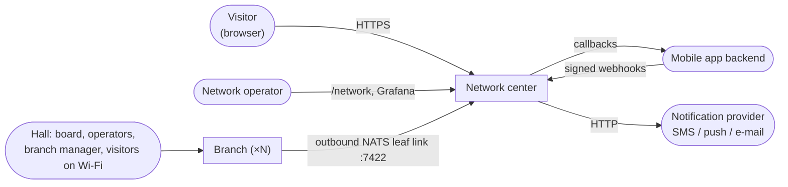
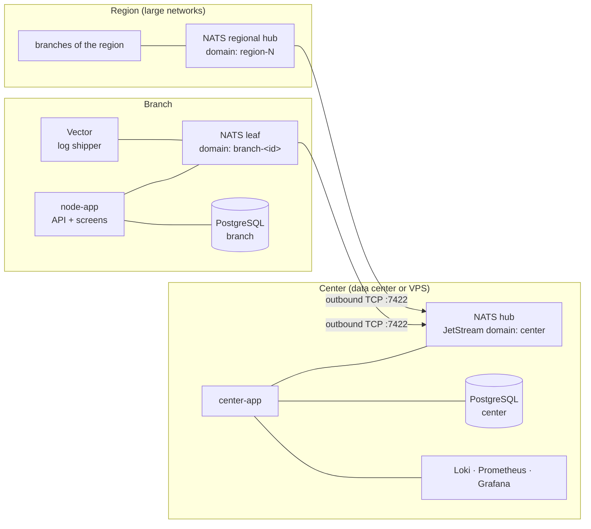
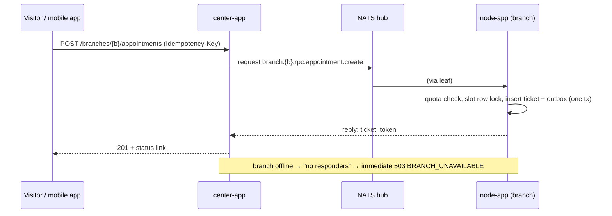

# ESUO — High-Level Design

| | |
|---|---|
| Status | Current |
| Scope | Whole system: branch nodes, network center, transport, observability, deployment |
| Related | [Low-Level Design](lld.md), [OpenAPI specs](../openapi), [Deployment guide](../../deploy/README.md) |

## 1. Overview

ESUO is a queue management system for a network of post offices ("branches"). A visitor gets into a branch's queue
from one of three sources:

- **Appointment** — booked in advance on the center's website or through the mobile app;
- **QR ticket** — taken in the hall by scanning the QR code on the board;
- **Walk-in** — registered by an operator at a service window.

All three sources merge into one queue per branch. Operators call visitors to windows, the branch manager sees
analytics and expected load, and the network operator sees every branch's queue and the health of its hardware.

Besides running the queue, a branch **plans its load**: a service-duration model predicts how much work each hour
will bring, the branch recommends how many windows to staff, closes booking for hours it cannot serve and shows
visitors an honest wait estimate.

### 1.1. Goals

- A branch serves visitors with no dependency on the center or the WAN link.
- No event, booking or important log line is lost because of a link outage, a crash or a restart.
- Adding a branch requires no configuration at the center.
- One center serves a network of up to ~250 000 branches.
- Every queue decision can be explained and replayed from the journal.

### 1.2. Non-goals

- Staffing decisions are not automated: the system recommends opening a window, a person decides.
- The branch database is not replicated (see [Trade-offs](#10-trade-offs-and-evolution)).
- The center is not a system of record for queues: it never serves a visitor in the hall.

## 2. Architectural principles

| # | Principle | Consequence |
|---|---|---|
| P1 | **A branch is autonomous.** The hall works fully without the center, not in a degraded mode. | All queue logic and its data live on the branch node; the center is not on the serving path. |
| P2 | **The branch initiates every connection.** Only outbound TCP to the center. | Branches behind NAT, on a mobile modem, without a public IP or VPN connect the same way. |
| P3 | **State lives only in PostgreSQL.** Nothing in process memory is precious. | A node restart is invisible to visitors; timers are computed from timestamps in the database. |
| P4 | **Delivery through a log, not through calls.** Everything that leaves a node is first written to a journal on the branch disk. | Synchronisation is catching up on a journal; nothing is lost during an outage. |
| P5 | **Every decision is explainable and reproducible.** Ticket selection, load-level changes and forecasts are journaled with their inputs. | "Why was I not called?" is answered from the journal; demo runs are deterministic. |

## 3. System context

| Actor / system | Interaction |
|---|---|
| Visitor | Books, takes a QR ticket and follows the ticket status, via the center (internet) or the branch node (hall Wi-Fi). |
| Operator | Works a service window from the operator screen on the branch node. |
| Branch manager | Queue, analytics, load plan, reference data and local configuration on the branch node. |
| Network operator | Network overview, central configuration, notifications, diagnostics on the center; dashboards in Grafana. |
| Mobile app backend | Sends bookings as HMAC-signed webhooks; receives the outcome as a callback. |
| Notification provider | Receives notification requests (ticket approaching, called, etc.) over HTTP. |

## 4. Containers

### 4.1. Branch

| Container | Responsibility |
|---|---|
| `node-app` | Spring Boot application: queue domain, REST API, SSE streams, transactional outbox, load planning, duration model. Serves every hall screen (client, board, operator, manager, demo console) from the same JAR — there is no separate web server. |
| `postgres` | All branch state: tickets, journals, outbox/inbox, configuration, statistics. |
| `nats-leaf` | Local NATS server with its own JetStream domain. Always reachable by the node, connects out to the center's hub and reconnects forever. |
| `vector` | Ships WARN/ERROR and lifecycle log lines of `node-app` into the branch's log stream. Optional (monitoring profile). |

A branch needs to know three things about the world: its `BRANCH_ID`, the center's host, and its leaf credentials.
The node itself only knows its local leaf.

### 4.2. Center

| Container | Responsibility |
|---|---|
| `center-app` | Public gateway for internet visitors (HTTP → NATS request-reply to the branch), branch registry, network overview, central configuration, event store, notification delivery, mobile-app integration, branch monitoring. |
| `postgres-center` | Registry, configuration and its versions, network events, metrics history, alerts, diagnostics, notification and mobile-app state. |
| `nats-hub` | Hub of the NATS topology. Accepts leaf connections from branches and regional hubs; holds the center's streams. |
| Observability | Loki (branch and center logs), Prometheus (metrics of the center, the hub and the center DB), Grafana (dashboards), exporters, the center's log shipper. |

The center needs to know nothing about a branch in advance: the first heartbeat registers it.

### 4.3. Regional tier

For large networks, branches connect to a **regional hub** (one NATS server per region with its own JetStream
domain) instead of directly to the center. The center then subscribes to one event stream per region instead of one
per branch. The regional hub uses the same outbound link and credentials model as a branch.

## 5. Key flows

### 5.1. Serving a visitor in the hall

Everything happens on the branch node. A QR ticket, a walk-in or a checked-in appointment becomes a `waiting` ticket
with a deadline (`due_at`) derived from the visitor category and the source. When a window calls the next visitor, the
node picks among the heads of the queues of the window's services: overdue tickets first, then — within a short
tolerance window — the one with the best score (shortest predicted service), otherwise earliest deadline first.
The decision and all candidates are journaled. The board, the operator screen and the visitor's phone are updated over
SSE.

### 5.2. Booking from the internet or the mobile app

Mobile-app bookings arrive as signed webhooks; if the branch is offline they wait in a center stream and are applied
when the branch reconnects, and the result goes back to the mobile app as a callback.

### 5.3. Events from branch to center

Each state change is written to the branch's outbox in the same transaction. A single worker publishes it to the
branch's event stream with a deduplication id. The center's event stream declares every branch (or region) stream as
a source, so NATS itself copies everything accumulated during an outage once the link is back. The center's consumers
are idempotent on `event_id`.

### 5.4. Configuration from center to branch

The network operator edits the global configuration or a branch override. The center validates it, assigns a network
version and publishes the full configuration of each affected branch to a last-value-per-subject stream. Branches
pull it through their inbox stream (so a branch that was offline gets the latest version on reconnect), apply it
without a restart and report `config.applied`. A background reconciler re-publishes until every branch has applied
its current version.

### 5.5. Onboarding a new branch

1. Install the branch stack with `BRANCH_ID`, the center host and leaf credentials.
2. The leaf connects to the hub; the node creates its streams in its own domain.
3. The first heartbeat reaches the center. The center registers the branch, attaches its event and log streams as
   sources, and publishes its configuration.
4. The branch applies the configuration and reports the applied version.

Nothing is configured by hand at the center — no list of branches, no routes, no streams.

## 6. Data ownership

| Data | Owner | Copies |
|---|---|---|
| Tickets, queue, windows, journals | Branch DB | Events in the center DB (append-only, for analytics) |
| Branch configuration | Center DB (global + per-branch override, versioned) | Applied copy in the branch DB, plus local manager overrides within center-defined bounds |
| Users and password hashes of a branch | Center DB | Delivered with the configuration |
| Duration model coefficients | Center configuration (`model` section) | Branch DB |
| Branch metrics history | Center DB (`branch_metrics`, 48 h) | — |
| Branch logs | Branch disk (file, 7 days) | Important lines in Loki; full logs only on request |
| Visitor ticket token | Branch only | Only its hash leaves the branch |

## 7. Quality attributes

### 7.1. Availability and resilience

- **Link outage:** the hall keeps working (tickets, calls, board, analytics, load planning). Internet bookings for
  that branch get an immediate, explicit `503 BRANCH_UNAVAILABLE`. The hall QR switches to the local node address.
  Events and important logs are buffered on the branch for 7 days and delivered on reconnect.
- **Node crash or restart:** all state is in PostgreSQL; timers resume from stored timestamps; the outbox is drained.
- **Branch DB stall:** the heartbeat keeps flowing from its own thread, so the center reports "queue data is not
  updating" rather than "offline".
- **Center restart:** branches are unaffected; durable consumers resume from their position; reconciliation runs every
  15 s.
- **Notification provider outage:** circuit breaker, retries with backoff, dead-letter queue with manual retry.
- **Loki outage:** log lines wait in the center's log stream.
- **Memory isolation:** every auxiliary container has a memory limit; JVM heaps are bounded and the JVM exits on OOM
  so Docker restarts it.

### 7.2. Scalability

- Adding a branch is starting another branch stack; nothing else changes.
- Branch performance does not depend on network size — the center is not on the serving path.
- The center is designed for ~250 000 branches on a single node: regional hubs, batched heartbeat ingest, monitoring
  rules evaluated in SQL, and no API or screen whose response grows with the size of the network (lists are paged).
- The NATS hub is not the bottleneck; the center application and its PostgreSQL writes are. The scaling path is in
  [section 10](#10-trade-offs-and-evolution).

### 7.3. Security

- Branch roles: `OPERATOR`, `BRANCH_ADMIN`; JWT. Public visitor endpoints need no login; the ticket token is the secret.
- The center is closed by default: an explicit allow-list of public endpoints; everything else under `/api/**` and
  `/actuator/**` requires the `NETWORK_ADMIN` role. A test asserts that every endpoint is either allow-listed or
  returns 401.
- Leaf connections authenticate with credentials (shared or per-branch accounts).
- Mobile-app webhooks and callbacks are HMAC-signed with a ±5 min replay window.
- Hall QR codes are HMAC-signed and rotate every 2 minutes; printed stickers are revoked by bumping a key version.
- Grafana reads the center DB with a read-only role limited to three monitoring tables.
- Secrets come only from environment files; the stacks refuse to start without them.

### 7.4. Observability

The center sees not only each branch's queue but the health of its PC and application — without SSH and without a
separate monitoring agent. Everything travels over the same NATS link as the events:

| Channel | What | Transport | Retention |
|---|---|---|---|
| Metrics | `sys` block in every heartbeat (CPU, memory, DB pool, disk, API latency, link RTT, errors) | heartbeat every 10 s | `branch_metrics`, 48 h |
| Important logs | WARN, ERROR, lifecycle events | file → Vector → branch stream → center stream → Loki | 7 days |
| Full logs | Any level for a time range | on request, via RPC | 7 days |
| Diagnostic snapshot | JVM threads, DB activity and locks, pool, outbox, NATS, config, disk | on request, via RPC | 30 days |

Monitoring rules (CPU, slow API, DB pool saturation, disk, unstable link, clock drift, restarts) are evaluated by the
center every 15 s and surface as anomalies in the network overview. The center itself exports Prometheus metrics.

## 8. Deployment view

| Environment | Composition | Defined in |
|---|---|---|
| Production — center | center-app, PostgreSQL, NATS hub; observability stack | `deploy/center` |
| Production — branch | node-app, PostgreSQL, NATS leaf, log shipper; one stack per branch PC | `deploy/branch` |
| Load test | Four regional hubs and `swarm-sim`, a process that simulates up to hundreds of thousands of branches | `deploy/loadtest` |
| Staging | Center, two branches, load-test regions and the scenario console on one host behind a reverse proxy | `deploy/staging` |
| Local development | Center, two isolated branches, integration mocks, optional observability/load-test/demo profiles | `compose.yaml` |

Network requirements: the center exposes `7422/tcp` (leaf connections) and HTTPS for the API through a reverse
proxy. A branch needs outbound TCP to the center's `7422` and exposes the node's HTTP port on the branch LAN only.

## 9. Technology stack

| Area | Choice | Why |
|---|---|---|
| Backend | Java 25, Spring Boot 4 | Mature ecosystem, virtual threads, Testcontainers. |
| Storage | PostgreSQL 16 | Transactions, row locks with `SKIP LOCKED`, partial unique indexes for invariants, partitioning. |
| Transport | NATS 2.15 with JetStream, leaf nodes, domains | Local broker per branch, outbound-only links, stream sourcing for catch-up, request-reply with instant "no responders", server-side deduplication — one binary per site. |
| Frontend | React 18, TypeScript, Vite | One multi-page build embedded into the backend JARs. |
| Model training | Python 3.11, standard library only | Offline, reproducible, no native dependencies. |
| Observability | Vector, Loki, Prometheus, Grafana | Open source, small footprint on the branch side. |
| Packaging | Docker Compose, Alpine-based images | Same topology on a laptop, a LAN and a VPS. |

Transport alternatives considered: direct HTTP between center and branches (requires inbound access to every branch,
hand-written retries and buffering), database replication (breaks autonomy, single point of failure), Kafka (heavy
broker per branch, no local-broker-plus-bridge model), RabbitMQ federation (per-pair bridges; request-reply and
replayable streams are separate mechanisms).

## 10. Trade-offs and evolution

| Decision | Rationale | Cost / next step |
|---|---|---|
| Single PostgreSQL per branch, no replica or WAL archive | Autonomy matters more than hardware fault tolerance at a branch | Streaming replica on a second PC, WAL archive to object storage |
| Integration adapters for notifications and the mobile app are behind ports | Real providers differ per deployment | Plug in a real SMS/push gateway by implementing `NotificationGateway` |
| Duration model trained offline | Training needs network-wide history and is not latency-sensitive | Scheduled training from exported history; network → region → branch hierarchy on top of existing config overrides |
| Windows are opened by people; the system only recommends | Staffing is the manager's responsibility | Automatic call of a reserve employee at the `overload` level |
| A single network-operator account from the environment | Sufficient for a single operations team | Center users in the DB, viewer/admin roles, login rate limiting |
| Branch metrics in the center's PostgreSQL rather than Prometheus | No extra component on the branch path; overview, rules and Grafana read one table | 15-minute partitions or TimescaleDB as the hot partition index grows |
| 60 s metrics resolution behind regional hubs | An order of magnitude less write load | Queue figures of those branches are up to a minute old |
| Network snapshot rebuilt every 1–5 s | Hundreds of thousands of branches are evaluated once, not per request | Counters and filters are up to 5 s old (cards are always fresh) |
| Single Loki instance | Sufficient for current volume | Loki simple-scalable mode with S3-compatible storage |
