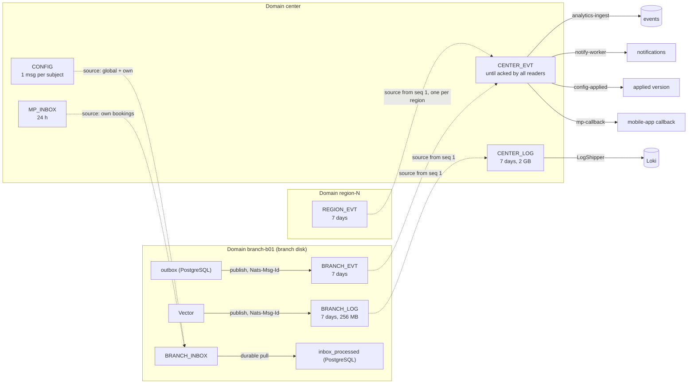

# ESUO — Low-Level Design

| | |
|---|---|
| Status | Current |
| Scope | Modules, messaging contracts, data model, algorithms, center internals, monitoring, configuration |
| Related | [High-Level Design](hld.md), [OpenAPI specs](../openapi) |

## Contents

1. [Code layout](#1-code-layout)
2. [Messaging](#2-messaging)
3. [Delivery guarantees](#3-delivery-guarantees)
4. [Branch node](#4-branch-node)
5. [Queue domain](#5-queue-domain)
6. [Wait-time estimate](#6-wait-time-estimate)
7. [Service-duration model](#7-service-duration-model)
8. [Load planning and booking quota](#8-load-planning-and-booking-quota)
9. [Center](#9-center)
10. [Monitoring and diagnostics](#10-monitoring-and-diagnostics)
11. [Security](#11-security)
12. [User interfaces and API](#12-user-interfaces-and-api)
13. [Configuration reference](#13-configuration-reference)
14. [Failure handling](#14-failure-handling)
15. [Testing](#15-testing)

---

## 1. Code layout

```
java-backend/
  shared-contracts/   event envelope, NATS subjects, error codes, RPC reply, DTOs — shared by node and center
  node-app/
    queue/domain       pure logic: Ticket, QueueSelection, QueuePolicy, queue simulator
    queue/application  commands (IssueTicket, CallNext, TicketCommands, WindowCommands), queries, ETA, recommendations
    queue/scoring      score strategies: uniform, heuristic
    model/             duration forecast chain
    planning/          load forecast, load levels, booking quota
    persistence/       repositories on JdbcClient, explicit SQL
    messaging/         outbox, inbox, RPC handlers, heartbeat, stream setup, leaf link monitor
    monitoring/        sys metrics, log file and lifecycle events, log pull, diagnostic snapshot
    api/               REST, SSE, QR, error handling (RFC 7807)
    security/          JWT, roles
    demo/              demo clock, demo-day reset, scenario-console proxy
  center-app/          gateway, registry, heartbeat ingest, configuration, event ingest, notifications,
                       mobile-app integration, monitoring, network overview
  swarm-sim/           simulator of many branches for load-testing the center
frontend/              one multi-page React build: client, board, operator, admin, network, demo
python-ai-service/     offline training of the duration model, synthetic data, scenario traces
tools/                 notify-mock, mp-simulator, demo-runner, load-generator
infrastructure/        NATS, Loki, Prometheus, Grafana, Vector configs; queue/planning/monitoring defaults
```

The domain core (`QueueSelection`, `LoadLevels`, `BookingQuota`, `ModelParams`, `LoadForecast`) consists of pure
functions with no database, Spring or system clock: every input is an argument. Decisions are therefore reproducible
from the journal and unit-testable without containers.

---

## 2. Messaging

### 2.1. Topology and configuration

- **Leaf node** — the branch's local NATS server, connected out to the hub, reconnecting every second. For the node it
  is always-available local infrastructure.
- **JetStream domains** — each branch has its own domain (`branch-<id>`) with file storage on the branch disk; the
  center has domain `center`; each regional hub has `region-N`.
- **Stream sources** — a center stream lists branch/region streams as sources; NATS copies messages across domains and
  catches up after a link outage.
- **Request-reply** — synchronous calls from the center to a branch without inbound ports; with no subscriber the
  server answers "no responders" immediately.
- **Deduplication** — `Nats-Msg-Id` within the stream's dedup window.

Three config files serve the whole network: `infrastructure/nats/hub.conf`, `leaf.conf`, `region.conf`. Instances
differ only by environment (`LEAF_SERVER_NAME`, `JS_DOMAIN`, `LEAF_REMOTE_URL`).

### 2.2. Subjects

All subjects are built in `shared-contracts/.../event/Subjects.java`.

| Direction | Subject | Mechanism | Purpose |
|---|---|---|---|
| branch → center | `branch.{b}.evt.{type}` | JetStream, `BRANCH_EVT` (or `REGION_EVT`) | Domain events: ticket lifecycle, windows, incidents, notifications, mobile-app bookings, config applied, model, load level |
| branch → center | `branch.{b}.hb` | core NATS, every 10 s | Heartbeat: queue, windows, outbox lag, config versions, load level, service catalogue, `sys` metrics |
| branch → center | `branch.{b}.log.{level}` | JetStream, `BRANCH_LOG` | Important log lines |
| center → branch | `branch.{b}.rpc.{op}` | request-reply, 3 s timeout | Public-API operations and diagnostics (below) |
| center → branch | `center.config.global`, `center.config.branch.{b}` | JetStream, `CONFIG` (last value per subject) | Full branch configuration |
| center → branch | `center.mp.inbox.branch.{b}` | JetStream, `MP_INBOX` | Mobile-app bookings |
| center | `center.log.pull.{b}` | JetStream, `CENTER_LOG` | Full logs pulled on request |

RPC operations: `info`, `slots.list`, `appointment.create`, `qr.issue`, `ticket.get`, `ticket.by_mp`,
`ticket.cancel`, `ticket.postpone`, `ticket.checkin`, plus the booking-limit query; diagnostics `diag.logs` and
`diag.snapshot`. Replies use `RpcReply` with an RFC 7807 problem on error.

Event types (`EventTypes.java`): `ticket.created|checked_in|called|recalled|serving|completed|requeued|redirected|
postponed|cancelled|no_show`, `window.opened|closing|closed`, `incident.created`, `notification.requested`,
`mp.appointment.confirmed|rejected`, `config.applied`, `model.trained`, `load.level_changed`. Every event travels in an
`EventEnvelope` with `event_id`, branch, aggregate, sequence, actor and payload.

### 2.3. Streams



| Stream | Domain | Contents | Retention |
|---|---|---|---|
| `BRANCH_EVT` | branch | Outgoing events | 7 days — a branch may be cut off for a week without losing events |
| `BRANCH_LOG` | branch | Important log lines | 7 days, 256 MB |
| `BRANCH_INBOX` | branch | Configuration and bookings, sourced from `CONFIG` and `MP_INBOX` | — |
| `REGION_EVT` | region | Events of all branches of the region (`branch.*.evt.>`) | 7 days |
| `CENTER_EVT` | center | All network events, sources only | Until acknowledged by all four consumers; 30 days for anything no one reads |
| `CENTER_LOG` | center | Branch logs and pulled logs | 7 days, 2 GB |
| `CONFIG` | center | Full config per branch | Last message per subject |
| `MP_INBOX` | center | Mobile-app bookings | 24 h |

Details that matter:

- `CENTER_EVT` has no subjects of its own from `branch.>`; events enter only via sources, otherwise with a live link
  every event would be stored twice. It is a delivery buffer, not an archive — the archive is the `events` table.
  The `analytics-ingest` consumer is created together with the stream, before any source is attached.
- **Every source starts at sequence 1** (`opt_start_seq = 1`). Otherwise NATS starts a new source at the time of the
  last message of the receiving stream if it has already deleted messages — and `CENTER_EVT` deletes everything
  delivered — so a region or branch attached later would lose its backlog. Re-reads are dropped by the DB on
  `event_id`; an attached source keeps its position.
- A **source stream recreated** (branch PC reinstalled, regional storage lost) is detected by NATS in ~20 s and read
  from the start.
- A **recreated `CENTER_EVT`** (hub volume lost) gets all sources again: the center clears its "attached" marks and
  re-attaches every branch and region.
- Streams are created and reconciled idempotently on every connect (`BranchStreams`, `CenterStreams`); the broker
  needs no manual preparation.

### 2.4. Regional tier

- The heartbeat of a branch behind a regional hub carries `events_via: "region-N"`. The center attaches that
  region's `REGION_EVT` to `CENTER_EVT` once (`CenterStreams.attachRegion`) instead of one source per branch.
- Subject filters on a partial token (`branch.s1-*.evt.>`) are not allowed in NATS, so `REGION_EVT` captures
  `branch.*.evt.>` and the regional hub refuses other regions' events from the hub
  (`deny_imports: ["branch.*.evt.>"]` in `region.conf`). Heartbeats, configuration and RPC flow as usual.
- For these branches the center stores heartbeat content and metrics at 60 s resolution
  (`METRICS_RESOLUTION_REGIONAL`); presence is still updated on every heartbeat.

---

## 3. Delivery guarantees

An event travels from a branch transaction to the center table effectively once, with at-least-once delivery on every
hop:

| Link | Where | Guarantee |
|---|---|---|
| 1. Transactional outbox | `ticket_events` and `outbox` are written in the same transaction as the ticket change | The event exists if and only if the change is committed |
| 2. Publish with `Nats-Msg-Id = event_id` | `OutboxWorker`: single thread (ordering), synchronous PubAck, 1 h dedup window | A crash between PubAck and marking "sent" produces no duplicate; without NATS the outbox simply grows |
| 3. Catch-up through sources | `BRANCH_EVT` / `REGION_EVT` → `CENTER_EVT`, from seq 1 | NATS copies the backlog after an outage; per-branch order is preserved |
| 4. Idempotent consumers | center: `ON CONFLICT (event_id) DO NOTHING`; branch: `inbox_processed` by `Nats-Msg-Id` | Redelivery changes nothing |

Publishing backs off exponentially from 500 ms to 30 s; during catch-up the worker publishes batches of 100 without
pauses until the outbox is empty.

Important logs follow the same chain: file → Vector (file position advances only after PubAck; the line hash is the
`Nats-Msg-Id`) → `BRANCH_LOG` → source → `CENTER_LOG` → Loki (acknowledged after Loki's 2xx).

---

## 4. Branch node

### 4.1. Storage

Schema: Flyway migrations `node-app/src/main/resources/db/migration`.

| Table | Purpose |
|---|---|
| `tickets` | Status, source, service, window, `due_at`, `eligible_from`, `seq`, version for optimistic checks |
| `ticket_events`, `window_events` | Journal of domain events with decision data (candidates, scores, reason) |
| `outbox` | Outgoing events until acknowledged by the broker |
| `inbox_processed` | Ids of processed inbound messages |
| `idempotency_keys` | Stored responses for repeated `Idempotency-Key` requests |
| `branch_config` | Configuration applied from the center plus local manager overrides |
| `handling_stats` | Duration statistics by slice (fallback cascade) |
| `appointment_slots` | One row per service slot; serialises concurrent bookings |
| `load_state` | Load level and entry time; survives restarts |
| `demo_clock` | Anchors of the accelerated demo clock |

Invariants enforced by the database:

- `ux_one_active_ticket_per_window` — at most one ticket `called`/`serving` per window;
- `ux_one_active_ticket_per_device` — at most one active ticket per visitor device;
- `ux_ticket_number` — ticket numbers unique per service and day;
- unique `mp_appointment_id` — a mobile-app booking never creates two tickets.

### 4.2. Heartbeat

`HeartbeatPublisher.snapshot` sends every 10 s: open windows, queue length, overdue tickets, longest wait, outbox size
and age, central and effective config versions, load level and its entry time, day profile, active service catalogue
(for branch selection on the center's site), `sys` metrics, and `events_via` behind a regional hub.

The heartbeat runs on its own thread. Its DB part waits at most 3 s; if it does not answer, the heartbeat still goes
out with the last known queue figures, fresh `sys` metrics and `db_ok=false`. A branch is considered offline after
30 s without a heartbeat.

### 4.3. Hall QR code

| `QR_MODE` | Target | When |
|---|---|---|
| `center` | Join page on the center (`QR_PUBLIC_BASE_URL`) | Visitors have mobile internet |
| `local` | Join page on the node (`QR_LOCAL_BASE_URL` or the board's origin) | Branch Wi-Fi only |
| `auto` (default) | The center while the leaf is linked to the hub, otherwise the node | — |

`LeafLinkMonitor` polls the leaf's `/leafz` every 5 s; in `auto` mode the board switches within seconds of a link
change. The API returns the final `join_url`; the board does not build it.

With `QR_SECRET` set, codes are HMAC-SHA256-signed:

- board code `q1.{branch}.{slot}.{sig}` — the slot changes every 2 minutes and a code is accepted in its slot and the
  next, so a photo of the board stops working within two rotations;
- sticker code `q1.{branch}.k{version}.{sig}` — long-lived; all printed stickers are revoked by incrementing
  `QR_STICKER_KEY_VERSION`; the printable sticker is in the manager's screen;
- slots follow real time, not the demo clock; the static code `demo:{branch}` is accepted only with demo data.

### 4.4. Logging

ECS JSON to a file, rotated at 20 MB, 7 days, 500 MB max, uncompressed (the shipper and log pull read rotated files
as is). Lifecycle events (`event.kind=lifecycle`) are shipped regardless of level: `app.started`, `app.stopping`,
`config.applied`, `leaf.linked` / `leaf.unlinked`, broker connection changes, `db.stuck` / `db.answering`,
`error.unhandled`. A crash shows up as `app.started` without a preceding `app.stopping`.

---

## 5. Queue domain

### 5.1. Entities

**Ticket.** `booked` (appointment, visitor not yet arrived) → `waiting` → `called` → `serving` → `done`; side exits
`cancelled` and `no_show`. Source: `appointment`, `qr`, `walkin`.

- `due_at` — the deadline by which the visitor is promised to be called. For QR and walk-in:
  `issued_at + target_wait(category, source)`; for appointments, derived from the slot time.
- `eligible_from` — earliest call time (appointments: 15 minutes before the slot, after check-in).
- `seq` — monotonically increasing; breaks deadline ties in favour of whoever came first.
- `target_window_id` — addressed redirect to a specific window.

**Window.** `open` → `closing` → `closed`; serves the set of services chosen when it was opened.

Default target waits (`infrastructure/config/queue-defaults.yml`, changeable from the center):

| Source | Default | Pensioner | Priority category |
|---|---|---|---|
| QR | 20 min | 15 min | 10 min |
| Walk-in | 30 min | 20 min | 15 min |

Category priority is expressed as an earlier deadline, not a separate queue: no one can wait forever, and overdue
tickets go first.

### 5.2. Selecting the next visitor

When a window is free, the node takes one head per service of the window — the earliest `due_at` among waiting
tickets whose `eligible_from` has passed and that are not addressed to another window. `QueueSelection.choose` then
applies, in order:

1. **Overdue first.** If any head has `due_at ≤ now`, the earliest of them wins. Score is ignored.
2. **Tolerance window (`slack`, 5 min).** If several heads are due within `now + slack`, the highest score wins; ties
   by `(due_at, seq)`.
3. **Otherwise EDF** — earliest deadline first by `(due_at, seq)`.

Score strategies (`scoring-strategy`):

- `uniform` — 1 for everyone, i.e. pure EDF;
- `heuristic` — `1 / predicted_duration_p50`: among heads due at about the same time the window takes the shorter
  service and serves more people without breaking anyone's deadline.

The median is used because only the order matters here. Score is confined to the slack window on purpose:
shortest-job-first without deadlines lowers the mean wait but pushes long services to an unbounded tail. The
guarantee "everyone is called by their deadline, overdue first" is more important for a public service than the mean.

### 5.3. No double assignment

`CallNext` runs in one transaction with four layers:

1. `SELECT … FOR UPDATE` on the window row — two concurrent "Next" from one window serialise; the second gets
   `WINDOW_BUSY`.
2. Queue heads are read `FOR UPDATE SKIP LOCKED` — two windows sharing a service never wait for each other and never
   take the same visitor.
3. Versioned `UPDATE` of the ticket.
4. Unique index `ux_one_active_ticket_per_window`.

### 5.4. Edge cases

| Situation | Behaviour |
|---|---|
| Visitor does not come to the window | Recall after 90 s; after 2 recalls — `no_show`. Timer counts from `called_at` in the DB, so it survives restarts. |
| Operator closes a window with a visitor at the desk | `graceful`: window goes `closing`, the current visitor is served, no new ones, then `closed`. `force`: the visitor returns to the queue keeping their place. |
| Redirect | To another window (`target_window_id`) or another service; the receiving window takes a redirected ticket first. |
| Requeue | `keep_position` (default) or `to_tail`. |
| Visitor asks to postpone | Once, up to 30 minutes. |
| Late for an appointment | Up to 10 minutes without losing priority; then `convert_to_qr` or `reject`, per configuration. |
| Visitor without a ticket at the desk | Walk-in with "call now": ticket created and assigned to the window in one transaction. |

### 5.5. Decision journal

`ticket.called` carries the reason (`overdue_edf` / `score_in_slack` / `edf` / `call_now`), the strategy, the model
version and **all candidates** with their deadlines, scores, predicted durations, prediction basis and sample counts.
Any decision can be replayed by the same pure function.

### 5.6. Configuration without redeploys

All queue parameters (~30, `queue-defaults.yml`) are a section of the central configuration. The center validates a
change, assigns a network version and publishes it; the branch applies it on the fly. The config version is stamped
into every ticket. A branch manager may override some parameters locally within bounds set by the center.

---

## 6. Wait-time estimate

`WaitTimeEstimator` computes position and estimated call time by running the queue forward with the same simulator
used for selection (`QueueSimulation`): open windows and their service sets, remaining time of current services,
`eligible_from` of appointments, addressed redirects.

- The ETA is a **sum** of durations, so the mean is used, not the median (a sum of medians systematically
  under-promises for a log-normal distribution).
- Confidence: `high` (the model knows the employee, category and hour), `medium` (enough per-service statistics),
  `low`, `none`.
- No open window for the service → no invented ETA: wait is `null`, confidence `none`, and the visitor sees that no
  window for the service is open.
- With the model the visitor sees an interval, p50–p90.

An "approaching" notification is sent at position ≤ 3 or ETA ≤ 5 minutes.

---

## 7. Service-duration model

### 7.1. Fallback chain

`ChainedDurationModel` answers "how long will this visitor take with this employee at this hour":

```
model coefficients  →  handling_stats cascade  →  default-service-duration-sec (300 s)
```

- **Model** — log-linear with shrinkage:
  `log d = μ + a[service] + b[service, category] + e[employee] + g[employee, service] + h[hour]`; each term is
  multiplied by `n / (n + k)` so sparse groups are pulled toward the mean. Produces p50, mean and p90.
- **`handling_stats` cascade** — averages from the narrowest slice to the widest: employee+service+category →
  service+category → service → fallback; a level is used with ≥ 5 observations.
- **Constant** — when there is neither a model nor statistics.

Every prediction is tagged with its `basis` and sample count; both go into the call journal.

### 7.2. Training and delivery

Training (`python-ai-service`, standard library only) is offline. The output is the `model` section of the central
configuration and travels like any other section: `CONFIG` → `BRANCH_INBOX` → `branch_config`. The node applies the
coefficients (`ModelParams` is the Java twin of `predict.py`; a shared fixture test keeps them identical) and
publishes `model.trained`.

- The branch never depends on ML availability — coefficients are in its database.
- `enabled: false` is not a rollback but the normal cascade mode; toggled without restart, network-wide or per branch.
- A new model version must pass acceptance: `esuo-ml fit` exits with 1 if it is worse than the baseline.

The main use of the forecast is not ordering but **capacity planning**: computing how many windows each hour needs.

---

## 8. Load planning and booking quota

### 8.1. Day profiles

The `planning` section (`infrastructure/config/planning-defaults.json`) defines day profiles:

| Profile | Flow multiplier | Hours | Notes |
|---|---|---|---|
| `normal` | ×1.0 | 09–18 | Peaks at 12–13 and 17 |
| `weekend` | ×0.85 | 10–16 | More parcels |
| `pension` | ×1.8 | 09–18 | 45 % pensioners, 40 % financial services, peak from opening |
| `closed` | — | — | Branch closed |

The profile for a date comes from the calendar (payout dates published by the center), then from the weekday map; the
manager can override today's profile.

### 8.2. Forecast and capacity

Capacity is measured in **window-minutes**: `work(h) = flow(h) × E[duration]`,
`windows_needed(h) = ⌈work(h) / (60 × utilization_target)⌉` with a target utilisation of 0.85. The forecast covers the
whole day and includes already accepted appointments. Current state: actual flow over the last 30 minutes, time to
drain the queue, ratio of work to the capacity of open windows.

### 8.3. Load levels with hysteresis

| Level | Condition (any) |
|---|---|
| `normal` | — |
| `high` | Queue will not drain within 15 min, or flow > 0.85 × capacity |
| `overload` | Queue will not drain within 30 min, or flow > 1.1 × capacity |

Escalation after 2 minutes of sustained excess; de-escalation only when the figures stay below 80 % of the
**current** level's threshold for 10 minutes. The asymmetry exists because the level drives booking: a level that
flips on every visitor would open and close booking several times a minute. `LoadLevels.next` is a pure function;
the state is stored in `load_state`.

Every change emits `load.level_changed` with figures and causes: `flow_above_forecast`, `slow_service`, `few_windows`,
`booking_peak`, `overdue_backlog`.

### 8.4. Levers

1. **Booking quota** — share of an hour's slots open for new bookings: `normal` 100 %, `high` 50 %, `overload` 0 %.
   `allowed = ⌊60 / slot_length × slot_capacity × quota⌋`. Accepted bookings are **never** revoked; only new ones get
   `BOOKING_LIMITED`. One check for the center's site, direct booking on the node and the mobile app. Visitors see
   closed hours in advance (`GET /public/booking-limits`).
2. **Open-window recommendation** to the manager, naming the service and the closed windows that can serve it.
   Triggers: forecast needs more windows than are open (fires **before** the queue grows); ETA exceeds deadlines by
   more than 10 minutes; more than 5 overdue; no open window for waiting visitors.
3. **Walk-in warning** from level `high`.

---

## 9. Center

The center keeps no queues and takes no part in serving visitors in the hall.

| Function | Implementation |
|---|---|
| Public gateway | HTTP → NATS request-reply (`BranchRpcClient`); `X-Deadline`, `Idempotency-Key`, `X-Request-Id` are forwarded; no subscriber → immediate `503 BRANCH_UNAVAILABLE`; branch list paged with search |
| Live ticket status | SSE: snapshot via RPC `ticket.get`, updates from `branch.*.evt.ticket.>` matched by `token_hash`; `branch_unavailable` event on outage, fresh snapshot on recovery |
| Registry | Batched heartbeat ingest, onboarding of new branches |
| Network overview | Snapshot, summary, regions, paged search, branch card |
| Central configuration | Global + per-branch override, deep merge, validation, a network version per change, version log; publish after commit, reconcile until `config.applied` |
| Event store | `analytics-ingest`: durable pull from `CENTER_EVT` into `events` |
| Notifications | `notify-worker`: `max_deliver` 6, backoff 1–2–5–15–30 s, circuit breaker (Resilience4j: 50 % over a window of 10 calls, 30 s open); exhausted / 4xx / expired TTL → DLQ; manual and bulk retry |
| Mobile app | HMAC webhook with ±5 min window; idempotent on `mp_appointment_id` (same body → 202 with current status, different body → 422); booking waits in `MP_INBOX` while the branch is offline; outcome via callback with retries and DLQ |
| Monitoring | Metrics history, rules, logs to Loki, log pull and diagnostic snapshots, Prometheus metrics of the center |

### 9.1. External integrations

Queue logic does not know about external systems: the branch writes an event, the center delivers it. Replacing an
adapter is a URL change or a new implementation of a port (`NotificationGateway`).

| System | Direction | Protocol | Timeouts and failures |
|---|---|---|---|
| Notification provider | center → provider | HTTP POST | connect 2 s, request 5 s, notification TTL 15 min; up to 6 attempts, circuit breaker, DLQ |
| Mobile app backend | app → center (booking), center → app (outcome) | HTTPS, HMAC signature, ±5 min window | idempotent on `mp_appointment_id`; callback timeout 5 s, up to 10 attempts, DLQ |
| Visitor | browser → center → branch | HTTP → NATS request-reply | 3 s per branch reply; offline branch → immediate 503 |

For development and staging, `tools/notify-mock` and `tools/mp-simulator` stand in for the provider and the app.

### 9.2. Onboarding

`HeartbeatListener` queues an unknown branch for registration. `BranchOnboarding` drains the queue on its own thread
in batches of up to 1000: one insert into the registry, attach `BRANCH_EVT`/`BRANCH_LOG` as sources of
`CENTER_EVT`/`CENTER_LOG` (or the region's `REGION_EVT` once per region), publish the full configuration via
`ConfigPublisher`. Background reconciliation every 15 s (`HeartbeatListener.reconcile`, `ConfigReconciler`) finishes
anything that failed; branches still waiting in the registration queue are left alone, so each gets exactly one
first configuration.

### 9.3. Heartbeat ingest

The NATS thread never blocks: a known branch's heartbeat goes into `HeartbeatBuffer` (latest per branch), an unknown
one into the registration queue. Every 5 s `HeartbeatFlush` writes the buffer:

1. **Presence first.** The whole batch is marked in the narrow table `branch_seen` (id, time). Presence does not wait
   for heavy writes and does not fail with them. "Last heard" = `GREATEST(branches.last_heartbeat_at,
   branch_seen.seen_at)`.
2. **Content and history.** Heartbeat JSON into `branches` and a history row into `branch_metrics`, in chunks of
   5 000 per transaction; a failed chunk goes back into the buffer unless a newer heartbeat replaced it.
3. **Content resolution.** 10 s for direct branches, 60 s behind a regional hub; each branch has its own phase within
   the period so the swarm is not written in one flush.

The narrow table exists because the heartbeat JSON is below the TOAST threshold and lives inline in `branches`:
updating one timestamp there would copy the whole row.

`branch_metrics` has typed numeric columns, **hourly partitions** with a default partition, whole-hour `DROP` after
48 h, and a size cap `METRICS_MAX_SIZE` beyond which the oldest hours are dropped early.

The center's PostgreSQL is tuned for this write pattern: `shared_buffers` (`CENTER_DB_SHARED_BUFFERS`), WAL up to
4 GB, checkpoint every 15 min, `wal_compression`, unthrottled autovacuum.

### 9.4. Event ingest

`analytics-ingest` pulls up to 500 events from `CENTER_EVT` and writes them with one multi-row
`INSERT … ON CONFLICT (event_id) DO NOTHING`, acknowledging after commit. A DB error redelivers the whole batch; an
unparseable event is terminated and does not block the batch.

### 9.5. Network overview

No overview response and no `/network` page grows with the network size: the home page shows aggregates, lists are
paged by 24.

- **Network snapshot** (`NetworkSnapshot`) — who is online, anomalies and their severity per branch, totals per
  network and region. Built on demand with a cursor (the network never sits in memory as one list), by one thread for
  all readers, at most every `clamp(3 × build_time, 1 s, 5 s)`; with no readers there is no load. Branch cards are
  read fresh from the DB for the branches shown.
- **API** (private): `/network/summary`, `/network/regions/{r}`, `/network/branches?q&status&region&anomaly`,
  `/network/branches/{id}`, `/network/center`; `/network/overview` returns all cards only for networks up to
  1 000 branches, otherwise `422 NETWORK_TOO_LARGE`.
- **Public** `/api/v1/branches?q&offset&limit` → `{total, offset, limit, items}` — branch selection for visitors.
- **Configuration** `/api/v1/config?q&region&offset&limit` — global sections and a page of branches.

Overview anomalies (`NetworkAnomalies`): `offline`, `overdue_tickets` (> 5), `no_open_windows` (queue but no
windows), `outbox_lag` (> 60 s), `wait_grows_without_tickets`, `config_pending`, `overload` (> 15 min; the entry time
comes from the branch so an outage does not reset it), `db_unavailable`, and fired monitoring rules `sys.*`.

---

## 10. Monitoring and diagnostics

### 10.1. Metrics

The `sys` block of the heartbeat (~600 bytes): process and system CPU, load average, heap, GC pauses, DB pool (busy /
waiting / max), DB size, free disk, request count, rps, p95 and 5xx share of the node's own API (`/api/` only,
without SSE and static files), SSE clients, link state and RTT, broker reconnects, ERROR/WARN count, uptime and
version, wall-clock time (drift against the center). An unavailable source means a missing field, not a failed
heartbeat.

History: `branch_metrics`; API `GET /api/v1/branches/{b}/metrics?from&to`. Grafana reads it with role `grafana_ro`
(`SELECT` on `branches`, `branch_metrics`, `branch_alerts` only).

### 10.2. Rules

`infrastructure/config/monitoring-rules.yml`, changeable without a rebuild; evaluated every 15 s.

| Rule | Condition | Severity |
|---|---|---|
| `sys.cpu` | CPU > 90 % for 5 min | warning |
| `sys.slow_api` | p95 > 1500 ms for 3 min | warning |
| `sys.db_pool` | Requests wait for a connection for 2 min | warning |
| `sys.disk` | Free < 10 % | critical |
| `sys.link` | > 5 reconnects per hour | warning |
| `sys.clock` | Drift > 60 s for 2 min | warning |
| `sys.restart` | Uptime decreased (30 min window) | info |

Four rule kinds — threshold, ratio, increase, restart — compile at startup into **one SQL query** (`RuleQuery`);
history is never loaded into the center's memory, only fired rules come back:

- **threshold** — cheap pre-filter without sorting (latest value, whether it holds, any bad points), then an exact
  continuity check for candidates only;
- **increase** — first and last point of the window via index; **restart** — by start time on the node's own clock
  (±5 s), not by delivery delay, so a lagging center does not invent restarts;
- **freshness** — a branch silent for longer than `max(2 min, 3 × metrics step)` cannot hold a threshold.

Results go to `branch_alerts`, written as arrays under an advisory lock; only changed rows are rewritten, and an
ongoing alert keeps its start time. With `DEMO_MODE=true` rule durations are scaled by 0.1.

### 10.3. Logs

- **Vector on the branch** (custom image with baked-in config, 64 MB) reads the file, keeps WARN, ERROR and
  lifecycle, rate-limits repeats (30 lines per minute per logger and level; the rest stays in the file) and publishes
  to `BRANCH_LOG`. File position advances only after the JetStream ack.
- **At the center**, `LogShipper` takes batches of up to 500 lines from `CENTER_LOG` and pushes them to Loki,
  acknowledging only after a 2xx; while Loki is down, retries back off 1–2–5–15–30 s. Labels: branch, level, source
  (`stream` / `pull`).
- **Full logs on request** — `POST /api/v1/branches/{b}/diagnostics/logs` (`minutes` or `from`/`to`, level,
  substring, up to 100 000 lines, range up to 7 days). The node reads its files in pages of 5 000 lines / 512 KB, the
  center puts them into `CENTER_LOG` → Loki and returns the line count and a Grafana Explore link. Until requested,
  full logs never leave the branch.
- **Center logs** — ECS JSON file; `vector-center` ships it to Loki with `service=center`.

### 10.4. Diagnostic snapshot

`POST /api/v1/branches/{b}/diagnostics/snapshots` takes, stores and returns a snapshot; list —
`GET …/diagnostics/snapshots`, full — `GET /api/v1/diagnostics/snapshots/{id}`; kept 30 days.

Sections: `app`, `jvm` (threads by state, blocked ones with stacks, deadlocks, heap), `db_pool`, `db` (active
queries, blocking chains, largest tables, size), `outbox`, `nats`, `config`, `disk`, `lifecycle`. Since a snapshot is
needed exactly when something is broken:

- each section runs separately under a shared 8 s deadline; a failed or hung section returns an error, the rest
  return normally;
- `db_pool` is read without a DB query;
- `db` uses its **own connection outside the pool**, so locks are visible even when their victims hold the whole pool;
- a section still hung from a previous snapshot is not started again;
- query text is truncated to 200 characters with no parameter values;
- the response is capped at 512 KB (stacks dropped first, then the largest sections).

### 10.5. Center self-monitoring

- **Prometheus**: center metrics (`/actuator/prometheus` on management port 9081), the hub (NATS exporter) and the
  center DB (postgres exporter).
- **`CenterMeters`**: heartbeat flush (duration, branches per flush, buffer), history rows written/lost, rule pass
  duration and failures, alerts, event ingest and lag, onboarding, Loki shipping, snapshot build, branches
  online/offline, metrics history size.
- **Grafana dashboards**: center, network (top-N and bounded tables), branch.
- **Center snapshot** `POST /api/v1/center/diagnostics[?heap=true]`: per-thread CPU over one second (Java threads with
  stacks and JVM threads from `/proc`), heap, GC, queues, DB pool, NATS, jobs; with `heap=true` a class histogram.
- Health: management port 9081 (loopback); `/livez` and `/readyz` on the main port for load balancers and Docker.

---

## 11. Security

- **Branch roles:** `OPERATOR`, `BRANCH_ADMIN` (includes operator). `/api/v1/admin/**` and actuator (except health)
  require the manager role; `/api/v1/public/**` is anonymous. Users and password hashes come from the center as
  configuration; hashes are stripped from the center's journal and API.
- **The visitor's secret never leaves the branch.** The ticket link contains `public_token`; events carry only
  `token_hash`. The event envelope constructor rejects a `public_token` in the payload.
- **The center is closed by default.** Anonymous access is limited to an explicit list: the visitor gateway (info,
  branch list, slots, booking, QR, ticket status and stream — the ticket token is the secret), the mobile-app webhook
  (own HMAC), login, health, API docs and static files. Everything else under `/api/**` and `/actuator/**` requires a
  JWT with role `NETWORK_ADMIN` and `iss=esuo-center` (branch tokens are rejected). `EndpointCoverageIT` asserts that
  every handler is either public or returns 401.
- **Management port** 9081 binds to loopback.
- **Scenario console** (`demo-runner`) holds the Docker socket, so it is never published: the browser reaches it only
  through a node as branch admin, and the node presents a shared token. It exists only in demo environments.
- Errors are RFC 7807 Problem Details with a stable machine-readable `code` and an `X-Request-Id` propagated through
  NATS.

---

## 12. User interfaces and API

One multi-page frontend (React 18, TypeScript, Vite), built into the backend image and served by the node and the
center.

| Screen | Where | For | Function |
|---|---|---|---|
| Client | node `/`, center `/` | Visitor | Branch and service selection, booking, QR ticket, live status with ETA interval, cancel, postpone, check-in; full-screen "you are called" with sound and vibration; reconnects after network loss |
| Board | node `/board` | Hall | Called tickets and windows, voice announcement, join QR |
| Operator | node `/operator` | Operator | Window and services, next, start/complete, requeue, redirect, no-show, walk-in, incident |
| Manager | node `/admin` | Branch manager | Queue, analytics, hourly load with level and causes, recommendations, reference data, configuration, incidents, model card, QR sticker |
| Network | center `/network` | Network operator | Counters, center health strip, anomalies, region tiles, paged branch list, branch panel with node health, log pull, snapshot, dashboards link; configuration and versions; notifications and DLQ |
| Demo console | node `/demo` | Demos | Decision journal in plain language, demo clock, link status, demo-day reset, scenario runner |

All screens have a large-font/high-contrast mode and a dark theme.

The REST API is described in OpenAPI ([`node.yaml`](../openapi/node.yaml), [`center.yaml`](../openapi/center.yaml));
Swagger UI is served by each service. Fields are snake_case. Ticket issuing and booking require an
`Idempotency-Key`.

---

## 13. Configuration reference

### 13.1. Runtime configuration (central, versioned)

| Section | Defaults | Notes |
|---|---|---|
| Queue | `infrastructure/config/queue-defaults.yml` | Target waits, slack, recall timers, policies, scoring strategy |
| Planning | `infrastructure/config/planning-defaults.json` | Day profiles, calendar, utilisation target, quota per level |
| Model | produced by `esuo-ml fit` | Coefficients, `enabled` flag |
| Monitoring rules | `infrastructure/config/monitoring-rules.yml` | Read by the center at startup |

### 13.2. Environment variables

| Variable | Service | Purpose |
|---|---|---|
| `DB_PASSWORD`, `JWT_SECRET`, `LEAF_PASSWORD`, `MP_WEBHOOK_SECRET` | all | Required secrets |
| `CENTER_PUBLIC_URL`, `NOTIFY_URL`, `MP_CALLBACK_URL` | center | Public URL and integration endpoints |
| `CENTER_ADMIN_LOGIN`, `CENTER_ADMIN_PASSWORD` | center | Network operator account; no password — private API closed |
| `LEAF_ADVERTISE`, `CENTER_HOST`, `HUB_HOST` | center, branch, regional hub | Hub address for leaf links |
| `QR_MODE`, `QR_PUBLIC_BASE_URL`, `QR_LOCAL_BASE_URL`, `QR_SECRET`, `QR_STICKER_KEY_VERSION` | branch | Hall QR |
| `LOKI_URL`, `GRAFANA_PUBLIC_URL`, `GRAFANA_DB_PASSWORD` | center | Logs and Grafana; empty disables the part |
| `METRICS_RESOLUTION`, `METRICS_RESOLUTION_REGIONAL`, `METRICS_RETENTION`, `METRICS_MAX_SIZE` | center | Metrics history: 10 s, 60 s, 48 h, 100 GB |
| `CENTER_HEAP`, `CENTER_DB_SHARED_BUFFERS`, `HUB_MEMORY`, `NODE_HEAP` | center, branch | Sizing |
| `DEMO_MODE`, `DEMO_DATA` | branch, center | Demo clock and seed data; rule durations ×0.1 |
| `IMAGE_REGISTRY`, `IMAGE_TAG` | compose | Application images |

---

## 14. Failure handling

| Failure | Keeps working | Degrades | Recovery |
|---|---|---|---|
| Branch ↔ center link down | The whole hall: QR, calls, board, branch analytics, load planning | Internet bookings for the branch get 503; center shows "offline"; `auto` QR points to the node | Leaf reconnects within ~1 s; events and logs catch up via sources; config and bookings arrive from `BRANCH_INBOX` |
| Node restart | — | API unavailable for seconds | State in PostgreSQL; recall/no-show timers from `called_at`; outbox drained |
| Node crash (`kill -9`) | DB, broker, buffers | API until restart | Docker restarts it; center shows "restarted at …"; logs before and after arrive |
| Branch DB stalled | Link, heartbeat | Queue data at the center stops updating | Center shows `db_unavailable` and `sys.db_pool`, not "offline"; snapshot shows the blocker |
| Branch PC overloaded | Slower service | — | `sys.cpu` in the overview |
| Branch NATS down | The whole hall | Events not sent | Outbox grows and is drained in batches |
| Notification provider down | Service | Notifications queue up | Breaker open → half-open → closed; DLQ retried manually |
| Center restart | All branches | Overview and gateway during restart | Durable consumers resume; reconciliation every 15 s |
| Center out of memory | All branches | Center during restart | JVM exits on OOM, Docker restarts it; heap dump in `center-dumps` |
| Loki down | Everything but log viewing | Logs not in Grafana | Lines wait in `CENTER_LOG` up to 7 days |
| Leaf or region storage lost | Everything | — | Stream recreated; hub detects it in ~20 s and reads it from the start |
| Hub volume lost (`CENTER_EVT` recreated) | All branches | Events wait in branch/region buffers | Center re-attaches every source |
| Burst of new branches | — | Registration is queued | Batches of 1000 on a dedicated thread; heartbeat ingest not blocked |
| Concurrent requests | — | — | Idempotency keys, unique indexes, `SKIP LOCKED`, slot rows |
| Model missing or bad | Everything | ETA without interval | Cascade → constant; versions pass acceptance |

**Idempotency of external commands.** Ticket issuing and booking require `Idempotency-Key`; a repeat returns the
original response. The client app keeps the key until a successful response, so resubmitting after a network error
does not create a second ticket.

**Backups.** `scripts/backup/dump.sh` / `restore.sh` take logical dumps of the databases. There is no WAL archiving or
replica yet (see the HLD trade-offs).

---

## 15. Testing

| Suite | Command | Notes |
|---|---|---|
| Branch node | `cd java-backend && ./mvnw -pl node-app -am test` | Testcontainers PostgreSQL; NATS deliberately absent to exercise autonomy |
| Center | `cd java-backend && ./mvnw -pl center-app -am test` | Testcontainers PostgreSQL and NATS, including hub + regional leaf topologies (`AbstractRegionsIT`) |
| Swarm simulator | `cd java-backend && ./mvnw -pl swarm-sim -am test` | |
| Duration model | `cd python-ai-service && uv run pytest` | Determinism, truth recovery, Java/Python parity fixtures |
| Scenario console | `python3 tools/demo-runner/test_runner.py` | |
| UI (Playwright) | `cd frontend && npm run e2e` | Phone and desktop viewports |
| Smoke | `scripts/smoke/*.sh` | Against a running local environment |

Fault injection: `scripts/chaos/` breaks one thing at a time on the local environment and restores it, printing what
the center sees every 10 s — link cut, CPU starvation, table lock, frozen DB (`docker pause`), `kill -9`, notification
provider outage.

Load: `swarm-sim` publishes exactly what a node publishes, in the same formats and through the same topology, so it
exercises the bus and the center rather than the HTTP API. Losses are checked by reconciling `events_acked_total`
from its report with the count of swarm events in the center's `events` table.
