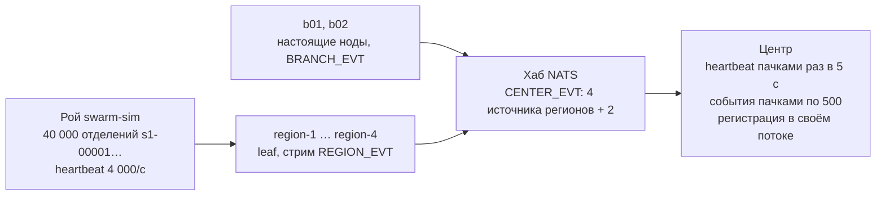

# Центр выдерживает 40 000 отделений

*ЕСУО · финал · отчёт для лида · 3 октября 2026 · ветки `develop`, `WiP/phase1_ng`*
*[Проверено на стенде: ноутбук, Docker Desktop, 7,7 ГБ на все контейнеры]*

Сделан рой виртуальных отделений и три доработки центра. На стенде центр принимает 40 000 отделений за минуту, без потерь событий и без падений. Раньше он ломался уже на нескольких тысячах.

## Главные цифры

| Показатель | Было | Стало |
|---|---|---|
| Регистрация 40 000 отделений (подключение событий и первая конфигурация) | за 3 мин 3 400, затем падение по памяти | все 40 000 за 60 с |
| Потерянные события | 0 | 0 — в базе центра ровно столько, сколько рой получил подтверждений, во всех прогонах |
| Запись событий в базу центра | ~1 000/с | ~25 700/с |
| Ответ обзора сети на 40 002 отделения | 5,8 с, 30 МБ | 1,3 с, 16 КБ |

## Что сделано

| Задача плана | Что сделано | Проверено |
|---|---|---|
| **C1** Рой | Модуль `swarm-sim`: до 40 000 виртуальных отделений в одном процессе. Часовые пояса, поток клиентов по кривой дня, полный цикл талона. Heartbeat с блоком `sys`; рой подтверждает конфигурацию, как нода. Четыре региональных leaf (`region-1…4`); центр подключает `REGION_EVT` один раз на регион | стенд, 13 тестов |
| **C3b** Heartbeat пачками | Основа — реализация коллеги (буфер, сброс раз в 5 с, `branch_metrics`). Поверх неё: регистрация новых отделений пачками в отдельном потоке, `events_via` для регионов. Поток NATS больше не ходит в базу и не запускает неограниченный пул потоков | стенд, `BranchOnboardingIT` |
| **C3a** События пачками | До 500 событий за выборку, один многострочный `INSERT … ON CONFLICT DO NOTHING`, подтверждение после записи, повтор всей пачки при ошибке базы. Битое событие снимается с повтора и не стопорит пачку | стенд, 4 теста |
| **C3c** Обзор большой сети | Новые `/network/summary` (счётчики, регионы, топ проблемных) и `/network/branches` (поиск, фильтр, страницы). Аномалии считаются одной функцией для старого и нового обзора. Экран `/network` переделан. Скрипты сценариев ищут отделение через новый API | стенд, 14 тестов, e2e |
| **D2** Режимы QR | `center / local / auto`: при обрыве связи QR на табло переключается на адрес узла и обратно | стенд, сценарий 10/10, переключение 2–7 с |
| **D3** Подписанный QR | HMAC-код, меняется каждые 2 минуты; наклейка с отзывом через версию ключа; печатная страница у руководителя | 8 тестов + `QrIssueIT` |
| **D4** Вызов на телефоне | Полноэкранное «Вас вызывают · Окно N», звук по нажатию, вибрация, Wake Lock, мигание заголовка | **на телефоне не проверено** |
| **D5** Пульт сценариев | Сервис `demo-runner` и вкладка «Сценарии» в `/demo`: запуск сценариев кнопкой, живой лог, остановка с возвратом стенда в порядок | стенд, 4 + 8 тестов |

## Как это устроено

Рой не поднимает настоящие отделения: это один Java-процесс, который шлёт в NATS ровно то, что шлёт нода. Поэтому он нагружает шину и центр, а не API. HTTP-скрипт этого бы не сделал.



- Heartbeat несёт `events_via: "region-N"`. По нему центр подключает `REGION_EVT` один раз на регион, а не 40 000 источников (ДД §3.8).
- Фильтр по части токена (`branch.s1-*.evt.>`) в NATS недопустим. Поэтому региональный leaf собирает `branch.*.evt.>` и не принимает чужие события от хаба (`deny_imports`).
- Рой сам получает свою конфигурацию от центра и отдаёт её версию в heartbeat. Иначе центр переотправлял бы конфигурацию 40 000 отделений каждую минуту.

## Замеры

Каждый прогон: сколько событий рой отправил и получил подтверждений, сколько записал центр, что происходило с центром.

| Прогон | Рой | Центр | Событий в базе |
|---|---|---|---:|
| 2 000 отделений, ×60, 2 мин | 182 тыс. событий, 24 тыс. heartbeat, ошибок 0 | все 2 000 зарегистрированы; в `CENTER_EVT` 4 источника регионов; запись отставала: ~1 000/с | 181 998 / 181 998 |
| 40 000, реальное время, до доработок | 720 тыс. heartbeat (4 000/с), 136 тыс. событий, ошибок 0 | **упал**: хаб дважды отключил центр как медленного потребителя; 3 400 из 40 000 за 3 мин; затем `OutOfMemoryError` | 136 148 / 136 148 |
| C3a: хвост 562 тыс. событий | — | центр дописал хвост на ~25 700 событий/с, Postgres загружен меньше чем наполовину | 562 439 / 562 439 |
| 40 000, реальное время, после слияния с `develop` | 720 тыс. heartbeat, 54 тыс. событий, ошибок 0 | **держит**: за 60 с все 40 000 зарегистрированы, подключены, получили конфигурацию; медленного потребителя и OOM нет | 53 983 / 53 983 |

### Обзор сети на 40 002 отделениях

| Запрос | Время | Размер |
|---|---:|---:|
| `/network/overview` — старый, экран опрашивал его раз в 5 с | 5,8 с | 30 МБ |
| `/network/summary` — счётчики, регионы, топ проблемных | 1,3 с | 16 КБ |
| `/network/branches?limit=24` — страница карточек | 1,0 с | 18 КБ |
| `/network/branches?q=s3-0042` — поиск | 0,7 с | 8 КБ |

Старый эндпоинт оставлен: его читают сценарии и смоук-тесты на маленьком стенде. Аномалии в старом и новом обзоре считаются одной функцией, расхождений нет — это проверяет тест.

## Находки

- **Исправлено — центр падал на волне новых отделений.** Каждый heartbeat обрабатывался в отдельном виртуальном потоке без ограничения. Под нагрузкой очередь росла в памяти до `OutOfMemoryError`, а хаб отключал центр как медленного потребителя. Сейчас приём heartbeat ничего не ждёт, а регистрация идёт пачками в одном потоке.
- **Исправлено — двойная конфигурация новым отделениям.** `ConfigReconciler` публиковал вторую версию отделениям, до которых ещё не дошла регистрация: 3 408 отправок на 2 000 отделений. Теперь он пропускает отделения в очереди регистрации — ровно одна конфигурация на отделение, это проверяет тест.
- **Исправлено — скрипты считали отделения «без связи».** `doctor` и сценарии читали полный обзор с таймаутом 5 с. На большой сети он не успевал, и отделения казались недоступными. Теперь скрипты ищут одно отделение (`center_card b01`). С 40 000 отделений в базе `doctor` зелёный, обрыв связи — 10/10.
- **Открыто — ещё две тяжёлые ручки на большой сети.** Вкладка «Конфигурация» (`/api/v1/config`): 15 с и 8 МБ. Публичный список отделений для клиента (`/api/v1/branches`): 3,9 с и 20 МБ. На двух отделениях этого не видно. Лечится так же, как обзор в C3c: страницы и поиск.
- **Настройка — память центра и частота метрик.** У центра не задан `-Xmx`, куча ограничена ~2 ГБ, и под роем сборщик мусора работает на пределе. Метрики по умолчанию раз в 10 с: на 40 000 отделений это 4 000 строк/с в `branch_metrics`. Для стенда с роем: `JAVA_TOOL_OPTIONS=-Xmx3g` и `METRICS_RESOLUTION=60s`.
- **К сведению — узкое место центр, а не NATS.** Во всех прогонах хаб NATS был загружен на единицы процентов, даже при ускорении ×60 (нагрузка как от ~120 000 отделений). Первыми упирались приложение центра и запись в Postgres. Оба места исправлены.

## Как проверить самому

Из корня репозитория, при запущенном Docker:

```bash
docker compose --profile demo --profile swarm up -d --build
cd java-backend && ./mvnw -q -pl swarm-sim -am package -DskipTests
java -Xmx2g -jar swarm-sim/target/swarm-sim-0.0.1-SNAPSHOT.jar --branches 40000 --duration 3m --start 12:00
```

Во время прогона все три числа должны стать 40 000 примерно за минуту:

```bash
docker exec esuo-postgres-center psql -U esuo -d esuo_center -c "select count(*), count(*) filter (where source_attached), count(*) filter (where last_heartbeat_at > now() - interval '30 seconds') from branches where id like 's%'"
```

После прогона число событий роя в базе совпадает с `events_acked_total` из JSON-отчёта роя. Экран `http://localhost:8081/network` показывает сводку, регионы и топ проблемных, а поиск находит любое отделение за секунду.

Автотесты: центр — 152, нода — 343, рой — 13, пульт сценариев — 8; все зелёные.

## Что дальше

1. **Стресс NATS до потолка.** Рой наращивает поток ступенями, пока не начнут расти задержка подтверждений и число неподтверждённых. Этот порог фиксируем как потолок.
2. **Кластер хабов NATS из трёх узлов.** Показываем, как потолок растёт с числом узлов и регионов. Заодно гасим один узел под нагрузкой — потерь нет.
3. **C2: скрипт замера и отчёт «до/после».** Итоговые цифры — на сервере стенда: на ноутбуке всё упирается в процессор.
4. **C4: реплики центра.** Несколько экземпляров за nginx; heartbeat через queue group, фоновые задачи — только на лидере.
5. **Страницы и поиск** для вкладки «Конфигурация» и публичного списка отделений.

> Состояние репозитория: слияние с `develop` — коммит `7b3df32`, он есть в `develop` и `WiP/phase1_ng`. C3c — в рабочей копии, ещё не закоммичен. На телефонах экран вызова (D4) ещё не проверялся.
